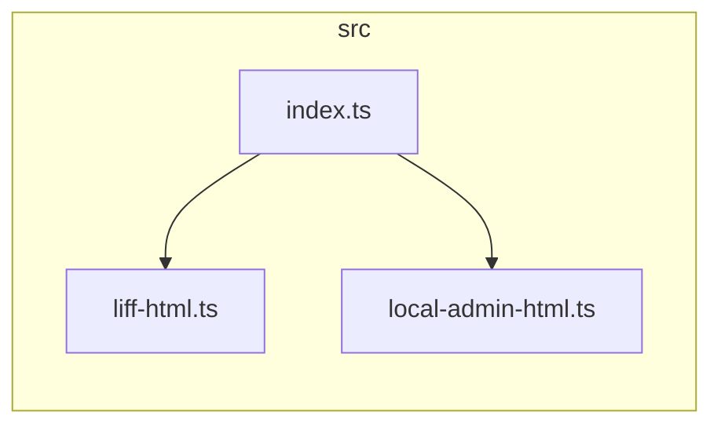

# Dependency Cruiser (Architecture & Coupling Governance)

Use this skill when evaluating, measuring, or enforcing software architectural maintainability, modularization wellness, module coupling, circular dependency detection, and architectural boundary constraints in JavaScript and TypeScript codebases.

---

## 1. Architectural Metrics & Theoretical Foundation

`dependency-cruiser` natively implements Robert C. Martin's (Uncle Bob) **Package Coupling & Stability Metrics**:

### Core Metrics

| Metric | Symbol | Definition & Architectural Meaning | Healthy Target |
| :--- | :---: | :--- | :--- |
| **Afferent Coupling** | **$C_a$** | **傳入耦合（Incoming Dependencies）**<br>有多少外部模組依賴於此模組。高 $C_a$ 代表此模組為核心基礎設施（被廣泛依賴），修改風險高、穩定度要求極高。 | 核心抽象/工具庫宜高；高層業務邏輯宜低 |
| **Efferent Coupling** | **$C_e$** | **傳出耦合（Outgoing Dependencies）**<br>此模組依賴了多少外部模組。高 $C_e$ 代表此模組脆弱、容易因外部變更而連帶破裂，通常是排程器、Controller 或聚合器。 | 純領域模型宜為 0；避免出現萬能協調者（God Object） |
| **Instability** | **$I$** | **不穩定度指數**：<br>$$I = \frac{C_e}{C_a + C_e}$$<br>範圍介於 $0.0$ (0%) 到 $1.0$ (100%)。 | **$I = 0$**：極致穩定（無外部依賴，如獨立 Type 定義）<br>**$I = 1$**：極致不穩定（純協調者，無人引用） |

### 核心架構治理原則 (Governance Principles)

1. **穩定依賴原則 (Stable Dependencies Principle, SDP)**：
   - 模組的依賴方向應該朝著「更穩定（$I$ 較小）」的方向進行。
   - **反模式**：底層核心共用庫（低 $I$）反向引用高層業務邏輯（高 $I$）。
2. **無環依賴原則 (Acyclic Dependencies Principle, ADP)**：
   - 依賴結構中嚴禁出現循環依賴（$A \rightarrow B \rightarrow A$ 或跨多層循環）。循環依賴會破壞模組隔離性，導致單元測試與版本更迭牽一髮而動全身。
3. **高內聚低耦合 (High Cohesion, Low Coupling)**：
   - 模組內部應具備共同變更的原因；跨模組的 $C_e$ 應透過明確窄介面（Narrow Interface / Facade）收斂。

---

## 2. 執行模式與環境配置 (Execution Modes)

`dependency-cruiser` 支援**免安裝隨選執行 (Zero-Install)** 與 **專案內建整合** 兩種模式：

### 模式 A：免安裝隨選執行 (`npx` 模式，0 元即跑)

適合日常突擊巡檢或不想污染 `package.json` 的情境。

> [!IMPORTANT]
> **Windows + TypeScript 關鍵反坑點 (Transpiler Resolution Trap)**：  
> 當使用 `npx dependency-cruiser` 執行時，CLI 運行於 npx 的隔離快取目錄中。若專案為 TypeScript，CLI 預設可能無法在 npx 快取中找到 `typescript` 編譯器，導致略過 `.ts` 檔案。  
> **解法**：在 Windows PowerShell 下執行前，設定 `$env:NODE_PATH` 指向專案本地的 `node_modules`：
> ```powershell
> $env:NODE_PATH = (Resolve-Path .\node_modules)
> npx --yes dependency-cruiser --no-config --metrics --output-type metrics src
> ```

### 模式 B：專案常態整合 (推薦 CI/CD 與日常維運)

將其作為開發依賴加入專案，團隊成員與 CI/CD 可直接執行：

```powershell
# 安裝至 devDependencies
npm install --save-dev dependency-cruiser
# 或使用 rtk
rtk npm install -D dependency-cruiser
```

在 `package.json` 的 `scripts` 中配置快捷指令：
```json
{
  "scripts": {
    "arch:metrics": "depcruise --metrics --output-type metrics src",
    "arch:check": "depcruise src",
    "arch:graph": "depcruise --output-type mermaid src"
  }
}
```

---

## 3. 實戰常用指令清單 (CLI Recipes)

在專案目錄下執行（以 `src` 目錄為例）：

### 1. 輸出模組耦合度指標矩陣 ($C_a, C_e, I$)
```powershell
# 檢視終端機表格形式的耦合度統計
npx --yes dependency-cruiser --no-config --metrics --output-type metrics src
```
範例輸出解讀：
```text
type    name                          N     Ca     Ce  I (%)        size   #tls
------- ------------------------ ------ ------ ------ ------ ----------- ------
module  src/index.ts                  1      0      2   100%  (協調入口：高 I 符合預期)
folder  src                           3      0      0     0%
module  src/liff-html.ts              1      1      0     0%  (純表現層模組：低 I 穩定)
module  src/local-admin-html.ts       1      1      0     0%  (純後台模組：低 I 穩定)
```

### 2. 產出 Markdown 可直接渲染之 Mermaid 架構依賴圖
```powershell
# 產出 Mermaid 流程圖語法
npx --yes dependency-cruiser --no-config --output-type mermaid src
```
可直接貼入 PR、Wiki 或 Markdown 文檔中產生互動式架構圖：


### 3. 檢查循環依賴與架構壞味道 (Architecture Linter)
```powershell
# 若有違規將以 exit code 1 退出，適合阻擋不合規之 Commit / PR
npx --yes dependency-cruiser --no-config src
```

### 4. 產出互動式 HTML 檢測報告
```powershell
# 注意：使用 --output-to 參數，避免 PowerShell 管道輸出之 UTF-16 編碼問題
npx --yes dependency-cruiser --no-config --output-type err-html --output-to arch-report.html src
```

### 5. 聚焦特定模組的上下游關聯 (Focus / Drill-down)
```powershell
# 僅檢視與 src/index.ts 有直接或深度 2 層依賴關聯的模組
npx --yes dependency-cruiser --no-config --focus "^src/index\.ts$" --focus-depth 2 src
```

### 6. 可達性分析 (Reaches Analysis)
```powershell
# 檢查哪些模組最終會存取/依賴特定底層模組
npx --yes dependency-cruiser --no-config --reaches "^src/db" src
```

---

## 4. 架構規則配置檔 (`.dependency-cruiser.cjs`)

若需制定團隊專屬的架構分層看門狗，可建立 `.dependency-cruiser.cjs`：

```javascript
/** @type {import('dependency-cruiser').IConfiguration} */
module.exports = {
  forbidden: [
    {
      name: 'no-circular',
      severity: 'error',
      comment: '禁止任何模組間循環依賴',
      from: {},
      to: { circular: true }
    },
    {
      name: 'no-orphans',
      severity: 'warn',
      comment: '偵測未被任何檔案引用的孤島模組 (可能為死代碼)',
      from: { orphan: true },
      to: {}
    },
    {
      name: 'not-to-unresolvable',
      severity: 'error',
      comment: '禁止無法解析的匯入路徑',
      from: {},
      to: { couldNotResolve: true }
    },
    {
      name: 'ui-not-to-db',
      severity: 'error',
      comment: '架構分層防護：UI/前端渲染層禁止直接跳過 Service 呼叫底層 DB',
      from: { path: '^src/(liff|admin)-html\\.ts' },
      to: { path: '^src/db' }
    }
  ],
  options: {
    doNotFollow: {
      path: 'node_modules'
    },
    tsPreCompilationDeps: true,
    tsConfig: {
      fileName: './tsconfig.json'
    },
    reporterOptions: {
      metrics: {
        showMetrics: true
      }
    }
  }
};
```

---

## 5. 架構病徵與重構指引 (Remediation Playbook)

| 檢測病徵 | 根因剖析 | 重構解決方案 |
| :--- | :--- | :--- |
| **模組 $C_e$ 過高 ($C_e > 10$)** | 萬能模組（God Object），知道過多外界細節，任何上游改動都會衝擊它。 | 1. 拆分職責，提煉出專門的小協調器。<br>2. 導入 **門面模式 (Facade)** 或 **轉接器 (Adapter)** 收斂外部介面。 |
| **底層模組 $I$ 偏高且被上層引用** | 違反穩定依賴原則 (SDP)，基礎模組卻依賴易變模組。 | 導入 **依賴反轉 (Dependency Inversion, DIP)**，由底層定義介面，高層實作並注入。 |
| **出現循環依賴 ($A \leftrightarrow B$)** | 職責劃分不清，雙向緊密耦合。 | 1. 將兩者共同依賴的資料結構或 Type 提煉至第三模組 $C$。<br>2. 改以事件機制或回呼函式解開實體關聯。 |
| **孤島模組 (Orphan)** | 遺留代碼、廢棄測試或未公開進入點。 | 確認若非測試或動態載入模組，應予以安全移除以精簡專案體積。 |

---

## 6. Windows PowerShell 避坑守則

1. **避免使用 `>` 重導向文字**：PowerShell 5.1 預設重導向輸出為 UTF-16 LE with BOM，常導致產出的 SVG / HTML / JSON 工具解析失敗。請一律使用 `--output-to <file>` 或 `-f <file>` 參數。
2. **路徑反斜線跳脫**：在 CLI 中傳入正則表示式時，路徑分隔符號使用 `/`（例如 `'^src/.*'`），避免 Windows 反斜線 `\` 引發正則轉義錯誤。
3. **命令列單引號包裹**：PowerShell 會將 `$` 當作變數解析，在傳入含 `$` 的正則（如 `'^src/index\.ts$'`）時，外層必須使用單引號 `'`。
