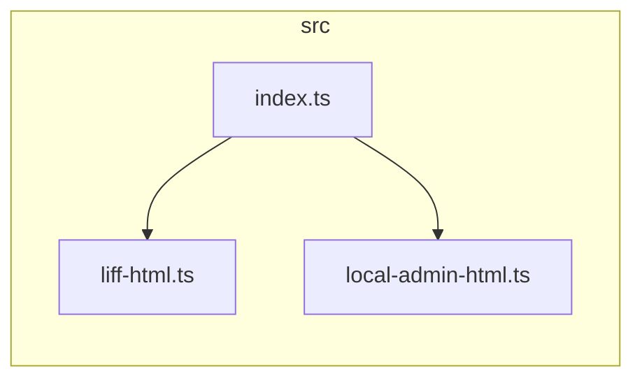

# Dependency Cruiser (Architecture & Coupling Governance)

Use this skill when evaluating, measuring, or enforcing software architectural maintainability, modularization wellness, module coupling, circular dependency detection, and architectural boundary constraints in JavaScript and TypeScript codebases.

---

## 1. Architectural Metrics & Theoretical Foundation

`dependency-cruiser` natively implements Robert C. Martin's (Uncle Bob) **Package Coupling & Stability Metrics**:

### Core Metrics

| Metric | Symbol | Definition & Architectural Meaning | Healthy Target |
| :--- | :---: | :--- | :--- |
| **Afferent Coupling** | **$C_a$** | **Incoming Dependencies**<br>Number of external modules that depend on this module. High $C_a$ denotes foundational infrastructure or core abstractions (widely relied upon); modifications carry high risk and demand maximum stability. | High for core abstractions and shared utility libraries; Low for high-level business logic |
| **Efferent Coupling** | **$C_e$** | **Outgoing Dependencies**<br>Number of external modules this module depends upon. High $C_e$ indicates fragility—vulnerable to changes across external modules; typical of orchestrators, controllers, or aggregators. | Zero for pure domain entities; avoid God Objects |
| **Instability** | **$I$** | **Instability Index**:<br>$$I = \frac{C_e}{C_a + C_e}$$<br>Ranges from $0.0$ (0%) to $1.0$ (100%). | **$I = 0$**: Maximally stable (no outgoing dependencies, e.g. standalone type definitions)<br>**$I = 1$**: Maximally unstable (pure orchestrator, no dependents) |

### Core Architectural Governance Principles

1. **Stable Dependencies Principle (SDP)**:
   - Module dependencies must point in the direction of stability (decreasing $I$).
   - **Anti-Pattern**: A low-level shared utility module (low $I$) depending on a volatile high-level business workflow (high $I$).
2. **Acyclic Dependencies Principle (ADP)**:
   - The dependency graph must strictly contain no cycles ($A \rightarrow B \rightarrow A$ or multi-hop loops). Cycles demolish modular isolation and cause cascading build, test, and refactoring failures.
3. **High Cohesion, Low Coupling**:
   - Internal module elements must share a unified reason to change; cross-module $C_e$ must be minimized via explicit narrow interfaces or Facade adapters.

---

## 2. Execution Modes & Environment Configuration

`dependency-cruiser` supports **Zero-Install On-Demand Execution** and **Project DevDependency Integration**:

### Mode A: Zero-Install On-Demand Execution (`npx` Mode)

Ideal for quick architectural audits without modifying `package.json`.

> [!IMPORTANT]
> **Windows + TypeScript Transpiler Resolution Trap**:  
> When running via `npx dependency-cruiser`, the CLI executes within an isolated cache directory. For TypeScript codebases, the CLI may fail to locate the local `typescript` compiler, causing it to skip `.ts` files.  
> **Resolution**: In Windows PowerShell, assign `$env:NODE_PATH` to the project's local `node_modules` before execution:
> ```powershell
> $env:NODE_PATH = (Resolve-Path .\node_modules)
> npx --yes dependency-cruiser --no-config --metrics --output-type metrics src
> ```

### Mode B: Project Integration (Recommended for CI/CD & Routine Maintenance)

Install as a development dependency:

```powershell
# Install to devDependencies
npm install --save-dev dependency-cruiser
# Or via rtk
rtk npm install -D dependency-cruiser
```

Configure npm scripts in `package.json`:
```json
{
  "scripts": {
    "arch:metrics": "depcruise --metrics --output-type metrics src",
    "arch:check": "depcruise src",
    "arch:graph": "depcruise --output-type mermaid src"
  }
}
```

---

## 3. Practical CLI Recipes

Run inside the project root (targeting `src`):

### 1. Output Module Coupling Metrics Matrix ($C_a, C_e, I$)
```powershell
# Display tabular metrics in the terminal
npx --yes dependency-cruiser --no-config --metrics --output-type metrics src
```
Sample output interpretation:
```text
type    name                          N     Ca     Ce  I (%)        size   #tls
------- ------------------------ ------ ------ ------ ------ ----------- ------
module  src/index.ts                  1      0      2   100%  (Coordinator entrypoint: high I as expected)
folder  src                           3      0      0     0%
module  src/liff-html.ts              1      1      0     0%  (Pure presentation module: low I, stable)
module  src/local-admin-html.ts       1      1      0     0%  (Pure admin view module: low I, stable)
```

### 2. Generate Renderable Markdown Mermaid Architecture Graph
```powershell
# Output Mermaid diagram syntax
npx --yes dependency-cruiser --no-config --output-type mermaid src
```
Directly renderable in PRs, Wikis, or Markdown documentation:


### 3. Architecture Linter & Circular Dependency Check
```powershell
# Exits with code 1 upon violation; ideal for CI/CD gates and pre-commit checks
npx --yes dependency-cruiser --no-config src
```

### 4. Interactive HTML Architecture Report
```powershell
# Note: Use --output-to to avoid PowerShell stdout UTF-16 pipeline encoding traps
npx --yes dependency-cruiser --no-config --output-type err-html --output-to arch-report.html src
```

### 5. Focus & Drill-Down on Specific Modules
```powershell
# Inspect modules with direct or 2-level dependency relationships with src/index.ts
npx --yes dependency-cruiser --no-config --focus "^src/index\.ts$" --focus-depth 2 src
```

### 6. Reaches Analysis
```powershell
# Identify all modules that eventually reach or depend on the database layer
npx --yes dependency-cruiser --no-config --reaches "^src/db" src
```

---

## 4. Architecture Rules Configuration (`.dependency-cruiser.cjs`)

Establish custom team architecture guardrails via `.dependency-cruiser.cjs`:

```javascript
/** @type {import('dependency-cruiser').IConfiguration} */
module.exports = {
  forbidden: [
    {
      name: 'no-circular',
      severity: 'error',
      comment: 'Disallow circular dependencies across all modules',
      from: {},
      to: { circular: true }
    },
    {
      name: 'no-orphans',
      severity: 'warn',
      comment: 'Detect orphan modules not referenced by any file (potential dead code)',
      from: { orphan: true },
      to: {}
    },
    {
      name: 'not-to-unresolvable',
      severity: 'error',
      comment: 'Disallow unresolvable import paths',
      from: {},
      to: { couldNotResolve: true }
    },
    {
      name: 'ui-not-to-db',
      severity: 'error',
      comment: 'Layer boundary guard: UI/presentation layers cannot bypass services to call DB directly',
      from: { path: '^src/(liff|admin)-html\\.ts' },
      to: { path: '^src/db' }
    }
  ],
  options: {
    doNotFollow: {
      path: 'node_modules'
    },
    tsPreCompilationDeps: true,
    tsConfig: {
      fileName: './tsconfig.json'
    },
    reporterOptions: {
      metrics: {
        showMetrics: true
      }
    }
  }
};
```

---

## 5. Architectural Smells & Remediation Playbook

| Detected Smell | Root Cause | Architectural Remediation |
| :--- | :--- | :--- |
| **Excessive $C_e$ ($C_e > 10$)** | God Object knowing too many external details; any upstream modification causes cascading breakage. | 1. Partition responsibilities into cohesive sub-coordinators.<br>2. Introduce **Facade** or **Adapter** patterns to narrow external interfaces. |
| **Low-level module has high $I$ while referenced by upper layers** | Violates Stable Dependencies Principle (SDP); foundational layer depends on volatile modules. | Apply **Dependency Inversion Principle (DIP)**: define interfaces in the lower tier; implement and inject from higher tiers. |
| **Circular Dependencies ($A \leftrightarrow B$)** | Ambiguous boundary, tight bilateral coupling. | 1. Extract shared types or data structures into a third module $C$.<br>2. Decouple via event emitters, callbacks, or dependency injection. |
| **Orphan Module** | Legacy code, abandoned tests, or unreferenced entry points. | Verify whether the module is loaded dynamically or in tests; safely prune if unused to keep codebase lean. |

---

## 6. Windows PowerShell Anti-Traps

1. **Avoid `>` Redirection**: PowerShell 5.1 redirects text using UTF-16 LE with BOM by default, breaking SVG, HTML, and JSON parsers. Always use `--output-to <file>` or `-f <file>`.
2. **Forward Slashes in Path Regexes**: When passing regex patterns via CLI, use forward slashes `/` (e.g. `'^src/.*'`) to avoid backslash escape syntax errors.
3. **Single Quotes for Regex Literals**: PowerShell parses `$` as a variable prefix. When providing regex patterns ending with `$` (e.g. `'^src/index\.ts$'`), always wrap the pattern in single quotes `'`.

