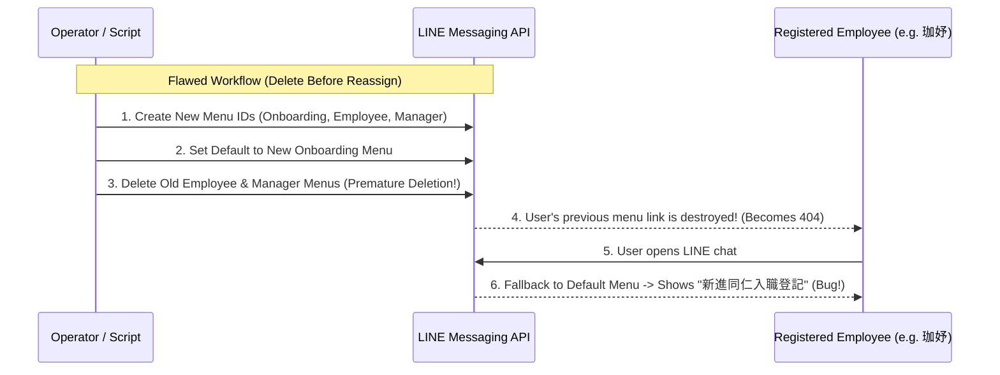
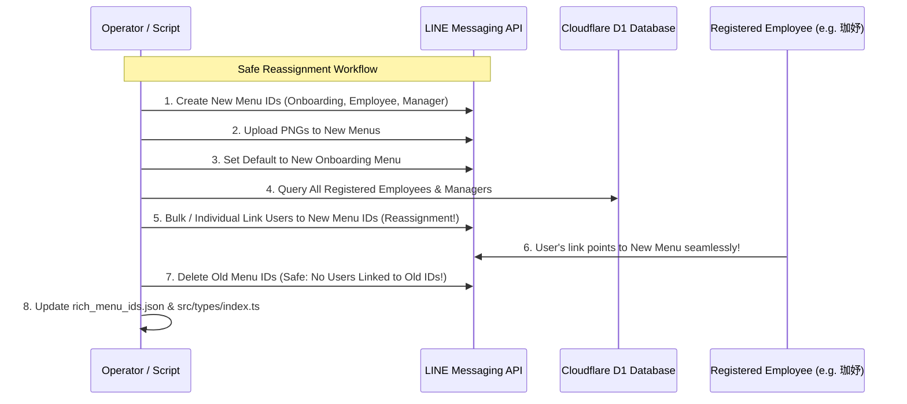

# LINE Rich Menu Lifecycle & Migration Architecture

## 1. Core Architectural Constraints

### LINE Messaging API Rich Menu Properties
1. **Server-Assigned Unique Identifiers**:
   - Every `POST https://api.line.me/v2/bot/richmenu` call yields a new random `richMenuId` generated by LINE.
   - IDs cannot be chosen, recycled, or updated in-place.
2. **Immutable Resource Policy**:
   - Once a rich menu image is uploaded (`POST https://api-data.line.me/v2/bot/richmenu/{id}/content`), it cannot be updated or replaced.
   - Area coordinates, bounds, actions, and display properties cannot be altered once created.
3. **Link Invalidation on Deletion**:
   - Calling `DELETE https://api.line.me/v2/bot/richmenu/{id}` deletes the menu on LINE's servers.
   - Any LINE user who is linked to that deleted ID will immediately lose their custom link (LINE returns `404: the user has no richmenu`).
   - When a user has no custom link, LINE falls back to the **Default Rich Menu** assigned to the channel (`POST /v2/bot/user/all/richmenu/{id}`).

---

## 2. Root Cause Analysis: The Fallback Bug



### The Solution: Zero-Downtime Safe Reassignment Protocol



---

## 3. LINE Rich Menu Endpoints Reference

### Create Rich Menu
```http
POST https://api.line.me/v2/bot/richmenu
Authorization: Bearer {CHANNEL_ACCESS_TOKEN}
Content-Type: application/json

{
  "size": { "width": 2500, "height": 843 },
  "selected": true,
  "name": "豬毛有限公司 - 員工選單",
  "chatBarText": "打卡與服務選單",
  "areas": [...]
}
```

### Upload Rich Menu Image
```http
POST https://api-data.line.me/v2/bot/richmenu/{richMenuId}/content
Authorization: Bearer {CHANNEL_ACCESS_TOKEN}
Content-Type: image/png

[Binary PNG Data]
```

### Set Channel Default Rich Menu
```http
POST https://api.line.me/v2/bot/user/all/richmenu/{richMenuId}
Authorization: Bearer {CHANNEL_ACCESS_TOKEN}
```

### Bulk Link Multiple Users to Rich Menu
```http
POST https://api.line.me/v2/bot/richmenu/bulk/link
Authorization: Bearer {CHANNEL_ACCESS_TOKEN}
Content-Type: application/json

{
  "richMenuId": "{richMenuId}",
  "userIds": [
    "U4eb5f204f746d1ab2b360e687eb99105",
    "Ubd107bb3ba1b85a8086fc3b2250458e8"
  ]
}
```
*Note: Maximum 500 user IDs per bulk link request.*

### Link Individual User to Rich Menu
```http
POST https://api.line.me/v2/bot/user/{userId}/richmenu/{richMenuId}
Authorization: Bearer {CHANNEL_ACCESS_TOKEN}
```

### Delete Rich Menu
```http
DELETE https://api.line.me/v2/bot/richmenu/{richMenuId}
Authorization: Bearer {CHANNEL_ACCESS_TOKEN}
```
