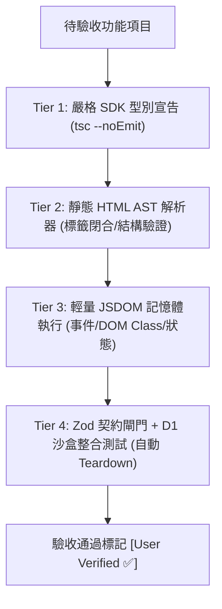

# 自主 AI 驗證執行藍圖與記憶持久化手冊 (Autonomous Verification Roadmap)

> **建立時間**：2026-09-08  
> **系統基準版本**：`v2.21.0`  
> **關聯文件**：[`LINE_CHECKIN_PROGRESS.md`](file:///d:/line-checkin/LINE_CHECKIN_PROGRESS.md) (SSOT) ｜ [`AI_VERIFICATION_DISCREPANCIES.md`](file:///d:/line-checkin/AI_VERIFICATION_DISCREPANCIES.md)  
> **核心宗旨**：在**不依賴肥重 Playwright 瀏覽器**的前提下，運用嚴格靜態型別、JSDOM 虛擬 DOM、Zod 協議契約與 D1 沙盒測試，分批自主驗證系統待驗收項目，並透過嚴格控制單次注意力預算（Attention Budget）徹底杜絕模型幻覺與狀態污染。

---

## 1. 核心驗證哲學與架構層級 (The 4-Tier Lightweight Verification Architecture)

歷史缺陷分析證實，系統過往發生之 BUG 絕大多數根源於**「靜態型別邊界模糊」**（如範本字串 TS 盲區、TDZ 暫時死區、`any` 導致的屬性打錯）與**「第三方平台契約缺乏校驗」**（如 LINE Flex 400 非法屬性）。因此，無須啟動真實 Chromium 繪圖引擎，透過以下四層輕量驗證鏈即可覆蓋核心邏輯：



1. **Tier 1: 嚴格 SDK 與前端型別防線 (`tsc -p tsconfig.client.json --noEmit`)**
   - 補齊 `@line/liff` 官方型別定義，全面廢除 `declare const liff: any;`。
   - 在編譯期抓出 TDZ（未初始化引用）、未宣告函式呼叫與參數數量不符。
2. **Tier 2: 靜態 HTML 語法樹校驗 (AST Linter)**
   - 針對 SSR 輸出的 HTML 骨架進行語法樹檢查，保證 `<div>` 閉合順序與巢狀合法性，杜絕後台 PBAC 彈窗被瀏覽器容錯機制推至螢幕外。
3. **Tier 3: JSDOM 輕量記憶體虛擬 DOM**
   - 在 Node.js 記憶體中執行編譯後的前端腳本，觸發點擊事件，斷言 `classList`（如 `.status-leave`、`.today`）、表單鎖定與 `finally` 按鈕解鎖，毫秒級完成。
4. **Tier 4: 後端 Zod 契約 + D1 沙盒整合測試 (負向注入與自動 Teardown)**
   - 模擬 HTTP / Webhook 呼叫，驗證狀態機運算，輸出 JSON 通過 Zod Schema 驗證，並直接檢核 D1 表紀錄。所有測試保證在 `finally` 區塊清除測試數據。

---

## 2. LLM 注意力預算與批次分組規範 (Attention Budget Protocol)

### ⚠️ 核心約束 (The Golden Invariant)
*   **嚴禁單次跨對話同時執行超過 3 個項目的驗證。**
*   **單次執行上限：2 ～ 3 個高度同質、同一子系統之功能項目。**

### 違規之後果 (Why 2~3 Items Max?)
1. **注意力稀釋 (Attention Dilution)**：超過 4 個項目會產生 6,000+ tokens 的測試輸入、SQL 流水與 Log 追蹤，模型在長上下文下對邊界值、外鍵約束的敏銳度急速衰減，容易出現「部分通過即視為全部合格」的過度樂觀幻覺。
2. **狀態污染 (State Leaks)**：測試若在第 3 項失敗，重構與除錯代碼會迅速擠滿對話歷史，導致忘記最初的架構規範與 Teardown 清理義務。

---

## 3. 分批驗證執行路徑 (The 7-Batch Execution Roadmap)

| 批次編號 | 負責領域 | 驗證項目清單 | 採行技術棧 | 預估耗時 | 當前狀態 |
| :---: | :--- | :--- | :--- | :---: | :---: |
| **Batch 1** | 線上簽核與防弊 | 1. 核准業務自動連動 (`APPROVED_OVERRIDE` / 銷假)<br>2. 嚴格身分防冒審 (`event.source.userId` 403 阻斷)<br>3. LIFF 簽核入口按鈕鎖定與解鎖 (無 TDZ / `finally` 解鎖) | Tier 3 (JSDOM) +<br>Tier 4 (D1 沙盒) | 1 Session | ✅ 已完成 (`v2.22.0`) |
| **Batch 2** | 排班月曆視覺燈號 | 4. 當日焦點 (TODAY) 翡翠綠光環與今日徽章<br>5. 請假專屬狀態 (LEAVE) 暖琥珀色卡<br>6. 未排班透明感知 (UNSCHEDULED 灰白虛線 / 靛藍出勤) | Tier 3 (JSDOM 渲染與 Computed Class) | 1 Session | ✅ 已完成 (`v2.23.0`) |
| **Batch 3** | 固定班與身分注入 | 7. 固定班預設班表一鍵實體化 (Auto-Seed & D1 落庫)<br>8. ID Token 本機快速解碼 (零延遲身分注入與防呆) | Tier 1 (TS) +<br>Tier 4 (D1 批次) | 1 Session | ✅ 已完成 (`v2.24.0`) |
| **Batch 4** | 後台金鑰與據點防呆 | 9. 企業 M2M API 金鑰自主生成 / 撤銷中心<br>10. 門市據點配置與刪除防呆 (總部保護與員工綁定攔截) | Tier 2 (HTML AST) +<br>Tier 4 (D1 API) | 1 Session | ✅ 已完成 (`v2.25.0`) |
| **Batch 5** | 後台排班與出勤報表 | 11. 排班管理 (UTF-8 BOM CSV 批次匯入與 Upsert)<br>12. 出勤監控與計薪 CSV 報表匯出 (字元集與數值核算) | Tier 4 (Node CSV 解析與資料對帳) | 1 Session | ✅ 已完成 (`v2.26.0`) |
| **Batch 6** | 企業公告與簽收冪等 | 13. 地端管理後台公告發布與即時簽收名單追蹤 (已簽收/未簽收同仁明細)<br>14. 員工 LINE 簽收互動 (Postback Idempotency 首簽與二簽) | Tier 4 (D1 資料庫狀態與冪等性) | 1 Session | ✅ 已完成 (v2.27.0) |
| **Batch 7** | 薪資明細與安全日誌 | 15. 專業海軍藍/翡翠綠 Flex 薪資卡片 (Zod 契約校驗)<br>16. 地端安全稽核日誌 (`SWITCH_DEVICE` 完整落庫)<br>17. 10 大細粒度原子權限體系 (PBAC 鑑權矩陣) | Tier 1 (Zod Gate) +<br>Tier 4 (D1 Audit Log) | 1 Session | ✅ 已完成 (`v2.28.0`) |

---

## 4. 排除與保留給實機驗收之項目 (Excluded & Manual Verification Items)

### 🚫 明確排除項目（防止消耗 LINE 官方付費訊息額度）
*   **多人多播推送測試 (LINE Multicast 500-User Chunking & 一鍵催簽實體推播)**：因直接向真實 LINE 官方帳號發送多播會消耗企業訊息額度，經決策**全面排除於自主驗證項目**，不執行任何真實的多播發送測試。

### 📱 保留給使用者實機驗收之項目
以下項目牽涉外部封閉生態的客戶端原生行為，不可由 AI 擅自改為 `[User Verified ✅]`，需由使用者在真實手機上驗收：

1. **PBAC 權限即時動態同步 LINE 選單**：✅ **使用者實機驗證通過**（後台改權限即刻呼叫 LINE API，實機秒切 2 排 4 格主管選單與 1 排 3 格員工選單）。
2. **LINE 聊天室指令鑑權 (`今日出勤` / `今日班表` / `我的權限`)**：✅ **使用者實機驗證通過**（實機文字指令發送，精準回傳身分與 10 大 PBAC 清單、排班時段與門市出勤看板）。
3. **新人入職 彈出式加好友強引導閉環**：需實機點擊驗收 Deep Link（`https://line.me/R/ti/p/@375nvoga`）喚起官方帳號之體驗。

---

## 5. 跨對話執行標準作業程序 (Cross-Conversation Execution SOP)

當在全新對話中啟動本驗證工作時，智能體與使用者必須嚴格遵循以下協議：

```markdown
### 啟動指令範例
「請載入 AUTONOMOUS_VERIFICATION_ROADMAP.md，執行 Batch 1（線上簽核與防弊子系統）的驗證工作。」
```

### 執行步調（嚴格 5 步走）：
1. **讀取本手冊**：確認當前執行的 Batch 編號與對應的 2~3 個目標項目。
2. **編寫/呼叫專屬測試腳本**：
   - 前端邏輯 ➔ 執行 JSDOM / TS 編譯器檢查。
   - 後端邏輯 ➔ 發起 API 請求，通過 Zod 契約檢驗，比對 D1 資料庫狀態。
3. **強制執行 Teardown**：測試結束（無論成功或失敗）必須執行 `finally` 清理，確保 D1 不殘留測試垃圾。
4. **更新文件狀態**：
   - 驗證 100% 通過後，將 [`LINE_CHECKIN_PROGRESS.md`](file:///d:/line-checkin/LINE_CHECKIN_PROGRESS.md) 對應項目更新為 `[User Verified ✅]`。
   - 更新本文件中的 Batch 當前狀態為 `✅ 已完成`。
5. **發布邊緣部署並回報**：
   - 執行 `npm run check` 確認 0 型別與架構違規。
   - 執行 `node run-wrangler.js deploy` 部署至 Cloudflare Workers。
   - 在回覆中明確標註當前版本號（例如 `【當前專案版本：v2.22.0】`）。
