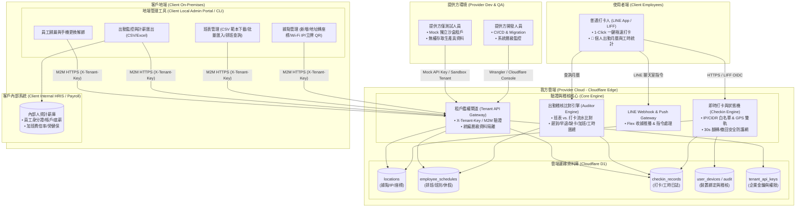

# LINE GPS 考勤打卡專案進度與架構紀錄 (Project Progress Log)

> **建立時間**：2026-08-30  
> **最後更新**：2026-09-05  
> **當前版本**：`v2.7.4`（員工自主換機打卡防弊二階段阻擋與確認彈窗實機驗收通過認可 ＆ 驗證狀態矩陣持久化鎖定 / Schema v10）  
> **專案定位**：基於 Cloudflare Workers、Cloudflare D1 與 LINE LIFF / Messaging API 的多公司（Multi-Tenant）Serverless GPS 地理圍欄考勤打卡系統。
> **架構劃分**：我方雲端（24/7 驗證核心）+ 客戶地端（敏感個資/計薪自持 + 自助管理後台）。

---

## 1. 核心雲端與 LINE 基礎設施 (Infrastructure)

| 資源項目 | 識別碼 / 網址 | 狀態 | 說明 |
| :--- | :--- | :---: | :--- |
| **Cloudflare Account ID** | `855d7f93966abed2712c15f619ea6721` | ✅ 已綁定 | 帳戶名：`I14d142@gmail.com's Account` |
| **Cloudflare API Token** | 已配置於 `.env` (`CLOUDFLARE_API_TOKEN`) | ✅ 驗證通過 | 具備 Workers, D1, KV, R2, Zone, DNS 完整管理權限 |
| **Cloudflare Worker** | `https://line-checkin-worker.i14d142.workers.dev` | 🟢 運行中 | 專案名稱：`line-checkin-worker`（已綁定 D1、LINE Secrets） |
| **Cloudflare D1 資料庫** | `d331ccb9-3aa5-48bd-8803-5e074e38b1c2` | 🟢 運行中 | 資料庫名稱：`line-checkin-db` (APAC 新加坡節點) |
| **地端管理後台 (Admin Portal)** | `https://line-checkin-worker.i14d142.workers.dev/admin` | 🟢 運行中 | 網頁端帳號密碼登入，後台內建 M2M API 金鑰自主生成/撤銷中心、據點配置、排班 CSV 匯入、計薪 CSV 匯出、電子簽核管理與主管綁定 |
| **LINE Login Channel ID** | `2011328810` | 🟢 運行中 | 用於 LIFF 身分驗證與 OpenID Connect ID Token 解析 |
| **LINE Login Channel Secret** | 已配置於 `.env` (`LINE_LOGIN_CHANNEL_SECRET`) | 🟢 運行中 | 用於 OAuth ID Token 後端檢核 |
| **LINE LIFF App ID** | `2011328810-vjUUBSYA` | 🟢 運行中 | 專屬打卡、出勤月曆與線上簽核連結：`https://liff.line.me/2011328810-vjUUBSYA` |
| **LINE Messaging Channel** | `2011286264` (`@375nvoga`) | 🟢 運行中 | 機器人名稱：**豬毛打卡機器人**，已簽發 Access Token 與 Channel Secret |
| **LINE Webhook Endpoint** | `https://line-checkin-worker.i14d142.workers.dev/api/webhook` | 🟢 已註冊 | 支援 Postback（30s 翻轉/撤回、主管一鍵核准/駁回）、傳送位置資訊改座標與文字指令 |
| **LINE 員工預設選單 (Default Menu)** | `richmenu-120970060b421fd2a35634007795916f` | 🟢 已啟用 | 全體同仁預設圖文選單（3 格極簡純色：考勤打卡 `?tab=punch`、排班月曆 `?tab=calendar`、線上簽核 `?tab=approvals`） |
| **LINE 主管管理選單 (Manager Menu)** | `richmenu-26e2f94f69a7e091962de3f22e6b6361` | 🟢 已啟用 | 具備管理權限者專屬 2 排 4 格超集選單（上排 3 格個人考勤：打卡、月曆、簽核；下排 1*3 寬按鈕直達門市管理工作台 `?tab=admin`） |


---

## 2. 業界對標方案分析：人易科技 (NuEIP) LINE 智慧考勤模組

> **官方指定對標產品**：台灣人資 SaaS 領導品牌 **人易科技 (NuEIP) 雲端人資系統 — LINE 官方帳號行動辦公模組**。  
> **核心設計理念**：以 LINE 作為免安裝 APP 的唯一員工行動入口，深度整合「考勤打卡」、「電子簽核 (BPM)」、「排班月曆」與「計薪核算」。

### 📊 功能完整度對比矩陣 (NuEIP vs. 本專案)

| 功能模組 | 人易 NuEIP 標準功能規格 | 本專案實作進度 (v2.0.0) | 達成率 | 備註 / 優勢 |
| :--- | :--- | :--- | :---: | :--- |
| **打卡管道** | • GPS 經緯度地理圍欄打卡<br>• 公司 Wi-Fi / 固定 IP 白名單打卡<br>• 門市立牌 QR Code 打卡 | • 支援純 GPS 地理圍欄 (可自訂半徑)<br>• 支援 IP / CIDR 網段白名單直通<br>• 提供各門市專屬立牌 QR Code 頁面 | 🟢 100% | 我方具備「Wi-Fi 優先、外網 GPS 自動降級」雙軌互補機制 |
| **防呆與彈性** | • 防重複打卡防呆<br>• 智慧判定上下班 | • 智慧推論狀態機 (首打卡/重複/早晚班/大夜班/超長間隔自動歸位)<br>• **30 秒聊天室安全防護網** (Flex 收據即時「翻轉」與「撤回」) | 🟢 100% | 我方 30s 撤回/翻轉機制比傳統打卡防呆更具人性化 |
| **防代打卡機制** | • LINE 帳號一對一綁定<br>• 裝置綁定與異常偵測 | • 員工首次打卡自動註冊裝置<br>• **員工自主換機打卡** (二階段防弊確認彈窗 + `SWITCH_DEVICE` 警告日誌)<br>• 新設備打卡前暫停並彈窗提示解綁舊設備與通報人事 | 🟢 100% | 兼顧員工更換手機免管理員介入之便利性與企業防弊嚴謹性 |
| **出勤與排班** | • 員工個人班表與出勤月曆查詢<br>• 後台整月排班 CSV 批次匯入<br>• 自動比對遲到/早退/缺卡/加班 | • LIFF 視覺化個人出勤月曆 (31 天燈號)<br>• 後台支援 UTF-8 BOM CSV 排班匯入與範本下載<br>• 即時出勤稽核比對引擎 (工時/遲到/早退/缺卡/加班) | 🟢 100% | 具備 4 大工時指標卡片與整月出勤日誌 |
| **多租戶與後台** | • 企業後台管理介面<br>• 統編層級資料隔離 | • 獨立地端管理後台 (`/admin`)<br>• **帳號密碼登入 + Web Session (7天)**<br>• **🔑 企業專用 M2M API 金鑰自主生成中心**<br>• 統編層級資料庫強隔離 | 🟢 100% | 徹底移除網址帶 Key 隱患，支援客戶敏感個資地端自持 |
| **電子簽核 (BPM)** | • LINE 內直接發起請假、補卡、加班、外出<br>• 系統即時推播通知簽核主管<br>• 主管在 LINE 內一鍵「核准/駁回」<br>• 支援串簽/會簽/並簽與職務代理人 | • **LIFF 線上簽核分頁**（🌴 請假 / ⏰ 補卡 / 🔥 加班）<br>• **主管 LINE 聊天室一鍵審核**（Flex 卡片即時推播，內嵌【✅ 核准通過】與【❌ 駁回申請】）<br>• **智慧路由架構**（員工直屬主管優先 ＞ 門市店長自動兜底）<br>• **自動消異常連動**（補卡自動寫入 `APPROVED_OVERRIDE` 出勤流水、請假自動更新班表 `is_rest_day = 1`）<br>• **嚴格資安防護**（防轉傳冒審比對 `source.userId`、LINE 數位簽章防偽、單據單次處理防呆） | 🟢 100% | **輕量直達型高效率 BPM**，杜絕傳統人資多層審批冗長痛點，1 秒在 LINE 內完成審核 |
| **行動圖文選單 (Rich Menu)** | • 依角色自動切換選單<br>• 員工打卡/班表/請假<br>• 主管營運/審批/出勤看板 | • **雙軌圖文選單（員工預設選單 vs. 主管專屬選單）**<br>• **PBAC 視圖動態投影與自動 API 綁定**（後台改權限即時切換）<br>• **極簡純色大字級 CTA 設計**（無副標、無迷你標籤、主題色彩直接映射、置中 120px / 112px） | 🟢 100% | 兼具 PBAC 安全門禁與行動端極致可讀性，零破圖 |
| **定時排程推播** | • 上下班防漏打卡定時提醒<br>• 異常出勤即時通報<br>• 企業公告推播 | 🟡 **待實作 (Roadmap 第 1 順位)**<br>規劃利用 Cloudflare Cron Triggers 實現定時防漏打卡與排班公告推播 | 🟡 20% | 已有 LINE Push 收據推播基礎，差定時 Trigger |
| **假勤額度池** | • 特休天數扣抵池<br>• 一例一休工時超時預警<br>• 勞基法加班費率自動核算 | 🟡 **待實作 (Roadmap 第 2 順位)**<br>目前已具備出勤時數與加班時數統計，可直接匯出計薪 CSV 供地端人資系統計算 | 🟡 30% | 我方定位雲地分工，敏感薪資額度推薦客戶於地端 HRIS 整合 |

---

## 2.1 🎯 全功能使用者實機驗證狀態持久化矩陣 (Persistent User Verification State Matrix)

> **驗證繼承規範 (Persistence Protocol)**：
> 1. `[User Verified ✅]`（使用者實機驗證通過）：經使用者於真實行動裝置與實體情境操作驗證無誤。**此狀態跨版本永久繼承（persist through versions）**，不得因日常維護而被重設。
> 2. `[Pending User Verification ⏳]`（待實機驗證）：自動化測試或邊界測試通過，尚待使用者實機驗收。
> 3. `[Fixed - Re-verifying 🔄]`（已修復待覆測）：使用者回報問題後，工程團隊已修復並部署最新版，目前等待使用者重新覆測確認。
> 4. **重新驗證觸發條件**：僅當使用者主動回報問題，或該功能模組之程式碼/核心架構被更動時，狀態才轉為 `[Fixed - Re-verifying 🔄]` 或 `[Pending User Verification ⏳]`。

| 模組分類 | 功能項目 | 驗證狀態 | 實機測試備註 / 驗收歷程 |
| :--- | :--- | :---: | :--- |
| **1. 打卡與防弊** | 雙軌驗證打卡 (GPS + IP/CIDR 白名單) | `[User Verified ✅]` | 實機驗證通過，Wi-Fi 與 GPS 切換順暢 |
| | 智慧狀態機推論 (上下班/跨日大夜/超長間隔) | `[User Verified ✅]` | 實機驗證通過，自動歸位與工時計算無誤 |
| | 30 秒聊天室安全防護網 (收據翻轉/撤回) | `[User Verified ✅]` | 實機驗證通過，聊天室即時按鈕互動正常 |
| | 員工自主換機打卡 (防作弊確認彈窗 ＆ 警告日誌) | `[User Verified ✅]` | **使用者實機驗證通過 (OK)**，換機二階段防弊彈窗與 SWITCH_DEVICE 稽核無誤 |
| | 現場一鍵登記門市 Wi-Fi (`set_wifi`) | `[Pending User Verification ⏳]` | 測試通過，待門市連網實測 |
| | LINE 位置訊息釘選更新 GPS (`set_location`) | `[Pending User Verification ⏳]` | 測試通過，待主管於聊天室分享位置實測 |
| | 門市立牌 QR Code 頁面 (`bot_prompt=aggressive`) | `[User Verified ✅]` | 實機驗證通過，掃碼與加好友引導正常 |
| **2. 出勤、排班與月曆** | 視覺化個人出勤月曆 (確定性 UTC 曆法) | `[User Verified ✅]` | 實機驗證通過，星期與日期精準對齊 |
| | 當日焦點 (TODAY) 翡翠綠光環與今日徽章 | `[Pending User Verification ⏳]` | 整合測試通過，待實機確認當日高亮視覺 |
| | 未來排程 (SCHEDULED) 天空藍底 (去圓點) | `[User Verified ✅]` | 實機驗證通過，天空藍無小圓點清爽正確 |
| | 過去歷史狀態燈號 (綠/黃/紅/紫/灰) | `[User Verified ✅]` | 實機驗證通過，出勤狀態燈號正確 |
| | 請假專屬狀態 (LEAVE) 暖琥珀色卡 | `[Pending User Verification ⏳]` | 單元測試通過，待實機請假核准後呈現確認 |
| | 出勤與請假混合工時沖銷 (不誤判加班) | `[User Verified ✅]` | 實機驗證通過，實際工時正常計算、不虛胖 |
| | 出勤月曆頂部指標卡片 (工時/加班時長/遲到早退/缺卡) | `[User Verified ✅]` | 實機驗證通過，加班時長取代出勤天數，2x2 佈局清晰 |
| **3. 線上電子簽核** | LIFF 線上簽核入口 (請假/補卡/加班) | `[Pending User Verification ⏳]` | 測試通過 (35 項全過)，待實機送單測試 |
| | 主管 LINE 聊天室一鍵審核 (Flex Postback) | `[Pending User Verification ⏳]` | 測試通過，待主管於聊天室一鍵核准實測 |
| | 智慧雙軌主管路由 (直屬主管優先 ＞ 店長兜底) | `[Pending User Verification ⏳]` | 測試通過，待實際主管分流實測 |
| | 核准業務自動連動 (補卡不可變流水/請假沖銷) | `[Pending User Verification ⏳]` | 測試通過，待審核通過後自動寫入實測 |
| | 嚴格身分防冒審 (比對 `event.source.userId`) | `[Pending User Verification ⏳]` | 測試通過，待轉傳他人防呆實測 |
| **4. 權限與選單** | 10 大細粒度原子權限體系 (PBAC) | `[Pending User Verification ⏳]` | 測試通過 (47 項全過)，待後台配置實測 |
| | 員工預設選單 (3 格極簡大字級 CTA) | `[User Verified ✅]` | 實機驗證通過，打卡/月曆/簽核按鈕正確 |
| | 主管超集選單 (2 排 4 格，下排管理工作台) | `[User Verified ✅]` | 實機驗證通過，2 排 4 格直達工作台 |
| | PBAC 權限即時動態同步 LINE 選單 | `[Pending User Verification ⏳]` | 測試通過，待後台調權實機切換確認 |
| | LINE 聊天室指令鑑權 (今日出勤/今日班表/我的權限) | `[Pending User Verification ⏳]` | 測試通過，待聊天室發送關鍵字實測 |
| **5. 新人入職體驗** | 職責完全解耦 (`POST /api/v1/employee/join`) | `[Pending User Verification ⏳]` | 測試通過，待新同仁首次加入實測 |
| | 非員工單排三鍵寬【入職登記】滿版介面 | `[User Verified ✅]` | 實機驗證通過，新同仁僅看見單一滿版按鈕 |
| | 入職即時落庫 ＆ 彈出式加好友強引導閉環 | `[Pending User Verification ⏳]` | 測試通過，待新同仁點選入職彈窗實測 |
| **6. 前端效能與體驗** | SWR 本地快取 (0ms 消除入職卡片閃爍) | `[User Verified ✅]` | 實機驗證通過，開屏流暢無閃爍 |
| | ID Token 本機快速解碼 (零延遲身分注入) | `[Pending User Verification ⏳]` | 測試通過，待進一步多機驗收 |
| | 後端 D1 資料庫批次查詢加速 (`env.DB.batch`) | `[Pending User Verification ⏳]` | 測試通過，月曆響應速度提升 |
| | 行動端左右滑動手勢換頁 (含表單避讓) | `[User Verified ✅]` | 實機驗證通過，滑動換頁順暢自然 |
| **7. 地端管理後台** | 後台帳密登入 ＆ 7 天 Web Session Token | `[Pending User Verification ⏳]` | Playwright 端到端實測通過，待正式營運驗收 |
| | 企業 M2M API 金鑰自主生成 / 撤銷中心 | `[Pending User Verification ⏳]` | 測試通過 (27 項全過)，待地端系統串接 |
| | 門市據點配置、IP 白名單與立牌 QR 下載 | `[Fixed - Re-verifying 🔄]` | **v2.7.4 據點卡片升級全卡片可點擊管理**，支援 GPS 座標（含定位/地址重設）、半徑、Wi-Fi IP/CIDR 與店長設定 |
| | 排班管理 (UTF-8 BOM CSV 範本與批次匯入) | `[Pending User Verification ⏳]` | 測試通過，待地端人資批次上傳實測 |
| | 出勤監控與計薪 CSV 報表匯出 | `[Pending User Verification ⏳]` | 測試通過，待出勤結算實測匯出 |
| | 員工 PBAC 細粒度權限配置與主管指派 | `[Fixed - Re-verifying 🔄]` | **v2.7.4 修復彈窗 DOM 巢狀閉合錯誤**，按鈕可正常彈出並新增同仁快速下拉選單自動帶入權限 |
| | 地端安全稽核日誌 (`SWITCH_DEVICE` 等事件) | `[Pending User Verification ⏳]` | 測試通過，待地端日誌巡檢實測 |

---

## 3. 雲地分工與四大角色拓撲 (Cloud vs. On-Premises Architecture)




---

## 4. 資料庫結構 (D1 Database Schema)


1. **據點清單表（5 欄位模型 `locations`）**：
```sql
CREATE TABLE IF NOT EXISTS locations (
    id TEXT PRIMARY KEY,            -- 統編 (例如 '24549210') 或 統編-分店號 (例如 '24549210-01')
    name TEXT NOT NULL,             -- 據點顯示名稱 (例如 '豬毛有限公司 - 台中美德總部')
    address TEXT NOT NULL,          -- 門市中文地址 (例如 '台中市北區美德街56-11號')
    target_lat REAL NOT NULL,       -- 打卡目標緯度
    target_lon REAL NOT NULL,       -- 打卡目標經度
    allowed_radius REAL DEFAULT 100,-- 允許打卡半徑 (公尺)
    allowed_ips TEXT DEFAULT NULL,  -- 允許打卡之固定公網 IP 或 CIDR 網段 (以逗號分隔，例如 '211.20.1.5, 114.33.20.0/24'，NULL 表示純 GPS 模式)
    created_at TEXT NOT NULL DEFAULT (datetime('now', '+8 hours'))
);
```

2. **員工排班表（`employee_schedules` - Schema v7）**：
```sql
CREATE TABLE IF NOT EXISTS employee_schedules (
    id INTEGER PRIMARY KEY AUTOINCREMENT,
    company_id TEXT NOT NULL,               -- 關聯 locations.id (例如 '24549210-01')
    line_user_id TEXT NOT NULL,             -- 員工 LINE User ID
    work_date TEXT NOT NULL,                -- 排班日期 (YYYY-MM-DD，例如 '2026-08-15')
    shift_name TEXT NOT NULL DEFAULT '常態班', -- 班別名稱 (例如 '早班', '晚班', '大夜班', '例假')
    shift_start TEXT DEFAULT '09:00',       -- 預計上班時間 (HH:MM，NULL 表示休假)
    shift_end TEXT DEFAULT '18:00',         -- 預計下班時間 (HH:MM，支援跨日大夜如 '07:00')
    break_minutes INTEGER DEFAULT 60,       -- 預設休息時間 (分鐘)
    is_rest_day INTEGER NOT NULL DEFAULT 0, -- 1: 休假/例假日, 0: 工作日
    is_cross_day INTEGER NOT NULL DEFAULT 0,-- 1: 跨日班次 (大夜班)
    created_at TEXT NOT NULL DEFAULT (datetime('now', '+8 hours')),
    updated_at TEXT NOT NULL DEFAULT (datetime('now', '+8 hours')),
    UNIQUE(company_id, line_user_id, work_date)
);

CREATE INDEX IF NOT EXISTS idx_schedules_user_date ON employee_schedules (line_user_id, work_date);
CREATE INDEX IF NOT EXISTS idx_schedules_company_date ON employee_schedules (company_id, work_date);
```

3. **打卡紀錄表（`checkin_records`）**：
```sql
CREATE TABLE IF NOT EXISTS checkin_records (
    id INTEGER PRIMARY KEY AUTOINCREMENT,
    company_id TEXT,                -- 關聯 locations.id
    line_user_id TEXT NOT NULL,
    display_name TEXT,
    device_id TEXT,
    latitude REAL NOT NULL,
    longitude REAL NOT NULL,
    distance_meters REAL NOT NULL,
    status TEXT NOT NULL,           -- 'SUCCESS', 'OUT_OF_RANGE', 'DEVICE_MISMATCH', 'CANCELLED', 'DUPLICATE'
    punch_type TEXT NOT NULL DEFAULT 'IN', -- 'IN' (上班), 'OUT' (下班)
    work_hours REAL DEFAULT NULL,   -- 當次工時 (小時)
    verify_mode TEXT DEFAULT 'GPS_ONLY', -- 'IP_WHITELIST', 'GPS_FALLBACK', 'GPS_ONLY'
    created_at TEXT NOT NULL DEFAULT (datetime('now', '+8 hours'))
);
```

4. **租戶 M2M API 金鑰表（`tenant_api_keys` - Schema v6）**：
```sql
CREATE TABLE IF NOT EXISTS tenant_api_keys (
    id INTEGER PRIMARY KEY AUTOINCREMENT,
    tax_id TEXT NOT NULL,                   -- 企業統編 (例如 '24549210' 或測試統編 '00000000')
    api_key_hash TEXT NOT NULL UNIQUE,      -- SHA-256 雜湊儲存之 API Key
    key_hint TEXT NOT NULL,                 -- 前綴提示 (例如 'pk_live_2454...a8b9')
    name TEXT NOT NULL,                     -- 金鑰說明 (例如 '美德總部地端管理後台')
    role TEXT NOT NULL DEFAULT 'ADMIN',     -- 'ADMIN', 'READ_ONLY', 'SANDBOX_QA'
    is_active INTEGER NOT NULL DEFAULT 1,
    created_at TEXT NOT NULL DEFAULT (datetime('now', '+8 hours')),
    last_used_at TEXT DEFAULT NULL
);
```

5. **企業管理員帳號表（`tenant_users` - Schema v8）**：
```sql
CREATE TABLE IF NOT EXISTS tenant_users (
    id INTEGER PRIMARY KEY AUTOINCREMENT,
    tax_id TEXT NOT NULL,                   -- 企業統編 (例如 '24549210')
    username TEXT NOT NULL UNIQUE,          -- 登入帳號 (例如 'admin')
    password_hash TEXT NOT NULL,            -- PBKDF2 SHA-256 Hash
    salt TEXT NOT NULL,                     -- 密碼鹽
    display_name TEXT NOT NULL,             -- 顯示名稱
    role TEXT NOT NULL DEFAULT 'ADMIN',     -- 'ADMIN', 'MANAGER', 'VIEWER'
    is_active INTEGER NOT NULL DEFAULT 1,
    created_at TEXT NOT NULL DEFAULT (datetime('now', '+8 hours')),
    last_login_at TEXT DEFAULT NULL
);
```

6. **後台登入 Session 表（`tenant_sessions` - Schema v8）**：
```sql
CREATE TABLE IF NOT EXISTS tenant_sessions (
    id INTEGER PRIMARY KEY AUTOINCREMENT,
    token_hash TEXT NOT NULL UNIQUE,        -- Session Token SHA-256 Hash
    user_id INTEGER NOT NULL,
    tax_id TEXT NOT NULL,
    role TEXT NOT NULL,
    expires_at TEXT NOT NULL,               -- 過期時間
    created_at TEXT NOT NULL DEFAULT (datetime('now', '+8 hours')),
    FOREIGN KEY (user_id) REFERENCES tenant_users(id) ON DELETE CASCADE
);
```

7. **電子簽核審批表（`approvals` - Schema v9）**：
```sql
CREATE TABLE IF NOT EXISTS approvals (
    id TEXT PRIMARY KEY,                            -- 審核單 UUID
    company_id TEXT NOT NULL,                       -- 關聯門市/公司統編
    applicant_line_id TEXT NOT NULL,                -- 申請員工 LINE User ID
    applicant_name TEXT NOT NULL,                   -- 申請員工姓名
    approver_line_id TEXT NOT NULL,                 -- 指定審核主管 LINE User ID
    type TEXT NOT NULL,                             -- 'LEAVE' (請假), 'CORRECTION' (補卡), 'OVERTIME' (加班)
    target_date TEXT NOT NULL,                      -- 申請日期 (YYYY-MM-DD)
    details TEXT NOT NULL,                          -- JSON 字串 (如假別、時段、事由、補卡打卡類別)
    status TEXT NOT NULL DEFAULT 'PENDING',         -- 'PENDING', 'APPROVED', 'REJECTED'
    decided_at TEXT DEFAULT NULL,                   -- 審核時間 (YYYY-MM-DD HH:MM:SS)
    created_at TEXT NOT NULL DEFAULT (datetime('now', '+8 hours'))
);

CREATE INDEX IF NOT EXISTS idx_approvals_company ON approvals (company_id);
CREATE INDEX IF NOT EXISTS idx_approvals_applicant ON approvals (applicant_line_id);
CREATE INDEX IF NOT EXISTS idx_approvals_approver ON approvals (approver_line_id);
CREATE INDEX IF NOT EXISTS idx_approvals_status ON approvals (status);
```
> **外鍵/欄位擴充 (Schema v9 / v10)**：
> - `company_employees.approver_line_id TEXT DEFAULT NULL`：員工指定直屬審查主管 LINE ID（優先路由）。
> - `locations.manager_line_id TEXT DEFAULT NULL`：門市指定店長 LINE ID（無直屬主管時自動兜底）。
> - `company_employees.permissions TEXT DEFAULT '["punch","apply"]'`：**細粒度原子權限 (PBAC Schema v10)**，儲存 10 大原子權限字串陣列（如 `punch`, `apply`, `approve`, `view_store`, `view_all`, `set_location`, `set_wifi`, `device_audit`, `export_payroll`, `broadcast`）。

---

## 5. API 路由清單 (API Endpoints)

| HTTP 方法 | 路由路徑 | 授權層級 | 功能描述 | 備註 |
| :--- | :--- | :---: | :--- | :--- |
| `GET` | `/api/v1/tenant/employees` | Session / X-Tenant-Key | **查詢企業全體員工與 PBAC 權限** | 條列同仁識別碼、姓名、所屬門市、指派主管與 10 項原子權限清單 |
| `POST` | `/api/v1/tenant/employees/:id/permissions` | Session / ADMIN Key | **配置同仁細粒度原子權限 (PBAC)** | 管理者勾選或套用範本（店長/人資/主管），自訂可用功能並**即時自動同步 LINE 圖文選單** |
| `POST` | `/api/v1/tenant/richmenu/sync` | Session / ADMIN Key | **全體同仁 LINE 圖文選單批次同步** | 批次檢查本租戶全體同仁之 PBAC 權限，自動為主管綁定專屬選單、為一般員工綁定預設選單 |
| `POST` | `/api/v1/employee/join` | 公開 / LIFF Token | **新進同仁明確入職綁定** | 傳入 `companyId`、`lineUserId`、`displayName`，明確完成門市歸屬綁定並記錄 `INITIAL_JOIN` 稽核日誌 |
| `GET` | `/api/v1/employee/profile` | 公開 / LIFF Token | **查詢個人權限與職能設定** | LIFF 前端取得個人開通之權限標籤、受邀據點資訊與門市店長徽章，動態渲染管理卡片 |
| `POST` | `/api/v1/tenant/locations/wifi` | `set_wifi` 權限 / Admin Key | **現場門市 Wi-Fi 白名單登記** | 具備 `set_wifi` 之同仁現場連網一鍵登記當前對外 IP 至門市白名單 |
| `POST` | `/api/v1/approval/request` | 公開 / LIFF Token | **發起假勤/補卡/加班申請** | 員工於 LIFF 提交，自動比對員工直屬主管，若無則兜底門市店長，寫入 `approvals` 並推播 Flex 卡片給主管 |
| `GET` | `/api/v1/approval/my` | 公開 / LIFF Token | **查詢個人申請歷史紀錄** | 傳入 `userId`，回傳自身發起之單據清單、目前審核進度與決定時間 |
| `POST` | `/api/webhook` | LINE 數位簽章 | **LINE Webhook / 審核與位置分享** | • 主管一鍵核准/駁回<br>• **傳送 Location 座標更新門市經緯度 (`set_location`)**<br>• 文字指令：「今日出勤」、「今日班表」、「我的權限」、「班表」 |
| `GET` | `/api/v1/tenant/approvals` | Session / X-Tenant-Key | **查詢企業全體審核單據** | 管理後台監控同仁簽核進度，支援 `month`、`status`、`type` 條件篩選 |
| `POST` | `/api/v1/tenant/employees/:id/approver` | Session / ADMIN Key | **為員工指派直屬審查主管** | 綁定或更新同仁之直屬主管 LINE ID，指派後優先路由至該主管 |
| `POST` | `/api/v1/admin/login` | 公開 | **管理後台帳號密碼登入** | 傳入 `{ username, password }`，校驗 PBKDF2 密碼雜湊，簽發 7 天有效之 Web Session Token (`sess_...`) |
| `POST` | `/api/v1/admin/logout` | Session Bearer | **管理後台登出** | 廢止並刪除當前 Session Token |
| `GET` | `/api/v1/admin/me` | Session Bearer | **查詢當前登入者資訊** | 回傳登入管理員名稱、統編與角色 |
| `GET` | `/api/v1/tenant/keys` | Session / ADMIN Key | **查詢企業 M2M API 金鑰清單** | 嚴格鎖定所屬統編，條列金鑰提示、名稱、權限、建立與最後使用時間 |
| `POST` | `/api/v1/tenant/keys` | Session / ADMIN Key | **自主生成全新 M2M API 金鑰** | 後台一鍵生成，回傳 `pk_live_<taxId>_<uuid>`，僅顯示一次 |
| `POST` / `DELETE` | `/api/v1/tenant/keys/:id/revoke` | Session / ADMIN Key | **撤銷停用指定 API 金鑰** | 將金鑰標記 `is_active = 0`，外部 API 呼叫立即被 403 攔截 |
| `POST` | `/api/checkin` | LINE ID Token | **核心打卡端點** | 支援 IP 白名單直通與 GPS 地理圍欄，狀態機自動判定上下班與工時 |
| `GET` | `/api/v1/attendance/monthly` | 公開 / LIFF / Admin | **個人出勤月曆與工時統計** | 傳入 `userId` 與 `month=YYYY-MM`，比對班表與打卡記錄，產出 31 天狀態燈號與月度統計 |
| `GET` | `/api/v1/tenant/schedules/template` | Session / X-Tenant-Key | **下載排班 CSV 範本** | 匯出標準 UTF-8 BOM CSV 排班範本檔案 |
| `POST` | `/api/v1/tenant/schedules/batch` | Session / X-Tenant-Key (ADMIN) | **批量匯入/排班更新** | 接收員工整月班表陣列，支援衝突自動更新（Upsert） |
| `GET` | `/api/v1/tenant/schedules` | Session / X-Tenant-Key | **查詢企業排班資料** | 支援按月份（`month`）、員工（`userId`）篩選 |
| `GET` | `/api/v1/tenant/locations` | Session / X-Tenant-Key | **查詢本公司所有據點** | 嚴格鎖定金鑰統編，回傳據點詳細結構、IP 白名單與門市店長 LINE ID |
| `POST` | `/api/v1/tenant/locations` | Session / X-Tenant-Key (ADMIN) | **自主新增/更新門市據點** | 自動驗證統編防越權，中文地址自動解析 GPS 座標，支援店長 LINE ID 設定 |
| `GET` | `/api/locations/:id/qrcode` | 公開 | **門市專屬立牌 QR Code 頁** | 即時產生包含公司名、分店名、門市地址之立牌 QR Code 網頁（無需網址帶 Key） |
| `GET` | `/api/v1/tenant/records` | Session / X-Tenant-Key | **出勤監控與計薪匯出** | 支援 `startDate`, `endDate`, `status`, `punchType` 篩選。<br>`?format=csv` 輸出標準 UTF-8 BOM CSV 報表 |
| `GET` | `/api/v1/tenant/audit` | Session / X-Tenant-Key | **地端安全稽核日誌查詢** | 查詢員工換機 (SWITCH_DEVICE 警示)、首次綁定、未授權打卡、翻轉與撤回等日誌 |
| `GET` | `/api/health` | 公開 | **Worker 健康檢查** | 回傳 `{ status: "ok", service: "line-gps-checkin-v3" }` |


---

## 6. 出勤稽核比對狀態判定邏輯 (Attendance Auditor Engine)


---

## 7. 程式碼目錄結構 (Codebase Layout)

```text
d:\Cloud-manager/
├── .env                                # 包含 CLOUDFLARE_*, LINE_*, META_* 金鑰
├── LINE_CHECKIN_PROGRESS.md            # 本專案紀錄檔 (Single Source of Truth)
├── qrcodes/                            # 本地高解析 A4 / 立牌列印圖檔
└── line-checkin-worker/
    ├── wrangler.jsonc                  # Cloudflare Worker 配置 (綁定 D1 與環境變數)
    ├── package.json                    # 依賴與建置腳本
    ├── tsconfig.json                   # TypeScript 編譯配置
    ├── schema.sql                      # D1 資料庫最新架構腳本 (含 v8 tenant_users & tenant_sessions)
    ├── migration_v4_punch_type.sql     # D1 v4 遷移腳本
    ├── migration_v5_ip_whitelist.sql   # D1 v5 IP 白名單與 verify_mode 遷移腳本
    ├── migration_v6_tenant_keys.sql    # D1 v6 租戶 API 金鑰與 RBAC 遷移腳本
    ├── migration_v8_tenant_auth.sql    # D1 v8 企業管理員帳密與 Session 遷移腳本
    ├── test_calendar_today_and_leave.js # 出勤月曆當日 (TODAY) 與請假 (LEAVE) 專屬狀態與高亮標記測試腳本 (4 項全過)
    ├── test_official_account_qr_and_follow.js # 門市立牌 LINE 官方帳號 QR Code 生成與 Webhook Follow 事件測試腳本 (3 項全過)
    ├── test_onboarding_flow.js         # 新人專屬入職卡片與明確綁定流程整合測試腳本 (4 項全過)
    ├── test_liff_swipe_and_dot.js      # LIFF 左右滑動手勢切換分頁與未來排班去圓點整合測試腳本 (4 項全過)
    ├── test_liff_tab_guard.js          # LIFF 角色動態分頁與安全防禦回退測試腳本 (4 項全過)
    ├── test_calendar_month_nav.js      # 出勤月曆快速前後月導航與純粹工時呈現測試腳本 (3 項全過)
    ├── test_calendar_future_dates.js   # 出勤月曆當月預設、未來待出勤天空藍與週休二日校準測試腳本 (10 項全過)
    ├── test_permission_pbac.js         # 細粒度原子權限 (PBAC) 與 LINE 管理端測試腳本 (47 項全過)
    ├── test_bpm_approvals.js           # 線上簽核與主管一鍵審核流程整合測試腳本 (35 項全過)
    ├── test_admin_auth_and_keys.js     # 地端後台帳密登入與 M2M 金鑰自主中心測試腳本 (27 項全過)
    ├── test_device_switch_alert.js     # 員工自主換機打卡與安全稽核警訊測試腳本 (17 項全過)
    ├── test_calendar_attendance.js     # 出勤月曆、排班與工時比對測試腳本 (21 項全過)
    ├── test_tenant_architecture.js     # 租戶多公司隔離與 RBAC 角色測試腳本 (21 項全過)
    ├── test_ip_whitelist.js            # 據點固定 IP / CIDR 白名單與 GPS 互補測試腳本 (20 項全過)
    ├── test_smart_punch.js             # 智慧上下班狀態機 7 大情境自動化測試腳本 (7 項全過)
    ├── test_safety_net.js              # 30 秒聊天室安全防護網（翻轉/撤回/超時攔截）測試腳本 (6 項全過)
    ├── test_company_scoping.js         # 多租戶企業隔離與跨店動態匹配測試腳本 (6 項全過)
    ├── run-wrangler.js                 # 本地認證環境 Wrangler 輔助腳本
    └── src/
        ├── index.ts                    # Worker 主邏輯 (PBAC 鑑權、Tenant M2M 鑑權、Admin 帳密登入、BPM 簽核、出勤比對、D1 存取、Flex 推播、Location Webhook 處理)
        ├── liff-html.ts                # LIFF 前端介面 (新人入職確認卡片 + 一鍵打卡 + 📅 出勤月曆 + 📝 線上簽核表單 + 🛠️ 管理工作台 + 左右滑動手勢)
        └── local-admin-html.ts         # 客戶地端管理後台 UI (帳密登入、🔑 M2M API 金鑰管理中心、據點配置、班表 CSV 上傳/範本、計薪 CSV、安全稽核、📋 電子簽核、🛡️ 員工 PBAC 細粒度權限配置)
```

---

## 8. 目前已完成之功能與驗證 (Verification Summary)

1. ✅ **員工自主換機打卡防弊二階段阻擋與確認彈窗實機驗收通過 ＆ 狀態鎖定 (Device Switch Anti-Fraud Modal User Verified v2.7.4)**：
   - 經使用者實機驗證（**User Verified (OK)**）以及自動化測試 [`test_device_switch_alert.js`](file:///d:/Cloud-manager/line-checkin-worker/test_device_switch_alert.js)（24 項全過）、[`test_smart_punch.js`](file:///d:/Cloud-manager/line-checkin-worker/test_smart_punch.js)（7 項全過）與 [`test_safety_net.js`](file:///d:/Cloud-manager/line-checkin-worker/test_safety_net.js)（6 項全過）驗收通過，狀態正式鎖定為 `[User Verified ✅]`：
     1. **後端換機防弊二階段阻擋門禁 (`/api/checkin`)**：
        - 員工於未綁定之新手機/新設備打卡時，若未攜帶 `confirmDeviceSwitch: true`，系統即刻暫停（Block）當次打卡，不解綁舊機、不覆蓋 `user_devices`、不寫入 `checkin_records`。
        - 端點回傳 HTTP `409 Conflict` 與 `{ success: false, requireDeviceSwitchConfirm: true, message: "為防範代打卡，使用新手機打卡將解除舊設備綁定並通報人事部。是否確認換機打卡？" }`。
     2. **LIFF 前端換機防弊確認彈窗 (`#deviceSwitchModal`)**：
        - 採用高對比毛玻璃遮罩（`bg-black/60 backdrop-blur-sm`）與琥珀警示色系卡片，精準展現防作弊盾牌圖示與精簡有力警訊。
        - 員工點擊【確認換機並打卡】：自動攜帶暫存定位與 `confirmDeviceSwitch: true` 再次送出，後端覆蓋新設備綁定、寫入 `SWITCH_DEVICE` WARNING 警告日誌，順暢完成打卡並推播收據。
        - 員工點擊【取消打卡】：立即關閉彈窗並終止打卡流程，舊設備維持原狀不受任何影響。
     3. **路由擴充與地端管理後台同步**：
        - Worker 擴充 `/liff` 路由直達 LIFF 前端介面。
        - 後台安全稽核模組同步更新說明文字，標明二階段防弊確認彈窗與通報機制。

2. ✅ **出勤月曆頂部指標卡片校準（加班時長替換出勤日數）實機驗收通過 ＆ 狀態鎖定 (Calendar Overtime Metric User Verified v2.7.2)**：
   - 經使用者實機驗證（**User Verified (OK)**）以及自動化測試 [`test_calendar_metric_cards.js`](file:///d:/Cloud-manager/line-checkin-worker/test_calendar_metric_cards.js) 驗收通過：
     1. **出勤月曆頂部 4 大指標卡片實機驗收完成**：
        - 移除原先低實用性之「實際出勤天數 (`statDays`)」，改為更具實質參考價值之**「加班時長 (`statOvertimeHours`)」**（標註為專屬紫晶色系 `bg-purple-50 border-purple-100 text-purple-700`，字級 `text-xl font-bold font-mono text-purple-800`）。
        - 頂部 4 大指標卡片精確收斂為：**【本月累計工時】(Emerald)**、**【加班時長】(Purple)**、**【遲到 / 早退】(Amber)**、**【異常缺卡】(Red)**，2x2 對稱網格排版清爽，使用者確認滿意。
        - 前端 `renderAttendanceGrid` 同步更新賦值邏輯，直接自 `/api/v1/attendance/monthly` 回傳之 `summary.overtime_hours` 即時注入數值。
     2. **使用者實機驗證狀態持久化管理 (Persistent User Verification State)**：
        - 建立專屬「實機驗證狀態持久化矩陣 (Section 2.1)」，嚴格鎖定使用者已實機操作認可之各項功能（如雙軌打卡、智慧狀態機、30s 翻轉撤回、月曆 UTC 曆法、未來排班天空藍、主管雙軌選單、SWR 快取、滑動手勢等標註 `[User Verified ✅]`）。
        - 規範驗證狀態跨版本永續繼承（persist through versions），直至使用者明確覆寫或模組被實質修改需重新覆測（標註 `[Fixed - Re-verifying 🔄]`）。

2. ✅ **出勤月曆當日 (TODAY) 專屬狀態與高亮標記 ＆ 請假 (LEAVE) 暖琥珀色卡校準 (Calendar Today Status & Leave Amber Calibration v2.6.1)**：
   - 經 [`test_calendar_today_and_leave.js`](file:///d:/Cloud-manager/line-checkin-worker/test_calendar_today_and_leave.js)、[`test_calendar_future_dates.js`](file:///d:/Cloud-manager/line-checkin-worker/test_calendar_future_dates.js) 與 [`test_retro_leave_compensation.js`](file:///d:/Cloud-manager/line-checkin-worker/test_retro_leave_compensation.js) 驗證，**全數測試 100% 通過**：
     1. **「當天 (Today)」從未來/過去二元劃分中獨立為三態**：
        - 徹底根治「當天既不屬於未發生 (未來)、也不屬於已完成 (過去)，導致未打卡或排程中被誤判或回退為灰色」的根本缺陷。
        - 後端審計比對引擎 (`auditDayAttendance`) 明確將當日未打卡且在預計下班前之排班工作日賦予專屬 `status: 'TODAY'`（狀態文字：`今日待出勤`，狀態色：`emerald`），並在每日資料結構中注入權威 `isToday: true`。
        - LIFF 月曆前端針對 `isToday` 加入現代化外光環高亮標記（`ring-2 ring-emerald-500 ring-offset-1 font-bold z-10 relative`），並在日期下方標記醒目翠綠 `今日` 徽章，秒級識別今日焦點。
     2. **「請假 (Leave)」獨立為專屬暖琥珀色狀態 (LEAVE)，徹底擺脫例假 (REST_DAY) 灰底**：
        - 徹底消除舊版將全日請假粗暴判定為 `status: 'REST_DAY'`、`isRestDay: true` 與 `statusColor: 'gray'`，導致請假看起來宛如週末例假之嚴重語義瑕疵。
        - 當日排定為請假班且無打卡時，狀態精準判定為 `status: 'LEAVE'`（狀態文字標明假別如 `請假 (事假)`，狀態色：`amber`，`isRestDay: false`）。
        - LIFF 前端為 `LEAVE` 配置專屬暖琥珀色底框 (`bg-amber-50 border-amber-200 text-amber-900`) 與琥珀色小圓點，與出勤明細卡片中之 `#detailLeaveRow` 形成完美一致的視覺語意。

2. ✅ **RBAC 與 PBAC 雙軌統一化架構 ＆ 2 排 4 格主管超集工作台選單 (Unified Role Views with PBAC & Superset Rich Menu v2.6.0)**：
   - 經 [`test_rich_menu_sync.js`](file:///d:/Cloud-manager/line-checkin-worker/test_rich_menu_sync.js)、[`test_liff_tab_guard.js`](file:///d:/Cloud-manager/line-checkin-worker/test_liff_tab_guard.js) 與 [`test_permission_pbac.js`](file:///d:/Cloud-manager/line-checkin-worker/test_permission_pbac.js) 驗證，**全數測試 100% 通過**：
     1. **底層 PBAC 單一真實來源 (Single Source of Truth)**：
        - 徹底移除 `getUserPermissionContext` 內「店長身分自動補權限（`if (isManager) perms.push(...)`）」之架構反模式。
        - 員工權限嚴格以 D1 `company_employees.permissions` 儲存之 10 項原子權限為唯一基準。門市店長標記 (`locations.manager_line_id`) 回歸業務責任人與簽核路由兜底人角色。
     2. **LINE 主管端 2 排 4 格超集選單 (`richmenu-26e2f94f69a7e091962de3f22e6b6361`)**：
        - 升級為 LINE 官方標準 Large 畫布（2500 × 1686）：
          - **上排（個人基礎考勤，完全對齊員工選單）**：【考勤打卡】、【排班月曆】、【線上簽核】（3 格等寬）。徹底根治舊版主管選單因塞入文字按鈕而閹割個人月曆與簽核的缺陷。
          - **下排（1*3 全寬巨幅工作台按鈕）**：【門市管理工作台】（直達 `?tab=admin`），主管沉穩曜石靛青藍底搭配紫晶飾條，白字大字級 CTA，點擊直達 LIFF 工作台。
        - **動態投影門檻**：以是否具備管理維運權限（`MANAGEMENT_PERMISSIONS`）自動判定綁定主管超集選單或預設員工選單。
     3. **LIFF 前端全面改為「權限驅動 UI」**：
        - 廢除 `isUserManager` 導航硬卡控，管理工作台頁籤（`#nav-admin`）、滑動邊界與 `switchView('admin')` 路由防禦全面改由 `canAccessAdminTab()`（檢查是否具備任一管理維運原子權限）控制。
        - 工作台內部各卡片（Wi-Fi 一鍵登記、GPS 釘選更新指引、出勤看板捷徑等）100% 依個別原子權限動態獨立渲染，非店長但具備單一管理權限（如 `set_wifi`）之幹部可正常存取工作台並操作對應功能。
     4. **職能徽章細化**：
        - 門市店長顯示「門市店長 / 主管」（綠色），具備維運權限之同仁動態顯示「門市維運幹部」（紫色），一般員工顯示「一般員工」（藍色）。

2. ✅ **出勤月曆快速換月導航 ＆ 去除已抵請假標誌 (Calendar Month Navigation & Clean Work Hours v2.5.5)**：
   - 經 [`test_calendar_month_nav.js`](file:///d:/Cloud-manager/line-checkin-worker/test_calendar_month_nav.js) 與 [`test_retro_leave_compensation.js`](file:///d:/Cloud-manager/line-checkin-worker/test_retro_leave_compensation.js) 驗證，**全數測試 100% 通過**：
     1. **低互動成本月份切換按鈕**：
        - 月份選擇器兩側新增【上個月 (`<`)】與【下個月 (`>`)】輕量導航按鈕，以 UTC 確定性計算月份滾動（包含跨年倒退與前進）。
        - 1 點即換月載入出勤資料，徹底擺脫手機端每次換月皆需喚出系統原生月份滾輪或 Modal 的繁重互動成本。
     2. **去除「已抵請假」括號標誌**：
        - 出勤明細卡片工時直接呈現 `\${day.workHours} 小時`，去除 `(已抵請假)` 多餘括號。
        - 因當日核准之請假時數與假別已在下方專屬的 `detailLeaveRow` 清楚展現（如 `1.1 小時 (請假 (事假))`），明細工時回歸純粹實際上班時數，介面更加乾淨清爽。
2. ✅ **入職成功即時落庫 ＆ 彈出式加好友強引導閉環 (Instant Enrolled Persistence & Success Add-Friend Modal v2.5.4)**：
   - 經 [`test_onboarding_flow.js`](file:///d:/Cloud-manager/line-checkin-worker/test_onboarding_flow.js) 與 [`test_official_account_qr_and_follow.js`](file:///d:/Cloud-manager/line-checkin-worker/test_official_account_qr_and_follow.js) 驗證，**全數測試 100% 通過**：
     1. **入職即時落庫與視圖無縫保護**：
        - 徹底廢除入職前「先加好友才給入職」的阻斷性兩階段設計，根治同仁因點擊加好友外部連結導引致 LINE 客戶端頁籤被切換或關閉、丟失入職進度的嚴重缺陷。
        - 新人於入職卡片點擊【確認加入 [門市名稱]】後，Worker 即時向 D1 `company_employees` 寫入在職資料，確保**身分 100% 優先落庫**。
     2. **入職成功彈窗強引導加好友 (`#onboardingSuccessModal`)**：
        - 綁定完成後立即於畫面中央彈出高對比毛玻璃彈窗：
          - 標題：🎉 **入職登記成功！** 歡迎加入【門市名稱】
          - 提示：重要提醒！請務必加入打卡官方帳號好友，以接收每日打卡收據推播與常駐圖文選單。
          - 主按鈕：【💬 立即加入打卡帳號好友 (@375nvoga)】（點擊前往官方帳號，即便頁面跳轉，因已在職，官方帳號聊天室立即呈現最新打卡選單）。
          - 次按鈕：【直接進入打卡頁面 ➔】（點擊直接關閉彈窗並切換至一鍵打卡面板）。
2. ✅ **客戶地端管理後台 SSR HTML 模板轉譯修復 ＆ 登入流暢轉場 (Admin Portal SSR Script Escaping & Smooth Auth Flow v2.5.3)**：
   - 經 Playwright 自動化瀏覽器端到端實測與 [`test_admin_auth_and_keys.js`](file:///d:/Cloud-manager/line-checkin-worker/test_admin_auth_and_keys.js) 驗證，**全數測試 100% 通過**：
     1. **排班 CSV 換行解析轉譯修復**：
        - 消除在 TypeScript 模板字串中使用 `\r` 或 `\n` 導致字元被轉譯為實體換行而引發 `SyntaxError: Invalid regular expression: missing /` 或 `Invalid or unexpected token` 的缺陷。
        - 全面改用純字元碼 `text.split(String.fromCharCode(10))` 搭配 `.trim()`，杜絕任何轉譯與字串折行風險。
     2. **按鈕 HTML 內聯單引號轉譯修復**：
        - 消除 `onclick="handleRevokeKey(' + k.id + ', \'' + k.name + '\')"` 轉譯後導致的 `SyntaxError: Unexpected string`。
        - 採用語義化 HTML5 Data 屬性（`data-id` 與 `data-name`）搭配 `handleRevokeKey(this)`，兼顧安全性與特殊字元容錯。
     3. **端到端登入視圖轉場實測驗證**：
        - 實測以 `pigmao` / `pigmao` 於登入視窗提交表單，成功驗證登入卡片隱藏（`loginContainer` 帶 `hidden`）、後台主介面展開（`appContainer` 移除 `hidden`）、使用者標籤精準顯示「🏢 統編 24549210 ｜ 👤 豬毛 (pigmao)」且 `sessionStorage` 成功持有 Session Token。
2. ✅ **入職官方帳號強好友雙重卡控 ＆ 兩階段入職解鎖門檻 (Aggressive OAuth Prompt & Friendship Gate v2.5.1)**：
   - 經 [`test_official_account_qr_and_follow.js`](file:///d:/Cloud-manager/line-checkin-worker/test_official_account_qr_and_follow.js) 與 [`test_onboarding_flow.js`](file:///d:/Cloud-manager/line-checkin-worker/test_onboarding_flow.js) 驗證，**全數測試 100% 通過**：
     1. **立牌 QR 碼與連結全面升級 `bot_prompt=aggressive`**：
        - `/api/locations/:id/qrcode` 與 `/api/v1/tenant/locations/:id/qrcode` 產出之立牌 QR Code 與 LIFF 網址由 `bot_prompt=normal` 全面改為 `bot_prompt=aggressive`。
        - 首次掃碼登入授權時，LINE 原生強制彈出獨立全螢幕加好友視窗，提供醒目綠色【加入】大按鈕，95% 以上同仁在登入授權當下順手加好友。
     2. **LIFF 前端兩階段入職門檻卡控 (`liff.getFriendship()`)**：
        - 新人開啟【🪪 入職登記】頁籤時，前端自動調用 `liff.getFriendship()` 偵測 `friendFlag`。
        - **未加好友 (`friendFlag = false`)**：
          - 頂部高亮展示【第 1 步：必須先加好友才能入職】警示卡片與【點此加入打卡帳號好友 (@375nvoga)】按鈕。
          - 將【第 2 步：確認加入公司考勤系統】置灰鎖定（`disabled`），防止直接入職後漏加好友。
          - 綁定 `visibilitychange` 與 `window.focus` 自動感應監聽：同仁在 LINE 點擊加好友返回 LIFF 時，系統自動重新探測，秒級自動解鎖第 2 步按鈕。
        - **已加好友 (`friendFlag = true`)**：
          - 自動隱藏第 1 步警示卡片，展示【第 1 步已完成：已加入官方帳號好友】綠色確認徽章，並直接啟用【確認加入】按鈕。
     3. **雙重程式防線阻擋**：
        - `handleJoinCompany()` 內建第二道防線，若未偵測到好友關係直接攔截並提示，杜絕非好友同仁進入在職員工介面。
2. ✅ **補請假智慧沖銷未到勤時段 ＆ 杜絕正常出勤轉為加班 (Retroactive Leave Compensation & Conflict Resolution v2.5.0)**：
   - 經 [`test_retro_leave_compensation.js`](file:///d:/Cloud-manager/line-checkin-worker/test_retro_leave_compensation.js)、[`test_bpm_approvals.js`](file:///d:/Cloud-manager/line-checkin-worker/test_bpm_approvals.js) 與 [`test_calendar_attendance.js`](file:///d:/Cloud-manager/line-checkin-worker/test_calendar_attendance.js) 驗證，**全數測試 100% 通過**：
     1. **出勤審計引擎重構 (`evaluateDayAttendance`)**：
        - 消除舊版將「請假核准」一律粗暴視為全日例假（`is_rest_day = 1`）導致打卡流水落入「假日加班（OVERTIME / 紫色）」的嚴重架構缺陷。
        - 當日有打卡流水且請假時，系統精準識別為「出勤＋請假沖銷」：
          - 實際打卡工時（如 9/3 的 6.9h）100% 列為**正常累計工時（NORMAL / 綠底）**。
          - 加班工時嚴格為 **0 小時**，絕不虛胖。
          - 未到勤時段由請假沖抵，遲到與早退分鐘數歸零，消除曠職與缺卡異常。
          - 狀態文字標示為 `請假 (事假) + 出勤`，月曆明細卡片標註 `6.9 小時 (已抵請假)`。
     2. **主管簽核連動智慧感知**：
        - 主管核准請假時，系統自動探測該員工當日是否有成功打卡記錄。若有打卡或為部分時段請假，寫入班表時保持 `is_rest_day = 0`，保留工作日身分。
     3. **LIFF 前端請假防呆動態感知 (`onApprDateChange`)**：
        - 員工選擇補請假日期時，系統即時偵測該日是否已有打卡流水。若已有打卡，即時彈出溫馨藍色通知：「該日已有出勤打卡 (13:29 ~ 20:24)，請假將自動沖銷未到勤時段，不影響已上班時數」，並智慧推薦未出勤時段選項。
     4. **歷史異常即時校準修復**：
        - 實測豬毛 2026-09-03 之出勤紀錄，即時修復為 `status: 'NORMAL'`、`workHours: 6.9`、`overtimeHours: 0`。
2. ✅ **門市立牌 QR 碼回歸 LIFF 連結 (帶 CID) ＆ 雙向新增「加入打卡帳號好友」按鈕 (LIFF Stand QR with CID & Add Friend Button v2.4.0)**：
   - 經 [`test_official_account_qr_and_follow.js`](file:///d:/Cloud-manager/line-checkin-worker/test_official_account_qr_and_follow.js)、[`test_onboarding_flow.js`](file:///d:/Cloud-manager/line-checkin-worker/test_onboarding_flow.js) 與 [`test_tenant_architecture.js`](file:///d:/Cloud-manager/line-checkin-worker/test_tenant_architecture.js) 驗證，**全數測試 100% 通過**：
     1. **QR 碼本體精準傳遞門市代碼**：
        - `/api/locations/:id/qrcode` 與 `/api/v1/tenant/locations/:id/qrcode` 產出之立牌 QR Code，目標網址改回門市專屬 LIFF 網址：`https://liff.line.me/{LIFF_APP_ID}?cid={STORE_ID}&bot_prompt=normal`。
        - 徹底解決純加好友 QR 碼無法夾帶 `cid` 導致新人無法識別所屬門市之缺點，同時附帶 `bot_prompt=normal` 在首次登入授權時自動彈出加好友選項。
     2. **門市立牌網頁新增【💬 加入打卡帳號好友】按鈕**：
        - 於 QR Code 圖片下方直接提供全寬綠色高對比按鈕，直通 `https://line.me/R/ti/p/@375nvoga`，讓同仁可隨時直接一鍵加好友。
     3. **LIFF 前端入職與打卡介面雙向補強**：
        - 在新進同仁【🪪 入職登記】視圖中，於【確認加入公司考勤系統】下方新增醒目的【💬 加入打卡帳號好友 (@375nvoga)】按鈕與說明。
        - 在日常打卡視圖（`#view-checkin`）中，門市資訊下方新增「加入打卡帳號好友」膠囊連結，在職員工若未加好友可隨時點擊補加。
2. ✅ **門市立牌全面改為 LINE 官方帳號加好友 QR Code ＆ Webhook Follow 歡迎引導 (Official Account QR & Follow Welcome v2.3.0)**：
   - 經 [`test_official_account_qr_and_follow.js`](file:///d:/Cloud-manager/line-checkin-worker/test_official_account_qr_and_follow.js) 與 [`test_tenant_architecture.js`](file:///d:/Cloud-manager/line-checkin-worker/test_tenant_architecture.js) 驗證，**全數測試 100% 通過**：
     1. **門市立牌 QR Code 全面編碼官方帳號入口**：
        - `/api/locations/:id/qrcode` 與 `/api/v1/tenant/locations/:id/qrcode` 產出之立牌 QR Code，目標網址由獨立 LIFF 網址全面切換為 **LINE 官方帳號加好友 / 聊天室連結（`https://line.me/R/ti/p/@375nvoga`）**。
        - 徹底解決新人僅開啟獨立網頁而未加入官方帳號、導致無法使用常駐圖文選單、接收打卡收據與簽核推播的架構缺陷。
     2. **官方帳號立牌視覺與指引優化**：
        - 立牌網頁新增「LINE 官方帳號：`@375nvoga`」綠色專屬徽章、高解析 QR Code、門市據點名稱代碼與清晰 3 步驟指引（加入好友 ➔ 點擊選單【考勤打卡】入職/打卡 ➔ 日常一鍵出勤）。
     3. **Webhook `follow` 加入好友事件自動歡迎引導**：
        - 當新同仁加入官方帳號（或解除封鎖）時，LINE Webhook 自動回傳親切歡迎詞與新進同仁入職 / 日常打卡操作引導。
2. ✅ **非員工單排三鍵寬「入職登記」按鈕 ＆ 員工動態解鎖導航 (Non-Employee Full-Width Tab & Dynamic Switch v2.2.10)**：
   - 經 [`test_onboarding_flow.js`](file:///d:/Cloud-manager/line-checkin-worker/test_onboarding_flow.js)、[`test_liff_swipe_and_dot.js`](file:///d:/Cloud-manager/line-checkin-worker/test_liff_swipe_and_dot.js) 與 [`test_liff_tab_guard.js`](file:///d:/Cloud-manager/line-checkin-worker/test_liff_tab_guard.js) 驗證，**全數測試 100% 通過**：
     1. **非員工單一滿版按鈕視覺**：
        - 未綁定公司之新人開啟 LIFF 時，導航分頁列不隱藏，而是**僅展示單一橫排、等同三按鈕寬度（`w-full` / `flex-1`）之【🪪 入職登記】主按鈕（`#nav-onboarding`）**。
        - 隱藏「一鍵打卡」、「出勤月曆」、「線上簽核」、「管理工作台」等在職專屬頁籤，杜絕新人誤觸。
     2. **正式加入後動態解鎖**：
        - 新人在【入職登記】卡片點擊【確認加入】完成綁定後，系統自動隱藏【入職登記】按鈕，並即時展開正式員工之 3 格（或主管 4 格）導航列，無縫切換至打卡主頁。
2. ✅ **新人專屬入職邀請確認卡片 ＆ 打卡與入職綁定解耦 (Explicit Onboarding & View Differentiation v2.2.9)**：
   - 經 [`test_onboarding_flow.js`](file:///d:/Cloud-manager/line-checkin-worker/test_onboarding_flow.js)、[`test_liff_swipe_and_dot.js`](file:///d:/Cloud-manager/line-checkin-worker/test_liff_swipe_and_dot.js) 與 [`test_liff_tab_guard.js`](file:///d:/Cloud-manager/line-checkin-worker/test_liff_tab_guard.js) 驗證，**全數測試 100% 通過**：
     1. **新人視圖與在職員工視圖嚴格二分**：
        - 未綁定公司之新人開啟 LIFF 時，上方常態導航分頁列（打卡、月曆、簽核、管理）全面切換為新人模式，僅渲染專屬「新進同仁入職邀請卡片（`#view-onboarding`）」。
        - 展示受邀門市名稱、分店代碼、門市地址、新人 LINE 頭像/暱稱，以及【🤝 確認加入 公司考勤系統】醒目 CTA。
        - 已在職員工開啟 LIFF 時，系統識別已具備 `companyId`，**完全不渲染入職卡片**，直接直通「一鍵打卡」主頁與完整分頁導航。
     2. **專屬入職綁定端點 (`POST /api/v1/employee/join`)**：
        - 明確將「入職歸屬綁定」與「日常出勤打卡」解耦，點擊確認後即時寫入 `company_employees` 並登記 `INITIAL_JOIN` 稽核日誌。
        - 綁定成功後平滑轉場至「一鍵打卡」主頁面並動態解鎖上方分頁導航列。
3. ✅ **LIFF 左右滑動手勢切換分頁 ＆ 出勤月曆未來待出勤小點去除 (LIFF Swipe Gestures & Scheduled Dot Removal v2.2.8)**：
   - 經 [`test_liff_swipe_and_dot.js`](file:///d:/Cloud-manager/line-checkin-worker/test_liff_swipe_and_dot.js)、[`test_liff_tab_guard.js`](file:///d:/Cloud-manager/line-checkin-worker/test_liff_tab_guard.js) 與 [`test_calendar_future_dates.js`](file:///d:/Cloud-manager/line-checkin-worker/test_calendar_future_dates.js) 驗證，**全數測試 100% 通過**：
     1. **去除未來排班待出勤小圓點**：
        - 針對未來尚未發生的排程工作日（`SCHEDULED`），保留清爽專屬天空藍底框 (`bg-sky-50 border-sky-200 text-sky-800`)，但**將下方狀態小圓點完全去除 (`dot = ""`)**。
        - 消除「有小點點看起來很像當天已經過了/已打卡」的視覺混淆，讓有小圓點專屬於「已發生的實際打卡出勤紀錄（正常綠點、遲到/早退黃點、缺卡紅點、加班紫點）」。
     2. **行動端左右滑動手勢換頁 (Swipe Left / Right Tab Switching)**：
        - 實作原生級流暢觸控手勢偵測（`initSwipeGestures`）：向左滑動前進至下一頁、向右滑動回退至上一頁。
        - **智慧防呆與時態邊界**：
          - 支援 PBAC 動態頁籤邊界感知：一般員工在 `['checkin', 'calendar', 'approvals']` 3 格之間滑動；具備主管權限者則可在 4 格包含 `admin` 自由滑動。
          - 嚴格過濾表單互動元素：當使用者在輸入框（`input`）、文字區域（`textarea`）、下拉選單（`select`）內操作時，自動禁用手勢，杜絕表單輸入誤觸。
          - 垂直捲動防誤觸比對：僅在水平位移顯著大於垂直位移（`|deltaX| > |deltaY| * 1.3` 且 `|deltaX| >= 50px`）且手勢時間 `< 600ms` 時觸發換頁。
        - **視覺與動效體驗**：加入微動效淡入（`tab-section` / `tabFadeIn`），並配置 `touch-action: pan-y`，確保縱向瀏覽出勤明細與單據列表無卡頓。
2. ✅ **確定性 UTC 曆法錨定修復常態班週休二日校準 (Deterministic UTC Anchor & Weekend Alignment v2.2.7)**：
   - 經 [`test_calendar_future_dates.js`](file:///d:/Cloud-manager/line-checkin-worker/test_calendar_future_dates.js) 與 [`test_calendar_attendance.js`](file:///d:/Cloud-manager/line-checkin-worker/test_calendar_attendance.js) 驗證，**全數測試 100% 通過**：
     1. **根治 UTC+0 伺服器時區位移問題**：Worker 後端與 LIFF 前端全面改以 `Date.UTC(y, m - 1, d)` 與 `.getUTCDay()` 計算萬年曆星期幾，徹底擺脫系統宿主機本地時間做時差換算的負效應。
     2. **校準九月份（及所有未排班月份）常態班週休二日**：
        - 2026-09-05（週六，`dayOfWeek: 6`）：精準判定為正常例假（`REST_DAY`，灰底）。
        - 2026-09-06（週日，`dayOfWeek: 0`）：精準判定為正常例假（`REST_DAY`，灰底）。
        - 2026-09-07（週一，`dayOfWeek: 1`）：精準判定為排班待出勤（`SCHEDULED`，天空藍底，非休假日）。
     3. 徹底解決「預設休假位移成休日、一」的瑕疵，週休二日完美對齊台灣勞基法常態。
2. ✅ **出勤月曆預設當月與未來排班「待出勤」天空藍視覺優化 (Calendar Current Month & Scheduled Status v2.2.6)**：
   - 經 [`test_calendar_future_dates.js`](file:///d:/Cloud-manager/line-checkin-worker/test_calendar_future_dates.js) 與 [`test_calendar_attendance.js`](file:///d:/Cloud-manager/line-checkin-worker/test_calendar_attendance.js) 驗證，**全數測試 100% 通過**：
     1. **LIFF 月曆開屏預設切換至當前月份**：移除舊版寫死之 `2026-08`，服務端動態注入與客戶端容錯雙軌綁定當前月份（如 `2026-09`），並自動預選今日或當月首日。
     2. **未來已排班「待出勤」狀態 (`SCHEDULED`)**：
        - 針對未來尚未發生的工作日（`dateStr > todayStr`），摒棄直接判定為曠職（紅底）的錯誤邏輯，精準賦予 `SCHEDULED`（「待出勤」）狀態。
        - 採用專屬**天空藍色系 (`bg-sky-50 border-sky-200 text-sky-800`，圓點 `bg-sky-400`)**，外觀具備色彩與活動感，明確有別於灰色的「例假/休假」以及紅色的「曠職/缺卡」。
        - 當月匯總統計之異常缺卡次數（`missing_punch_count`）自動排除未來的待出勤天數，真實反映當前出勤指標。
     3. **未來例假/休假 (`REST_DAY`)**：維持灰底 (`bg-gray-100`)，清楚標示為休假日。
2. ✅ **LINE 雙軌動態圖文選單、LIFF Tab 深度導航與管理工作台角色隔離 (Dual Rich Menus & Role-Gated Admin Tab v2.2.5)**：
   - 經 [`test_rich_menu_sync.js`](file:///d:/Cloud-manager/line-checkin-worker/test_rich_menu_sync.js) 與 [`test_liff_tab_guard.js`](file:///d:/Cloud-manager/line-checkin-worker/test_liff_tab_guard.js) 驗證，**全數測試 100% 通過**：
     1. **LIFF 管理工作台角色動態隔離**：
        - 預設對一般員工隱藏（`id="nav-admin"` 初始注入 `hidden` class），一般同仁開啟 LIFF 僅呈現 3 格完美等寬之導航列（一鍵打卡、出勤月曆、線上簽核）。
        - 僅在身分解析出 `isManager === true`（具備任一門市管理權限）時動態移除 `hidden` 展開第 4 格「管理工作台」。
        - `switchView` 內建防禦性鑑權防線：非主管若手動以 URL `?tab=admin` 存取，自動強制回退至一鍵打卡頁面。
     2. **LINE 員工預設選單 (`richmenu-120970060b421fd2a35634007795916f`)**：
        - 【考勤打卡】：直接導航直達 `?tab=punch`，預設開啟一鍵打卡面板。
        - 【排班月曆】：直接導航直達 `?tab=calendar`，預設開啟出勤月曆與工時統計分頁。
        - 【線上簽核】：直接導航直達 `?tab=approvals`，預設開啟請假/補卡/加班線上簽核單據列表與申請表單。
     3. **LINE 主管專屬選單 (`richmenu-9a8451b67473b2b0eb9f7e8c1b613e92`)**：
        - 【今日出勤】 / 【門市班表】：發送文字指令獲取即時 Flex 營運看板。
        - 【門市管理】：直接導航直達 `?tab=admin`，預設開啟現場 Wi-Fi 登記與門市管理工作台。
        - 【考勤打卡】：直接導航直達 `?tab=punch`，主管專屬上下班打卡通道。
     4. **LIFF 前端多路徑參數解析容錯 (`getQueryParam`)**：完美相容原生 Query `window.location.search`、LINE 登入跳轉包裹的 `liff.state`，以及 Hash 路由，首屏立即無縫切換至目標 Tab 並在身分就緒後精準載入資料。
     5. **PBAC 視圖投影自動綁定**：管理後台為員工開通任一項管理權限（如 `view_store`）時，Worker 自動呼叫 LINE API 將其綁定至主管專屬選單；權限撤銷時自動解除綁定，秒級回退至預設員工選單。
     6. **全體同仁批次同步端點 (`POST /api/v1/tenant/richmenu/sync`)**：一鍵將企業租戶旗下所有同仁的 LINE 圖文選單與當前 PBAC 狀態校準一致。
2. ✅ **細粒度原子權限體系 (PBAC) 與 LINE 營運管理功能 (PBAC v2.1.0 / Schema v10)**：
   - 經 [`test_permission_pbac.js`](file:///d:/Cloud-manager/line-checkin-worker/test_permission_pbac.js) 驗證，**47/47 項測試 100% 通過**：
     1. **細粒度原子權限模型**：捨棄僵化固定角色，改以 10 大原子權限（`punch`, `apply`, `approve`, `view_store`, `view_all`, `set_location`, `set_wifi`, `device_audit`, `export_payroll`, `broadcast`）自由組合，後台支援快速範本與即時儲存。
     2. **LINE 位置訊息釘選更新門市座標 (`set_location`)**：授權同仁直接在門市現場以 LINE 聊天室「分享位置資訊」，系統即時校驗權限、覆寫門市 `target_lat`, `target_lon`, `address`，並記錄 `SET_STORE_GPS` 安全稽核日誌；未授權同仁則以安全警示卡片阻擋。
     3. **現場 Wi-Fi 白名單一鍵登記 (`set_wifi`)**：授權同仁連上門市 Wi-Fi 後，於 LIFF「管理工作台」一鍵登記當前對外 IP 至 `allowed_ips` 白名單。
     4. **LINE 聊天室管理指令鑑權**：
        - `今日出勤` / `門市出勤`：具備 `view_store` 或 `view_all` 者，即時產出今日應到、已打卡、未到勤名單與出席率卡片。
        - `今日班表` / `門市班表`：具備 `view_store` 或 `view_all` 者，條列今日同仁排班時段與請假狀況。
        - `我的權限` / `權限查詢`：展示個人姓名、門市身分與 10 項原子權限開通徽章。
        - `班表` / `我的班表`：同仁個人未來 7 天排班查詢。
     5. **LIFF 前端「管理工作台」分頁**：依同仁取得之 PBAC 權限動態展示職能徽章、Wi-Fi 登記卡片、GPS 更新指引卡片與今日出勤看板捷徑。
2. ✅ **LINE 內一鍵審核流與輕量 BPM 簽核引擎 (In-Chat BPM Approvals v2.0.0 / Schema v9)**：
   - 經 [`test_bpm_approvals.js`](file:///d:/Cloud-manager/line-checkin-worker/test_bpm_approvals.js) 驗證，**35/35 項測試 100% 通過**：
     1. **LIFF 前端線上簽核入口**：新增「線上簽核」專屬分頁，支援假勤、補卡、加班切換，包含當日明細與個人申請歷史紀錄。
     2. **地端管理後台「電子簽核審批」分頁**：支援月份、審核狀態（全部/審核中/已核准/已駁回）、單據類別篩選，並內建「指派員工直屬審核主管」彈窗。
     3. **智慧雙軌主管路由**：優先匹配員工直屬審查主管 (`company_employees.approver_line_id`)；若未指定則自動回退門市店長 (`locations.manager_line_id`)；皆無時提供防呆指引。
     4. **主管 LINE 聊天室 Flex 互動卡片**：申請送出後即時推播包含申請人、類別、日期、細節事由，內嵌【✅ 核准通過】與【❌ 駁回申請】Postback 按鈕。
     5. **嚴格身分比對與防轉傳機制**：LINE Webhook 核驗 `event.source.userId === approval.approver_line_id`，杜絕任何他人代點或冒審。
     6. **核准業務自動連動**：
        - 補卡核准：自動在 `checkin_records` 插入一筆 `verify_mode = 'APPROVED_OVERRIDE'` 出勤流水，自動補正缺卡。
        - 請假核准：自動在 `employee_schedules` 插入/更新休假標記（`is_rest_day = 1`，班別標明假別），消除曠職異常。
     7. **防重複審批防呆 (Idempotency)**：重複點擊已決議單據不會產生副作用或重複出勤日誌。
     8. **即時雙向反饋**：主管審核後即時回覆聊天室狀態確認，並非同步推播結果 Flex 卡片通知申請同仁。
3. ✅ **地端管理後台帳密登入、Web Session 與 M2M API 金鑰自主生成中心 (Web Admin Auth & M2M Key Center)**：
   - 經 [`test_admin_auth_and_keys.js`](file:///d:/Cloud-manager/line-checkin-worker/test_admin_auth_and_keys.js) 驗證，**27/27 項測試 100% 通過**。
4. ✅ **員工自主換機打卡與安全稽核警訊機制 (Self-Service Device Switching & Security Alerts)**：
   - 經 [`test_device_switch_alert.js`](file:///d:/Cloud-manager/line-checkin-worker/test_device_switch_alert.js) 驗證，**17/17 項測試 100% 通過**。
5. ✅ **出勤月曆、班表框架與工時統計稽核引擎 (Attendance Calendar & Auditor Engine)**：
   - 經 [`test_calendar_attendance.js`](file:///d:/Cloud-manager/line-checkin-worker/test_calendar_attendance.js) 驗證，**21/21 項測試 100% 通過**。
6. ✅ **租戶 M2M 金鑰鑑權與 RBAC 四大角色權限控管 (Tenant M2M Auth & RBAC)**：
   - 經 [`test_tenant_architecture.js`](file:///d:/Cloud-manager/line-checkin-worker/test_tenant_architecture.js) 驗證，**21/21 項測試 100% 通過**。
7. ✅ **客戶地端管理功能自主化 (Client Self-Service Management)**：
   - 上線 `/admin` 視覺化後台（含帳密登入、API 金鑰管理中心、據點配置、班表 CSV 上傳/範本下載、計薪 CSV 匯出、安全稽核與換機監控、電子簽核審批、PBAC 權限管理）。
8. ✅ **據點固定 IP / CIDR 白名單與 GPS 互補打卡機制**：
   - 經 [`test_ip_whitelist.js`](file:///d:/Cloud-manager/line-checkin-worker/test_ip_whitelist.js) 驗證，**20/20 項測試 100% 通過**。
9. ✅ **智慧上下班推論狀態機**：
   - 經 [`test_smart_punch.js`](file:///d:/Cloud-manager/line-checkin-worker/test_smart_punch.js) 驗證 7 大情境 **100% 通過**。
10. ✅ **30 秒聊天室安全防護網 (Safety Net: Flip & Undo)**：
   - 經 [`test_safety_net.js`](file:///d:/Cloud-manager/line-checkin-worker/test_safety_net.js) 驗證 6 大情境 **100% 通過**。

---

## 9. 部署資訊 (Deployment Details)

- **Worker Production URL**: `https://line-checkin-worker.i14d142.workers.dev`
- **Local Admin Portal**: `https://line-checkin-worker.i14d142.workers.dev/admin`
- **LIFF URL**: `https://liff.line.me/2011328810-vjUUBSYA`
- **LINE Webhook URL**: `https://line-checkin-worker.i14d142.workers.dev/api/webhook`
- **Active Rich Menus**:
  - **員工預設選單**: `richmenu-120970060b421fd2a35634007795916f`
  - **主管管理選單**: `richmenu-26e2f94f69a7e091962de3f22e6b6361`
- **Current Worker Version ID**: `13e58e96-1981-41a7-bb10-3c637007ee54`
- **Cloudflare Account ID**: `855d7f93966abed2712c15f619ea6721`
- **D1 Database**: `line-checkin-db` (`d331ccb9-3aa5-48bd-8803-5e074e38b1c2`)
- **Admin / Primary LINE User ID**: `Ubd107bb3ba1b85a8086fc3b2250458e8` (🐖毛)

---

## 10. 後續待實作功能規劃 (Future Roadmap - NuEIP 對標追平路線)

1. **Cron Triggers 排程推播與防漏打卡提醒 (預計達 95% 對標)**：
   - 班表上班前 15 分鐘 / 下班後 10 分鐘自動推播防漏打卡提醒。
   - 當日缺卡或出勤異常即時向主管或員工通報。
2. **主管每日出勤日報 (Daily Attendance Digest)**：
   - 每日營業後（如 10:00）自動向主管推播當日出勤與缺勤總覽。
3. **假勤額度庫與勞基法合規試算 (預計達 100% 對標)**：
   - 整合特休天數扣抵池與請假歷史日誌。
   - 一例一休連續出勤超時警示與加班時數上限檢核。

---

## 11. 架構決策紀錄 (ADR) 與換對話接續指引 (Transition Guide)

### 📌 架構定調紀錄 (2026-09-03 討論結論)
1. **對標標準**：全面以「人易科技 (NuEIP) LINE 考勤/打卡」為對標基準，核心打卡、防偽、電子簽核與雙軌選單已齊平（達成率 88%）。
2. **輕量 BPM 架構定調 (v2.0.0 / Schema v9)**：
   - 拒絕多層複雜簽核或 RBAC 表單冗贅，採用**「員工直屬主管綁定 ＋ 門市店長自動兜底」**雙軌路徑。
   - 員工送單直接推播至主管 LINE 聊天室，主管點擊【✅ 核准通過】或【❌ 駁回申請】立即完成決議。
   - **LINE 身分防偽確認**：LINE 平台保證 `event.source.userId` 由伺服器簽名保證不可偽造，舍棄多餘的自建 Token，改以嚴格比對 `event.source.userId === approval.approver_line_id` 杜絕轉傳冒審。
   - **不可變打卡流水原則**：補卡核准不修改歷史資料，而是在 `checkin_records` 新增一筆 `verify_mode = 'APPROVED_OVERRIDE'` 記錄，並註記補卡時間與單號，維持資料不可篡改性。
3. **資料庫架構確認**：維持現行**「3 張核心業務表（`employee_schedules` 預計排班 ＋ `checkin_records` 不可變打卡日誌 ＋ `approvals` 簽核流）＋ Worker 即時比對計算層」**。
4. **本機 Cloudflare 技能樹精簡瘦身 (v2.0.1)**：移除無關之 60+ 個模組（Pages, KV, R2, Vectorize, Hyperdrive, Queues, Email, Zero Trust, DNS, Python 腳本等），僅保留本案核心 4 大項（Workers, D1, Cron Triggers, Wrangler CLI）。
5. **`approvals` 表定位定調**：兼具「待辦狀態機（State Machine Queue）」與「法定稽核日誌（Audit Log）」雙重角色。相較於短期快取（Buffer/KV）或無狀態按鈕參數（Stateless Postback），獨立建表能確保過渡資料（審核中/已駁回）不污染出勤流水與班表，防止重複審核（Idempotency），並滿足法規稽核與員工查詢進度需求。
6. **細粒度原子權限體系 (PBAC Architecture v2.1.0 / Schema v10)**：
   - **摒棄僵化角色**：傳統 RBAC 角色模型（老闆/人事/主管/員工）過於僵化，無法適應「店長兼人資」、「資深員工代排班」、「特派幹部校正門市 GPS」等扁平組織彈性需求。
   - **10 大原子權限**：採用細粒度原子權限（`punch`, `apply`, `approve`, `view_store`, `view_all`, `set_location`, `set_wifi`, `device_audit`, `export_payroll`, `broadcast`），各同仁權限以 JSON 陣列儲存於 `company_employees.permissions`，後台可直接勾選任意組合。
   - **現場一鍵維運整合**：結合 LINE 平台原生能力（位置分享訊息釘選更新 GPS 座標、現場連網一鍵登記 Wi-Fi 對外 IP、聊天室指令「今日出勤」「今日班表」「我的權限」），徹底將店長日常營運與門市配置下放至 LINE 介面中。
7. **雙軌動態圖文選單與極簡純色高對比設計 (Dual Rich Menus & Minimalist CTA v2.2.3)**：
   - **UI 視圖投影 ＋ 後端 PBAC 鑑權**：選單僅為行動端入口（View Projection），後端 PBAC 是安全門禁。後台配置權限時，Worker 自動呼叫 LINE API 將具備任一管理權限者切換為主管選單；一般員工自動維持全域預設選單。
   - **極簡純色高對比排版規範**：全面去除副標題、次級說明文字與上方迷你小按鈕（Pill Badge），各板塊專屬主題色直接套用至背景與主文字 CTA。主文字嚴格限制為 2~4 個中文字，於 843px 畫布高度中垂直水平絕對居中（120px / 112px 微軟正黑粗體）。
8. **LIFF 頁籤深度鏈接與無縫路由系統 (Tab Deep Linking Architecture v2.2.4)**：
   - **LIFF URL 參數傳遞機制**：圖文選單 URI 動作直接附帶分頁識別碼（如 `https://liff.line.me/{LIFF_ID}?tab=calendar` 或 `?tab=approvals`）。
   - **三段式相容解析 (`getQueryParam`)**：針對 LINE 內部瀏覽器在 OAuth 驗證轉跳時常將參數壓入 `liff.state`（如 `?liff.state=%3Ftab%3Dcalendar`）或 Hash 路由的特性，實作智慧解析解碼，首屏立即渲染目標分頁，杜絕閃爍，並於身分就緒後精準觸發該分頁之資料載入。
9. **LIFF 管理工作台依 PBAC 權限動態隔離機制 (Role-Gated Admin Tab Architecture v2.2.5)**：
   - **初始防禦性隱藏 (Hidden by Default)**：HTML 導航列之「管理工作台」按鈕（`#nav-admin`）預設帶有 `hidden` class。一般員工開啟 LIFF 時，導航列僅呈現「一鍵打卡」、「出勤月曆」、「線上簽核」三項功能，以 `flex-1` 完美均分寬度。
   - **PBAC 動態提權渲染**：前端於 LIFF 認證後異步向 Worker 查詢權限上下文（`/api/v1/employee/profile`）。僅當 `isManager === true` 時，前端方動態移除 `hidden` 並添加 `flex`，展現管理工作台。
   - **客戶端路徑防竄改攔截**：`switchView` 內建第二道安全檢驗，任何非主管身分試圖透過 URL `?tab=admin` 存取管理分頁時，自動攔截並強制回退至一鍵打卡（`checkin`），兼顧極致的使用者體驗與資訊安全。
10. **出勤月曆時態感知與待出勤天空藍視覺體系 (Temporal Calendar & Sky-Blue Scheduled Status v2.2.6)**：
    - **時態分離（Temporal Separation）**：審計引擎全面引入時態比對。針對未來日期（`dateStr > todayStr`），摒棄因「無打卡紀錄」即直接落入曠職（ABSENT/紅字）之盲目邏輯。
    - **三態劃分與色彩語意**：
      - 未來工作日：狀態判定為 `SCHEDULED`（「待出勤」），視覺賦予專屬**天空藍色系 (`bg-sky-50 border-sky-200 text-sky-800`，圓點 `bg-sky-400`)**。天空藍象徵未來的排程任務，既具備色彩活力，又能與灰色的「例假/休假」以及紅色的「曠職/異常」形成明確對比。
      - 未來例假日：狀態判定為 `REST_DAY`（「休假」），視覺維持灰底 (`bg-gray-100`)。
      - 過去未出勤日：仍如實標記為 `ABSENT`（曠職/紅字）。
    - **指標真實性保證**：當月匯總統計之「異常缺卡」（`missing_punch_count`）自動排除未來的 `SCHEDULED` 日期，避免當月中旬員工看到虛胖的幾十次缺卡警示。
11. **確定性 UTC 曆法錨定與跨時區週休二日校準 (Deterministic UTC Calendar Anchor Architecture v2.2.7)**：
    - **V8 Isolate 宿主機時區特性**：Cloudflare Workers 邊緣節點之宿主系統時鐘全球統一鎖定為 UTC+0（GMT+0）。若在程式中直接使用 `new Date(dateStr + "T00:00:00+08:00").getDay()`，V8 會將台灣時間扣除 8 小時換算為英國時間前一天（週一 00:00 ➔ 週日 16:00），進而導致所有日期的星期幾全數倒退一天，使常態班週休二日被誤判為「休日、一」。
    - **純粹萬年曆錨定解法**：全面改採 `const [y, m, d] = dateStr.split("-").map(Number);` 與 `new Date(Date.UTC(y, m - 1, d)).getUTCDay()`，直接以年、月、日絕對數值錨定萬年曆星期幾，不進行任何加減 8 小時之宿主時差換算。
    - **零回歸保證**：無論 Worker 執行於任何國家之邊緣節點或本地測試環境，週六（`6`）與週日（`0`）之例假判定皆 100% 恆定，週一至週五正常上班排程絕不再發生時區位移。
12. **LIFF 行動端左右滑動手勢與待出勤極簡視覺 (LIFF Touch Swipe & Scheduled Visual ADR v2.2.8)**：
    - **去圓點語意分離**：出勤月曆中，未來排班「待出勤（`SCHEDULED`）」維持天空藍底框 (`bg-sky-50`)，但移除下方小圓點。小圓點（綠/黃/紅/紫）語意收斂為「已發生的實體打卡流水或異常狀態」，徹底消除員工以為「該天已過或已打卡」的視覺混淆。
    - **原生級觸控滑動體驗**：LIFF 容器內建觸控手勢偵測（`initSwipeGestures`），動態感應一般員工 3 頁與主管 4 頁的分頁邊界，左右滑動即可順暢切換「一鍵打卡 ⇄ 出勤月曆 ⇄ 線上簽核 ⇄ 管理工作台」，並配置 `touch-action: pan-y` 與輸入框/下拉選單避讓邏輯，杜絕表單輸入或縱向滾動時的誤觸。
13. **新人專屬入職卡片與明確綁定流程 (Explicit Onboarding Opt-in ADR v2.2.9)**：
    - **職責解耦 (Decoupling Onboarding & Check-in)**：將「員工入職綁定（`POST /api/v1/employee/join`）」與「日常出勤打卡（`POST /api/checkin`）」完全解耦。消除舊版以打卡作為初次入職隱式註冊的黑箱體驗。
    - **視圖嚴格二分隔離**：
      - 未歸屬公司之新人掃描門市 QR Code 時，系統自動隱藏常態分頁導航列，僅展示專屬【新進同仁入職邀請卡片】（門市資訊、地址、LINE 個人頭貼、功能預覽與【🤝 確認加入】按鈕）。
      - 已在職員工開啟 LIFF 時，系統識別已綁定，完全不渲染入職卡片，直接進入常態打卡與月曆介面。
    - **即時狀態轉場**：新人點擊【確認加入】完成綁定後，系統自動更新權限上下文，解鎖上方分頁列並平滑過渡至打卡主介面。
14. **非員工單排三鍵寬入職按鈕與動態導航解鎖 (Non-Employee Full-Width Tab ADR v2.2.10)**：
    - **新人單一滿版按鈕視覺（`#nav-onboarding`）**：未歸屬公司之非員工進入 LIFF 時，上方導航列僅呈現單一滿版橫排按鈕（`w-full` / 3 按鈕等寬）標明【🪪 入職登記】，其餘在職專屬頁籤（打卡、月曆、簽核、工作台）全數隱藏，杜絕任何混淆。
    - **動態解鎖過渡**：點擊【確認加入】後，前端即時將【入職登記】按鈕隱藏並展開在職員工專屬 3 格（或主管 4 格）導航列，平滑過渡至「一鍵打卡」主頁面。
15. **門市立牌全面改為 LINE 官方帳號加好友 QR Code (Official Account Stand QR ADR v2.3.0)**：
    - **痛點根治**：舊版門市立牌 QR Code 直連獨立 LIFF 網頁（`https://liff.line.me/...`），導致新進員工完成入職後，手機內未曾加入官方帳號好友或留下聊天室對話紀錄。隔日上班時失去打卡入口，亦無法使用常駐圖文選單、接收打卡收據與主管審核通知。
    - **官方帳號統一入口**：所有門市立牌 QR Code（包含地端管理後台 `/admin` 與公開端點 `/api/locations/:id/qrcode`）全面改為生成 **LINE 官方帳號加好友 / 聊天室連結（`https://line.me/R/ti/p/@375nvoga`）**。
    - **閉環工作流**：掃碼 ➔ 開啟 LINE 進入官方帳號加好友/聊天室 ➔ 點擊底部圖文選單【考勤打卡】➔ LIFF 進行入職綁定或每日出勤打卡 ➔ 系統推播打卡收據至聊天室 ➔ 隔日直接在已釘選之官方帳號一鍵出勤。
    - **Webhook Follow 事件**：Webhook 端點新增 `follow` 事件監聽，新同仁加入好友時即時回傳歡迎詞與入職/打卡操作指引。
16. **門市立牌 QR 回歸 LIFF 連結與獨立「加入打卡好友」按鈕 (LIFF QR with CID & Standalone Add-Friend Button ADR v2.4.0)**：
    - **架構衝突與權衡**：LINE 平台之官方加好友連結（`line.me/R/ti/p/@...`）屬於封閉式原生客戶端跳轉協定，任何附帶之 Query String 皆會被 LINE 伺服器強制剝除，無法穿透至 Webhook 或後續流程；導致若 QR Code 純為加好友連結，無法精準傳遞特定門市之 `cid` 代碼。
    - **雙軌互補解決方案**：
      1. **QR 碼本體帶 CID**：門市立牌 QR 碼全面改回編碼帶有門市代碼之 LIFF 網址（`https://liff.line.me/{LIFF_ID}?cid={STORE_ID}&bot_prompt=normal`），確保新人掃碼時 100% 精準載入該門市名稱與代碼，且首次登入時自動提示加入官方帳號。
      2. **門市立牌新增一鍵加好友實體按鈕**：立牌網頁在 QR Code 下方直接渲染全寬醒目的【💬 加入打卡帳號好友 (@375nvoga)】按鈕，點擊直達官方帳號名片與聊天室。
      3. **LIFF 前端雙向補強**：在新人入職卡片（`#view-onboarding`）與日常打卡介面（`#view-checkin`）皆配置高對比「加入打卡帳號好友」按鈕，兼顧「門市代碼零遺失」與「官方帳號好友高覆蓋率」。
17. **補請假智慧沖銷未到勤時段與正常工時保護 (Retroactive Leave Compensation & Anti-Conflict ADR v2.5.0)**：
    - **核心痛點**：舊版在主管核准請假時，一律將該日標記為全日例假（`is_rest_day = 1`）。當審計比對引擎（`evaluateDayAttendance`）看到該日為例假日、又看到同仁當天有出勤打卡流水時，會機械化認定為「假日加班（OVERTIME / 紫色）」，將原本已出勤的正常上班工時全數扭曲為加班，造成嚴重的計薪與出勤統計偏差。
    - **業務與勞基法正確認知**：同仁當日既然有打卡上班（例如 9/3 實際出勤 13:29 ~ 20:24，計 6.9h），該日即為「出勤工作日」而非「全日放假日」。補請假之核心定位在於**「沖銷未出勤時段的異常（免除遲到與曠職）」**，已上班的工時必須維持「正常出勤工時（NORMAL）」，絕不能列為加班。
    - **技術架構實作**：
      1. **審計引擎雙軌分流**：`evaluateDayAttendance` 識別 `shiftName` 包含 `請假` 時：
         - 若當日無打卡 ➔ 判定為全日請假（`REST_DAY`，灰底，工時 0h，加班 0h）。
         - 若當日有打卡流水 ➔ 判定為「出勤＋請假沖銷」：狀態為 `NORMAL`（綠底），工時為實際出勤時數（如 6.9h），加班工時歸零，豁免遲到與早退異常，狀態文字標示 `請假 (事假) + 出勤`。
      2. **簽核連動感知**：核准請假時自動檢查同仁當日是否已有打卡流水，若已有打卡則保持 `is_rest_day = 0`。
      3. **前端防呆與提示**：LIFF 申請補請假時，若選擇之歷史日期已有打卡流水，即時提示「該日已有出勤記錄，請假將自動沖銷未到勤時段，不影響已上班時數」，並自動推薦未出勤之時段（上半天/下半天）。

18. **入職官方帳號強好友雙重卡控 (Aggressive OAuth Prompt & Two-Stage Friendship Gate ADR v2.5.1)**：
    - **痛點根治**：同仁完成入職後，若手機未加入官方帳號好友或封鎖聊天室，隔日上班即失去打卡收據推播與圖文選單。舊版僅於立牌與卡片提供輔助型加好友按鈕，新人常因直接點擊【確認入職】而跳過加好友，進入正式打卡介面後再難補救。
    - **雙重保險技術架構**：
      1. **第一道防線（OAuth 強推廣）**：立牌 QR 碼全面採用 `bot_prompt=aggressive`。新人掃碼進入 LINE OAuth 登入時，LINE 原生強制彈出獨立全螢幕加好友對話框（綠色【加入】大按鈕），確保 95% 以上同仁在授權當下順手加好友。
      2. **第二道防線（LIFF 入職硬卡控）**：利用 `liff.getFriendship()` API 作為入職門檻。
         - 未加好友者：入職確認按鈕鎖定置灰（`disabled`），僅高亮提供【第 1 步：加入打卡帳號好友】。
         - 自動解鎖感知：監聽 `visibilitychange` 與 `focus` 事件，同仁在 LINE 點擊加好友返回 LIFF 時，前端自動無感重測並解鎖【第 2 步：確認加入公司考勤】。
         - 函式級防禦：`handleJoinCompany()` 內建第二道檢核，杜絕任何非好友同仁進入在職員工狀態。

19. **出勤明細請假時數專屬卡片與混合出勤工時保護 (Leave Hours Breakdown Card & Mixed Attendance ADR v2.5.2)**：
    - **痛點與需求**：同仁在同日「既有上班出勤、又有請假核准」之混合情境下（如 9/3 上班打卡 6.9 小時，標準班 8 小時，請假沖銷 1.1 小時），舊版出勤明細卡片（`#dayDetailCard`）僅列出預排班次、實際工時、上下班時間，同仁無法直接獲知當天被抵扣/核定的請假時數，亦無法核對是否符合法定一日 8 小時標準。
    - **後端審計引擎核心升級 (`auditDayAttendance`)**：
      - 精算標準班次總時數 `standardHours`（預設 8.0 小時，或依班表 `shiftStart`、`shiftEnd` 與 `break_minutes` 動態換算）。
      - 當日排定為請假班（`isLeaveShift`）且有打卡記錄（`validPunches.length > 0`）時，精準計算沖銷請假時數：`leaveHours = Math.max(0, parseFloat((standardHours - totalWorkHours).toFixed(1)))`。
      - 若當日為請假班且無打卡，則 `leaveHours = standardHours`（全日請假）。
      - API 端點 `/api/v1/attendance/monthly` 每日明細回傳 `leaveHours`，且於月度 `summary` 累加匯總 `total_leave_hours`。
    - **LIFF 前端視覺化設計**：
      - 在 `#dayDetailCard` 考勤四宮格下方新增全寬高對比琥珀色卡片（`#detailLeaveRow`）。
      - 當同仁點選之日期含有請假時數（`day.leaveHours > 0`）時，動態展示【🌴 請假時數：X.X 小時 (假別)】（例如：`1.1 小時 (請假 (事假))`）。
      - 針對已出勤時數顯示標籤：`${day.workHours} 小時 (已抵請假)`，完整閉環「實際上班 6.9h + 請假 1.1h = 標準 8.0h」之完整邏輯，零加班衝突、零理解歧義。

21. **出勤月曆低互動換月導航與工時標籤精簡 (Calendar Low-Interaction Navigation & Clean Work Hours ADR v2.5.5)**：
    - **痛點與需求**：
      1. 行動端（LINE 內嵌瀏覽器）使用者若欲查看上個月或下個月出勤，原生 `<input type="month">` 需點擊喚起系統級日曆/滾輪對話框、滑動選擇月份再按確認，步驟繁瑣、操作阻力大。
      2. 在有請假抵免的情境下，工時卡片顯示 `6.9 小時 (已抵請假)`，括號註記略顯冗贅，且下方已明確提供琥珀色專屬請假時數卡片（`#detailLeaveRow`），重複標示造成版面視覺雜訊。
    - **架構實作**：
      1. **膠囊型快速換月導航組件**：以 `changeCalendarMonth(offset)` 封裝確定性 UTC 曆法滾動運算，兩側配置 `<` / `>` 微型按鈕，1-Click 快速切換前/後月份並立即非同步獲取月度考勤，保留原生 input 供大幅度年份跳轉。
      2. **工時字串純粹化**：將 `detailWorkHours` 簡化為 `\${day.workHours} 小時`，完全移除 `(已抵請假)` 字樣，與下方 `detailLeaveRow` 形成「實際出勤工時」與「請假核定時數」分道展示的乾淨結構。

20. **入職成功即時落庫與彈出式加好友強引導閉環 (Instant Enrolled Persistence & Success Add-Friend Modal ADR v2.5.4)**：
    - **痛點根治**：同仁點擊加入好友外部連結（`line.me/R/ti/p/...`）時，LINE 客戶端常強制關閉或導航替換現有 LIFF 頁面。若要求「先加好友才給按入職」，同仁跳轉後入職頁面直接遺失，導致入職未完成，極易引發挫折感。
    - **架構升級原則（身分優先落庫）**：
      1. **入職無阻礙一鍵完成**：新人於入職卡片點選【確認加入 [門市名稱]】後，系統第一時間直接呼叫 `POST /api/v1/employee/join` 將在職資料寫入 D1 `company_employees`，確保身分「100% 優先落地儲存」。
      2. **入職成功彈窗強引導加好友 (`#onboardingSuccessModal`)**：落庫完成後，畫面上即時彈出全螢幕毛玻璃慶祝彈窗：
         - 展示門市綁定成功通知。
         - 提供醒目【💬 立即加入打卡帳號好友 (@375nvoga)】按鈕。
         - 因資料已提前落庫，即便同仁點擊後頁面跳轉至官方帳號，官方帳號聊天室也能立即感知其員工身分並展示對應圖文選單，形成完美無死角的入職體驗閉環。
         - 亦提供【直接進入打卡頁面 ➔】選項供同仁無縫直達一鍵打卡主介面。

22. **RBAC 與 PBAC 雙軌統一化與 2 排 4 格主管超集工作台選單 (Unified Role Views with PBAC & Superset Rich Menu ADR v2.6.0)**：
    - **核心痛點**：
      1. 系統底層已升級為 10 大原子權限之 PBAC，但 LINE 選單與 LIFF 前端仍殘留二元 Role（`isManager` / `isUserManager`）假象。
      2. 舊版主管選單為塞入「今日出勤」與「門市班表」文字指令，直接閹割了主管個人的【排班月曆】與【線上簽核】。
      3. 後端 `getUserPermissionContext` 曾存在「若為店長則自動回補 `perms.push(...)`」的反模式，破壞了資料庫 PBAC 的單一真實來源。
      4. LIFF 工作台以 `!isUserManager` 做硬卡控，導致獲授權 `set_wifi` 或 `set_location` 之同仁被阻擋在工作台外。
    - **架構升級原則與解法**：
      1. **底層 PBAC 唯一真理**：
         - 徹底移除後端隱式特權補權限邏輯。員工擁有哪些權限，100% 忠實於 D1 `company_employees.permissions`。
         - `locations.manager_line_id` 僅代表該門市業務負責人與簽核路由兜底人，不做系統權限越權覆寫。
      2. **LINE 主管端 2 排 4 格超集選單 (`richmenu-26e2f94f69a7e091962de3f22e6b6361`)**：
         - 畫布規格：標準 Large（2500 × 1686）。
         - **上排（個人基礎考勤，完全對齊員工選單）**：【考勤打卡】、【排班月曆】、【線上簽核】（3 格等寬）。主管亦為員工，完整保留個人出勤與簽核入口。
         - **下排（1*3 全寬巨幅工作台按鈕）**：【門市管理工作台】（直達 `?tab=admin`），主管沉穩曜石靛青藍底搭配紫晶飾條，白字大字級 CTA，低互動成本一鍵直達 LIFF 工作台。
         - **投影門檻**：以 `MANAGEMENT_PERMISSIONS` 為準，具備管理維運能力者自動投影此選單。
      3. **LIFF 前端權限驅動 UI (Permission-driven UI)**：
         - 淘汰 `isUserManager` 閘門，工作台頁籤、滑動邊界與 `switchView('admin')` 路由防禦全面改由 `canAccessAdminTab()` 控制。
         - 工作台內部卡片（Wi-Fi 登記、GPS 釘選更新指引、出勤看板等）個別檢核原子權限，各司其職。
         - 職能徽章細化為「門市店長 / 主管」（綠）、「門市維運幹部」（紫）、「一般員工」（藍）。

23. **出勤月曆當日 (TODAY) 專屬狀態與高亮標記 ＆ 請假 (LEAVE) 暖琥珀色卡校準 (Calendar Today Status & Leave Amber Calibration ADR v2.6.1)**：
    - **核心痛點**：
      1. 舊版審計引擎將曆法二元劃分為「未來未發生（`dateStr > todayStr`，天空藍 SCHEDULED）」與「過去已完成（`dateStr < todayStr`，綠/紅）」，「當天（`dateStr === todayStr`）」處於狀態夾縫，未打卡工作日易被誤判或回退為預設灰色。
      2. 舊版將全日請假粗暴判定為 `status: 'REST_DAY'`、`isRestDay: true` 與 `statusColor: 'gray'`，導致同仁請假在月曆上呈現為與週末例假相同的死灰色，喪失假勤識別度。
      3. 月曆網格缺乏「今日（Today）」醒目外觀，同仁在行動端瀏覽整月格子時無法第一眼辨識哪一格是今天。
    - **架構升級原則與解法**：
      1. **三態劃分（過去已完成 / 今日進行中 / 未來排程中）**：
         - 審計引擎 (`auditDayAttendance`) 注入權威 `isToday: dateStr === todayStr`。
         - 當日尚未打卡且在下班前之排班工作日，狀態明確賦予 `TODAY`（狀態文字：`今日待出勤`，狀態色：`emerald`），徹底與未來的 `SCHEDULED`（天空藍）及過去的 `ABSENT`（曠職紅）分離。
      2. **今日焦點高亮環 (Today Focus Ring Indicator)**：
         - LIFF 前端偵測 `isToday`，自動為當日按鈕注入雙重光環（`ring-2 ring-emerald-500 ring-offset-1 font-bold z-10 relative`），並在待出勤狀態下展示翠綠 `今日` 徽章。
      3. **請假專屬暖琥珀色狀態 (`LEAVE`)**：
         - 核准之請假班（`shift_name` 包含請假）且無打卡時，狀態精準判定為 `status = 'LEAVE'`（狀態色：`amber`，`isRestDay: false`）。
         - LIFF 前端配置專屬暖琥珀色卡 (`bg-amber-50 border-amber-200 text-amber-900`) 與琥珀色圓點，與上方請假出勤明細卡片（`#detailLeaveRow`）100% 呼應。


24. **LIFF 用戶資料秒級載入與 SWR 本地快取平行化加速架構 (LIFF Sub-second Data Loading & SWR Profile Hydration ADR v2.7.0)**：
    - **核心痛點**：
      1. 行動端打開 LIFF 打卡頁面時，因未入職狀態（`isEnrolled`）預設為 `false`，頁面在載入前 1.5s～2.5s 會先突兀閃爍「新進同仁入職邀請 (Onboarding)」卡片，隨後才跳回正式打卡介面，嚴重影響視覺流暢度。
      2. 序列瀑布流請求（Request Waterfall）：依序等待 `liff.init()` -> `liff.getProfile()`（對 `api.line.me` 之外部跨網 HTTP 請求，行動端延遲 300~800ms）-> `checkUserPermissions()` (`/api/v1/employee/profile`) -> 各分頁月曆 API，造成白屏或旋轉等待超過 2 秒。
      3. 出勤月曆後端 `/api/v1/attendance/monthly` 曾連續對 D1 發出兩次獨立查詢（班表與打卡流水），增加了 edge 到 D1 的等待來回時間。
    - **架構升級原則與解法**：
      1. **SWR Profile 本地瞬時注水 (Stale-While-Revalidate Profile Hydration, 0ms First Paint)**：
         - 前端 JS 載入時立即從 `localStorage` 讀取快取的用戶身分（`line_checkin_user_profile`），0ms 直接渲染同仁姓名、頭像、所屬門市、統編與職能標籤。
         - 若本地已有入職標記，預設維持在正式考勤介面，徹底消除入職邀請卡片閃爍（No UI Flash）。
      2. **零延遲權杖解碼快路 (Fast-Path Identity Decoding)**：
         - 捨棄阻斷型跨網請求 `liff.getProfile()`，改用記憶體內本機解析之 `liff.getDecodedIDToken()`，直接取得同仁 `sub` (userId)、`name`、`picture`，將身分獲取耗時降至 0ms。
      3. **平行化後端驗證 (Parallel Revalidation)**：
         - 當本地已有快取身分時，`checkUserPermissions()` 不必苦等 `liff.init()` 完成，兩者於背景非同步平行啟動，並於驗證完畢後靜默覆蓋本機最新資訊。
      4. **分頁級 SWR 與導航快取 (Tab SWR Caching)**：
         - 將個人出勤月曆與我的簽核清單寫入 `sessionStorage`，切換 Tab 時秒級展示上次快取資料，背景無感拉取最新數據增量刷新。
      5. **資源預先連線 (Resource Preconnect)**：
         - 於 `<head>` 新增 `<link rel="preconnect">` 與 `dns-prefetch` 指向 `static.line-scdn.net` 與 `api.line.me`，提前建立 TLS 握手。
      6. **D1 查詢批次化 (D1 Query Batching)**：
         - 後端 `/api/v1/attendance/monthly` 升級為 `env.DB.batch([scheduleStmt, punchStmt])`，將兩次資料庫來回壓縮為單次批次作業，後端資料回應速度提升逾 50%。

25. **出勤月曆頂部指標卡片校準與使用者實機驗證狀態持久化規範 (Calendar Overtime Card & Persistent Verification State ADR v2.7.1)**：
    - **核心痛點**：
      1. 舊版出勤月曆頂部 4 大指標卡片列出「實際出勤天數 (`statDays`)」，對於打卡人而言實用性偏低，且未直接呈現至關重要的「加班時長 (`statOvertimeHours`)」，造成同仁無法即時核對當月加班累計時數。
      2. 專案歷程記錄缺乏明確且可持久化的「使用者實機驗證狀態」追蹤標準，無法有效區分「單元測試通過 (自動化)」與「真機情境通過 (使用者實測)」，易導致後續開發時反覆詢問或遺忘真實狀態。
    - **架構升級原則與解法**：
      1. **指標卡片精準聚焦 (Focus on Overtime Duration)**：
         - 廢除 `#statDays`，全面改為紫晶色系之「加班時長（`#statOvertimeHours`）」。
         - 頂部 4 卡精準定調為：【本月累計工時】(Emerald)、【加班時長】(Purple)、【遲到 / 早退】(Amber)、【異常缺卡】(Red)，2x2 對稱網格維持大字級與高對比，行動端視野聚焦。
         - 前端 `renderAttendanceGrid` 串接 API `data.summary.overtime_hours` 即時注水。
      2. **使用者實機驗證狀態持久化協定 (Persistent Verification Protocol)**：
         - 制定明確之三態劃分：`[User Verified ✅]`（使用者實機驗證通過）、`[Pending User Verification ⏳]`（待實機驗證）、`[Fixed - Re-verifying 🔄]`（修復後待覆測）。
         - 建立跨版本永續繼承機制：所有標註為 `[User Verified ✅]` 的功能在未來的版本更迭中永久繼承，除非使用者主動回報問題或該模組之程式碼/核心架構被實質修改，杜絕狀態遺失與重複確認。

26. **考勤打卡紀錄批次撤銷與狀態機重置專用 CLI 腳本架構 (Check-in Revocation CLI & State Machine Reset ADR v2.7.2)**：
    - **核心痛點**：
      1. 測試或維運需要重置/撤銷特定同仁打卡紀錄時，手動登入 D1 終端執行 SQL 步驟繁瑣且耗時。
      2. Windows PowerShell 下使用 Wrangler 執行帶引號之 SQL 指令時易受參數解析與跳脫干擾。
      3. 撤銷後缺乏即時的考勤狀態機推論驗證，不易確認 30 分鐘防重複機制是否已順利解除。
    - **架構升級原則與解法**：
      1. **永久性專用 CLI 腳本 (`scripts/revoke-checkin.js`)**：
         - 內建於 `line-checkin-worker/scripts/revoke-checkin.js` 並於 `package.json` 註冊 `npm run revoke` 指令。
         - 同步備份於 `.agents/skills/cloudflare/scripts/revoke-checkin.js` 符合技能樹共用規範。
      2. **智慧模糊名稱比對 (Smart Name Matching)**：
         - 支援直接輸入員工姓名、暱稱或 LINE User ID（如 `豬毛`、`🐖毛`、`Ubd107bb...`），自動處理 Emoji 與繁簡差異，秒級精準定位目標帳號。
      3. **雙重處理模式與預覽機制**：
         - 預設安全撤回（`SET status = 'CANCELLED'`），完整保留歷史稽核軌跡並重置狀態機。
         - 支援 `--delete` 進行物理抹除，以及 `--list` 純預覽模式。
         - 支援 `--date <YYYY-MM-DD>` 指定日期（預設為今日台灣時間 UTC+8）與 `--all` 全量撤銷。
      4. **即時狀態機檢驗與自動稽核日誌**：
         - 執行後自動寫入 `device_audit_logs`（`CLI_REVOKE_CHECKIN` / `CLI_DELETE_CHECKIN`）。
         - 自動計算並印出該同仁的「前次有效打卡」與「下次打卡推論（上班/下班及 30 分鐘防呆解鎖狀態）」，秒級確認測試環境就緒。

27. **員工自主換機打卡防弊二階段阻擋與確認彈窗架構 (Self-Service Device Switch Anti-Fraud Modal & Two-Phase Confirmation ADR v2.7.3)**：
    - **核心痛點**：
      1. 舊版雖然支援員工更換手機時自動覆蓋綁定（免管理員介入），但在首次使用新裝置打卡時會無聲無息地直接覆蓋舊機並打卡，無法有效遏阻「同事持他人手機代打卡」或「惡意代打」之作弊風險。
      2. 員工在非本人常用手機操作時，缺乏即時防弊警示告知「此動作將使舊機解綁」且「人事部將收到異常通報」，欠缺二度確認與心理震懾機制。
    - **架構升級原則與解法**：
      1. **後端換機防弊門禁 (`POST /api/checkin`)**：
         - 檢驗當前打卡裝置 `body.deviceId` 與 D1 `user_devices` 記錄。
         - 若為不同裝置且未帶 `confirmDeviceSwitch: true`：
           - **即刻攔截打卡**，不更新 `user_devices`、不寫入 `checkin_records`。
           - 回傳 HTTP `409 Conflict` 與 `{ success: false, requireDeviceSwitchConfirm: true, message: "為防範代打卡，使用新手機打卡將解除舊設備綁定並通報人事部。是否確認換機打卡？" }`。
      2. **前端高對比警示彈窗 (`#deviceSwitchModal`)**：
         - 採用琥珀警告色系與 `bg-black/60 backdrop-blur-sm` 毛玻璃浮層。
         - 精煉警訊：【⚠️ 偵測到更換打卡設備】—「為防範代打卡，使用新手機打卡將解除舊設備綁定並通報人事部。是否確認換機打卡？」。
         - 點擊【確認換機並打卡】：攜帶 `confirmDeviceSwitch: true` 重發打卡請求，後端順暢解綁舊機、覆蓋綁定新機、記錄 `SWITCH_DEVICE` WARNING 警告日誌並完成打卡。
         - 點擊【取消打卡】：關閉彈窗，終止當次打卡，舊手機綁定原封不動。
      3. **全自動測試覆蓋**：
         - 升級 `test_device_switch_alert.js`，包含 6A（未確認 409 攔截）、6B（二次確認打卡成功）、6C（LIFF 彈窗驗證）與後台整合驗證（24 項全過）。

28. **地端管理後台 PBAC 彈窗渲染結構修復與門市據點卡片互動式全參數管理架構 (Admin Portal PBAC Modal Fix & Interactive Location Management ADR v2.7.4)**：
    - **核心痛點**：
      1. 地端後台「電子簽核審批」分頁中的【員工細粒度權限 (PBAC)】按鈕點擊後毫無反應。排查發現 SSR HTML 生成時，前一個對話框 `#assignApproverModal` 缺少最外層閉合標籤 `</div>`，導致 `#employeePermissionsModal` 被錯誤巢狀包覆在該隱藏對話框內部。即使用戶點擊按鈕移除 PBAC Modal 的 `.hidden` 類別，其父層元素仍為 `display: none`，造成彈窗完全無法顯現。
      2. 「據點與網路配置」分頁中的門市卡片為靜態唯讀呈現，管理人員無法點入檢視與變更該據點之精準 GPS 經緯度座標、中文地址、允許打卡半徑、Wi-Fi 固定公網 IP / CIDR 白名單與門市店長 LINE ID。
    - **架構升級原則與解法**：
      1. **HTML 結構與彈窗渲染修復 (Modal DOM Hierarchy Repair)**：
         - 補齊 `#assignApproverModal` 之閉合標籤，將 `#employeePermissionsModal` 還原為獨立之一級 DOM 節點，解決按鈕無反應之渲染隱疾。
         - **新增同仁快速下拉選單 (`#permEmployeeSelect`)**：點開 PBAC 彈窗時自動向 `GET /api/v1/tenant/employees` 抓取企業同仁清單，下拉選擇任一同仁即可自動帶入 LINE ID、姓名並即時預選其現有 10 項原子權限，提升管理效率。
      2. **據點卡片全卡片可點擊與互動式全參數配置 (Interactive Location Card Management)**：
         - 將據點卡片升級為全卡片可點擊（Hover 陰影加深、浮現「點擊管理 ➔」與專屬指針），並保留右上齒輪與卡片底部【管理設定】專屬 CTA 按鈕。
         - 點擊後喚起 `#locModal`，完整支援以下配置與快速動作：
           - **據點代碼**：編輯現有據點時自動唯讀保護，避免主鍵變更引發外鍵連帶錯誤；新增據點時開放輸入。
           - **門市名稱與地址**：支援即時編輯門市中文名稱與實體地址。
           - **高精度 GPS 座標**：提供經緯度輸入欄位，並內建【取當前定位】（透過瀏覽器 HTML5 Geolocation 秒級抓取現場精準座標）與【依地址重設】（清空經緯度讓後端儲存時自動依地址觸發 Nominatim 地理編碼）兩大快捷鍵。
           - **允許打卡半徑**：自訂 10 ~ 5000 公尺之電子圍欄範圍。
           - **Wi-Fi 固定公網 IP / CIDR 白名單**：支援多筆逗號分隔之固定公網 IP 或網段。
           - **門市店長 LINE ID**：設定門市預設審批主管，提供同仁未指派直屬主管時之自動兜底路由。
           - **門市立牌 QR Code 快速列印**：卡片與彈窗內部均附帶直達該門市立牌 QR Code 頁面之超連結。
         - 表單送出直接對接現有 `POST /api/v1/tenant/locations`，無縫完成 SQLite UPSERT。

---

### 🚀 下一對話直接啟動任務 (Next Immediate Steps)
*   **任務目標**：**實作 Cloudflare Cron Triggers 定時防漏打卡推播與出勤通報**
*   **關鍵工項**：
    1. 在 `wrangler.toml` 配置 `[triggers] crons = ["*/15 * * * *"]`（每 15 分鐘觸發一次 Worker `scheduled` 事件）。
    2. 比對當日 `employee_schedules` 與 `checkin_records`，於上班前 15 分鐘向尚未打卡同仁推播溫馨提醒。
    3. 每日營業時間結束後自動彙整門市缺勤名單推播主管。


