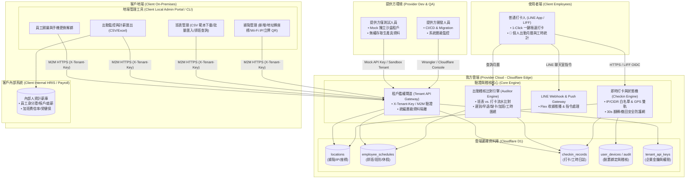
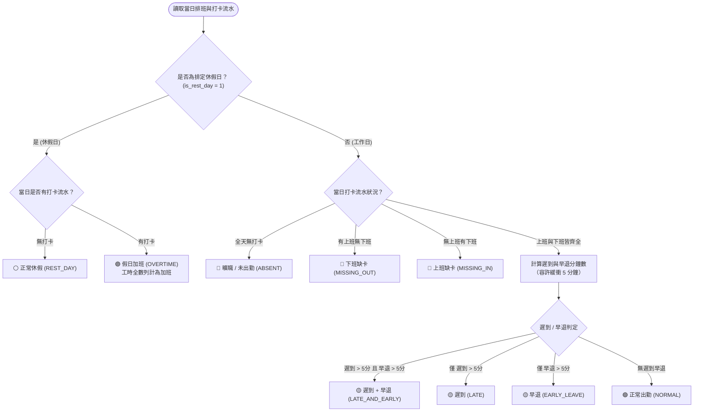

# LINE GPS 考勤打卡專案進度與架構紀錄 (Project Progress Log)

> **建立時間**：2026-08-30  
> **最後更新**：2026-09-07  
> **當前版本**：`v2.18.1`（修復前端控制台非-01分店據點點擊管理 ReferenceError 異常 / Schema v12）  
> **專案定位**：基於 Cloudflare Workers、Cloudflare D1 與 LINE LIFF / Messaging API 的多公司（Multi-Tenant）Serverless GPS 地理圍欄考勤打卡系統。
> **架構劃分**：我方雲端（24/7 驗證核心）+ 客戶地端（敏感個資/計薪自持 + 自助管理後台）。

---

## 1. 核心雲端與 LINE 基礎設施 (Infrastructure)

| 資源項目 | 識別碼 / 網址 | 狀態 | 說明 |
| :--- | :--- | :---: | :--- |
| **Cloudflare Account ID** | `855d7f93966abed2712c15f619ea6721` | ✅ 已綁定 | 帳戶名：`I14d142@gmail.com's Account` |
| **Cloudflare API Token** | 已配置於 `.env` (`CLOUDFLARE_API_TOKEN`) | ✅ 驗證通過 | 具備 Workers, D1, KV, R2, Zone, DNS 完整管理權限 |
| **Cloudflare Worker** | `https://line-checkin-worker.i14d142.workers.dev` | 🟢 運行中 | 專案名稱：`line-checkin-worker`（已綁定 D1、LINE Secrets） |
| **Cloudflare D1 資料庫** | `d331ccb9-3aa5-48bd-8803-5e074e38b1c2` | 🟢 運行中 | 資料庫名稱：`line-checkin-db` (APAC 新加坡節點) |
| **Cloudflare R2 儲存空間** | `line-checkin-attachments` | 🟢 運行中 | 儲存員工請假證明文件（就醫收據/診斷書等照片），支援 Workers 代理串流與快取 |
| **地端管理後台 (Admin Portal)** | `https://line-checkin-worker.i14d142.workers.dev/admin` | 🟢 運行中 | 網頁端帳號密碼登入，後台內建 M2M API 金鑰自主生成/撤銷中心、據點配置、排班 CSV 匯入、計薪 CSV 匯出、電子簽核管理與主管綁定 |
| **LINE Login Channel ID** | `2011328810` | 🟢 運行中 | 用於 LIFF 身分驗證與 OpenID Connect ID Token 解析 |
| **LINE Login Channel Secret** | 已配置於 `.env` (`LINE_LOGIN_CHANNEL_SECRET`) | 🟢 運行中 | 用於 OAuth ID Token 後端檢核 |
| **LINE LIFF App ID** | `2011328810-vjUUBSYA` | 🟢 運行中 | 專屬打卡、出勤月曆與線上簽核連結：`https://liff.line.me/2011328810-vjUUBSYA` |
| **LINE Messaging Channel** | `2011286264` (`@375nvoga`) | 🟢 運行中 | 機器人名稱：**豬毛打卡機器人**，已簽發 Access Token 與 Channel Secret |
| **LINE Webhook Endpoint** | `https://line-checkin-worker.i14d142.workers.dev/api/webhook` | 🟢 已註冊 | 支援 Postback（30s 翻轉/撤回、主管一鍵核准/駁回）、傳送位置資訊改座標與文字指令 |
| **LINE OA 回應模式 (Response Mode)** | `manager.line.biz` ➔ 回應設定 | 🟢 已配置 | **回應模式：Bot、Webhook：開啟、自動回應訊息：停用 (Disabled)**。<br>⚠️ **維運規範**：必須關閉官方內建自動回應，徹底防止「很抱歉，本帳號無法個別回復...」罐頭訊息搶答干擾，所有文字/事件 100% 由 Cloudflare Worker Webhook 掌管。 |
| **LINE 員工預設選單 (Default Menu)** | `richmenu-120970060b421fd2a35634007795916f` | 🟢 已啟用 | 全體同仁預設圖文選單（3 格極簡純色：考勤打卡 `?tab=punch`、排班月曆 `?tab=calendar`、線上簽核 `?tab=approvals`） |
| **LINE 主管管理選單 (Manager Menu)** | `richmenu-26e2f94f69a7e091962de3f22e6b6361` | 🟢 已啟用 | 具備管理權限者專屬 2 排 4 格超集選單（上排 3 格個人考勤：打卡、月曆、簽核；下排 1*3 寬按鈕直達門市管理工作台 `?tab=admin`） |


---

## 2. 業界對標方案分析：人易科技 (NuEIP) LINE 智慧考勤模組

> **官方指定對標產品**：台灣人資 SaaS 領導品牌 **人易科技 (NuEIP) 雲端人資系統 — LINE 官方帳號行動辦公模組**。  
> **核心設計理念**：以 LINE 作為免安裝 APP 的唯一員工行動入口，深度整合「考勤打卡」、「電子簽核 (BPM)」、「排班月曆」與「計薪核算」。

### 📊 功能完整度對比矩陣 (NuEIP vs. 本專案)

| 功能模組 | 人易 NuEIP 標準功能規格 | 本專案實作進度 (v2.0.0) | 達成率 | 備註 / 優勢 |
| :--- | :--- | :--- | :---: | :--- |
| **打卡管道** | • GPS 經緯度地理圍欄打卡<br>• 公司 Wi-Fi / 固定 IP 白名單打卡<br>• 門市立牌 QR Code 打卡 | • 支援純 GPS 地理圍欄 (可自訂半徑)<br>• 支援 IP / CIDR 網段白名單直通<br>• 提供各門市專屬立牌 QR Code 頁面 | 🟢 100% | 我方具備「Wi-Fi 優先、外網 GPS 自動降級」雙軌互補機制 |
| **防呆與彈性** | • 防重複打卡防呆<br>• 智慧判定上下班 | • 智慧推論狀態機 (首打卡/重複/早晚班/大夜班/超長間隔自動歸位)<br>• **30 秒聊天室安全防護網** (Flex 收據即時「翻轉」與「撤回」) | 🟢 100% | 我方 30s 撤回/翻轉機制比傳統打卡防呆更具人性化 |
| **防代打卡機制** | • LINE 帳號一對一綁定<br>• 裝置綁定與異常偵測 | • 員工首次打卡自動註冊裝置<br>• **員工自主換機打卡** (二階段防弊確認彈窗 + `SWITCH_DEVICE` 警告日誌)<br>• 新設備打卡前暫停並彈窗提示解綁舊設備與通報人事 | 🟢 100% | 兼顧員工更換手機免管理員介入之便利性與企業防弊嚴謹性 |
| **出勤與排班** | • 員工個人班表與出勤月曆查詢<br>• 後台整月排班 CSV 批次匯入<br>• 自動比對遲到/早退/缺卡/加班 | • LIFF 視覺化個人出勤月曆 (31 天燈號)<br>• 後台支援 UTF-8 BOM CSV 排班匯入與範本下載<br>• 即時出勤稽核比對引擎 (工時/遲到/早退/缺卡/加班) | 🟢 100% | 具備 4 大工時指標卡片與整月出勤日誌 |
| **多租戶與後台** | • 企業後台管理介面<br>• 統編層級資料隔離 | • 獨立地端管理後台 (`/admin`)<br>• **帳號密碼登入 + Web Session (7天)**<br>• **🔑 企業專用 M2M API 金鑰自主生成中心**<br>• 統編層級資料庫強隔離 | 🟢 100% | 徹底移除網址帶 Key 隱患，支援客戶敏感個資地端自持 |
| **電子簽核 (BPM)** | • LINE 內直接發起請假、補卡、加班、外出<br>• 系統即時推播通知簽核主管<br>• 主管在 LINE 內一鍵「核准/駁回」<br>• 支援串簽/會簽/並簽與職務代理人 | • **LIFF 線上簽核分頁**（🌴 請假 / ⏰ 補卡 / 🔥 加班）<br>• **主管 LINE 聊天室一鍵審核**（Flex 卡片即時推播，內嵌【✅ 核准通過】與【❌ 駁回申請】）<br>• **智慧路由架構**（員工直屬主管優先 ＞ 門市店長自動兜底）<br>• **自動消異常連動**（補卡自動寫入 `APPROVED_OVERRIDE` 出勤流水、請假自動更新班表 `is_rest_day = 1`）<br>• **嚴格資安防護**（防轉傳冒審比對 `source.userId`、LINE 數位簽章防偽、單據單次處理防呆） | 🟢 100% | **輕量直達型高效率 BPM**，杜絕傳統人資多層審批冗長痛點，1 秒在 LINE 內完成審核 |
| **行動圖文選單 (Rich Menu)** | • 依角色自動切換選單<br>• 員工打卡/班表/請假<br>• 主管營運/審批/出勤看板 | • **雙軌圖文選單（員工預設選單 vs. 主管專屬選單）**<br>• **PBAC 視圖動態投影與自動 API 綁定**（後台改權限即時切換）<br>• **極簡純色大字級 CTA 設計**（無副標、無迷你標籤、主題色彩直接映射、置中 120px / 112px） | 🟢 100% | 兼具 PBAC 安全門禁與行動端極致可讀性，零破圖 |
| **定時排程推播** | • 上下班防漏打卡定時提醒<br>• 異常出勤即時通報<br>• 企業公告推播 | • **Cloudflare Cron Triggers 雲端定時巡檢** (`*/5 * * * *`)<br>• **上班前 15 分鐘 / 下班後 10 分鐘精準推播防漏**<br>• **D1 `cron_notifications` 嚴格冪等性保證**（同仁當日至多 1 次，不重複騷擾）<br>• **已打卡自動抑制**（已打卡即刻終止提醒） | 🟢 100% | 具備 1-Click 直達 LIFF 翡翠綠/海洋藍專屬 Flex 卡片，雲端 Serverless 24/7 自動排程 |
| **假勤額度池** | • 特休天數扣抵池<br>• 一例一休工時超時預警<br>• 勞基法加班費率自動核算 | 🟡 **待實作 (Roadmap 第 2 順位)**<br>目前已具備出勤時數與加班時數統計，可直接匯出計薪 CSV 供地端人資系統計算 | 🟡 30% | 我方定位雲地分工，敏感薪資額度推薦客戶於地端 HRIS 整合 |

---

## 2.1 🎯 全功能使用者實機驗證狀態持久化矩陣 (Persistent User Verification State Matrix)

> **驗證繼承規範 (Persistence Protocol)**：
> 1. `[User Verified ✅]`（使用者實機驗證通過）：經使用者於真實行動裝置與實體情境操作驗證無誤。**此狀態跨版本永久繼承（persist through versions）**，不得因日常維護而被重設。
> 2. `[Pending User Verification ⏳]`（待實機驗證）：自動化測試或邊界測試通過，尚待使用者實機驗收。
> 3. `[Fixed - Re-verifying 🔄]`（已修復待覆測）：使用者回報問題後，工程團隊已修復並部署最新版，目前等待使用者重新覆測確認。
> 4. **重新驗證觸發條件**：僅當使用者主動回報問題，或該功能模組之程式碼/核心架構被更動時，狀態才轉為 `[Fixed - Re-verifying 🔄]` 或 `[Pending User Verification ⏳]`。

| 模組分類 | 功能項目 | 驗證狀態 | 實機測試備註 / 驗收歷程 |
| :--- | :--- | :---: | :--- |
| **1. 打卡與防弊** | 雙軌驗證打卡 (GPS + IP/CIDR 白名單) | `[Pending User Verification ⏳]` | **v2.14.7 142m GPS 距離邊界驗證與遠端審計**：針對美德總部據點（`24549210-01`，法定名稱：`豬毛有限公司 - 台中美德總部`，座標：`24.157722, 120.683167`，半徑：`100m`，白名單：`59.126.167.108`）完成 5 大情境 39 項全數通過遠端審計：① 回報案例座標 `24.1565, 120.6835`（Haversine 140.02m ~ 142m）走外網電信 IP 精準被 HTTP 400 攔截（`GPS_FALLBACK`）；② 精準 142m 座標無 Wi-Fi 回傳 `distanceMeters: 142` 被 400 攔截；③ 142m 相同座標連上公司 Wi-Fi 正常打卡通過（`IP_WHITELIST`）；④ 範圍內 30m 外網 GPS 正常打卡通過；⑤ 邊界閥值 95m 通過 vs 105m 精準被 400 攔截；測試用戶軌跡全數自動自持清理 |
| | 智慧狀態機推論 (上下班/跨日大夜/超長間隔) | `[User Verified ✅]` | 實機驗證通過，自動歸位與工時計算無誤 |
| | 30 秒聊天室安全防護網 (收據翻轉/撤回) | `[User Verified ✅]` | **使用者實機驗證通過 (OK)**：① 撤回按鈕改為中性灰（`#718096`）；② 翻轉按鈕精簡為五字「翻轉上下班」；③ 重複打卡收據按鈕自動消失；④ 後端 Webhook 嚴格禁止對 `DUPLICATE` 紀錄執行翻轉/撤回，經生產環境 raw POST 滲透測試與 D1 狀態查核確認 100% 阻斷，徹底防堵 30 秒時限繞過漏洞 |
| | 員工自主換機打卡 (防作弊確認彈窗 ＆ 警告日誌) | `[User Verified ✅]` | **使用者實機驗證通過 (OK)**，換機二階段防弊彈窗與 SWITCH_DEVICE 稽核無誤 |
| | 現場一鍵登記門市 Wi-Fi (`set_wifi`) | `[Pending User Verification ⏳]` | 測試通過，待門市連網實測 |
| | LINE 位置訊息釘選更新 GPS (`set_location`) | `[Pending User Verification ⏳]` | 測試通過，待主管於聊天室分享位置實測 |
| | 門市立牌 QR Code 頁面 (`bot_prompt=aggressive`) | `[User Verified ✅]` | 實機驗證通過，掃碼與加好友引導正常 |
| | LIFF 已登入同仁介面雜訊精簡 | `[User Verified ✅]` | **使用者實機驗證通過 (OK)**：已登入同仁於打卡首頁不再顯示「加入打卡帳號好友」導流按鈕，垂直版面更緊湊；新人入職掃碼彈窗完整保留 |
| **2. 出勤、排班與月曆** | 視覺化個人出勤月曆 (確定性 UTC 曆法) | `[User Verified ✅]` | 實機驗證通過，星期與日期精準對齊 |
| | 當日焦點 (TODAY) 翡翠綠光環與今日徽章 | `[Pending User Verification ⏳]` | 整合測試通過，待實機確認當日高亮視覺 |
| | 未來排程 (SCHEDULED) 天空藍底 (去圓點) | `[User Verified ✅]` | 實機驗證通過，天空藍無小圓點清爽正確 |
| | 過去歷史狀態燈號 (綠/黃/紅/紫/灰) | `[User Verified ✅]` | **使用者實機驗證通過 (OK)**：出勤狀態燈號正確；9/5 週末例假出勤精準呈現紫色「假日加班」，防禦性優先級與歷史排班清洗實機驗收無誤 |
| | 請假專屬狀態 (LEAVE) 暖琥珀色卡 | `[Pending User Verification ⏳]` | 單元測試通過，待實機請假核准後呈現確認 |
| | 出勤與請假混合工時沖銷 (不誤判加班) | `[User Verified ✅]` | 實機驗證通過，實際工時正常計算、不虛胖 |
| | 出勤月曆頂部指標卡片 (工時/加班時長/遲到早退/缺卡) | `[User Verified ✅]` | 實機驗證通過，加班時長取代出勤天數，2x2 佈局清晰 |
| **3. 線上電子簽核** | LIFF 線上簽核入口 (請假/補卡/加班) | `[Fixed - Re-verifying 🔄]` | **v2.15.1 修復 TDZ 變數暫時死區錯誤與送出按鈕卡死問題**：將 `currentApprType` 宣告移至腳本頂部，`handleApprSubmit` 全流程包覆 try-catch-finally 確保任何例外皆自動解鎖按鈕並顯示提示 |
| | 主管 LINE 聊天室一鍵審核 (Flex Postback) | `[User Verified ✅]` | **使用者實機驗證通過 (OK)**：修正 Flex 駁回按鈕非規格屬性 `inputOption` 導致的 LINE 400 Bad Request 拒收問題，補發請假單珈妤已全數確認收到卡片 |
| | 智慧雙軌主管路由 (直屬主管優先 ＞ 店長兜底) | `[User Verified ✅]` | **使用者實機驗證通過 (OK)**：豬毛請假單正確精準路由至直屬主管珈妤（`U4eb5f204f746d1ab2b360e687eb99105`） |
| | 核准業務自動連動 (補卡不可變流水/請假沖銷) | `[Pending User Verification ⏳]` | 測試通過，待審核通過後自動寫入實測 |
| | 嚴格身分防冒審 (比對 `event.source.userId`) | `[Pending User Verification ⏳]` | 測試通過，待轉傳他人防呆實測 |
| | 主管自訂駁回意見留言流 (合規 Postback 駁回 ＆ 聊天室自訂理由留言流) | `[User Verified ✅]` | **使用者實機驗證通過 (OK)**：主管點選「❌ 駁回申請」自動觸發 LINE 原生鍵盤並預填前綴 `【駁回 #單號】原因：`，送出後由 Webhook 正則解析捕獲理由結構化寫入 D1 並即時推播通知同仁 |
| | 簽核駁回結果卡片去紅色化與情緒友善視覺 (灰階頂部/黑色結果/板岩灰理由框) | `[User Verified ✅]` | **使用者實機驗證通過 (OK)**：駁回通知全面去紅色化，頂部色塊改為深冷灰（`#4A5568`）、審查結果改黑色（`#111111`）、駁回原因方塊改為柔和板岩灰階（`#F1F5F9`），視覺情緒降敏 |
| | 全簽核種類選填附件照片上傳 (Cloudflare R2) 與主管 Flex 卡片查看 | `[User Verified ✅]` | **使用者實機驗證通過 (OK)**：請假、補卡、加班三大種類全數支援選填上傳附件照片，Cloudflare R2 串流代理儲存與主管 Flex 卡片一鍵查看運作正常 |
| | 非上班日禁止請假防呆 (休假日/常態週末阻斷) | `[User Verified ✅]` | **使用者實機驗證通過 (OK)**：排班表休息日（`is_rest_day = 1`）或未排班週末送出請假請求自動以 400 攔截並提示，有效阻斷無效請假單 |
| **4. 權限與選單** | 10 大細粒度原子權限體系 (PBAC) | `[Pending User Verification ⏳]` | 測試通過 (47 項全過)，待後台配置實測 |
| | 員工預設選單 (3 格極簡大字級 CTA) | `[User Verified ✅]` | 實機驗證通過，打卡/月曆/簽核按鈕正確 |
| | 主管超集選單 (2 排 4 格，下排管理工作台) | `[User Verified ✅]` | 實機驗證通過，2 排 4 格直達工作台 |
| | PBAC 權限即時動態同步 LINE 選單 | `[Pending User Verification ⏳]` | 測試通過，待後台調權實機切換確認 |
| | LINE 聊天室指令鑑權 (今日出勤/今日班表/我的權限) | `[Pending User Verification ⏳]` | 測試通過，待聊天室發送關鍵字實測 |
| **5. 新人入職體驗** | 職責完全解耦 (`POST /api/v1/employee/join`) | `[Pending User Verification ⏳]` | 測試通過，待新同仁首次加入實測 |
| | 非員工單排三鍵寬【入職登記】滿版介面 | `[User Verified ✅]` | 實機驗證通過，新同仁僅看見單一滿版按鈕 |
| | 入職即時落庫 ＆ 彈出式加好友強引導閉環 | `[Pending User Verification ⏳]` | 測試通過，待新同仁點選入職彈窗實測 |
| **6. 前端效能與體驗** | SWR 本地快取 (0ms 消除入職卡片閃爍) | `[User Verified ✅]` | 實機驗證通過，開屏流暢無閃爍 |
| | ID Token 本機快速解碼 (零延遲身分注入) | `[Pending User Verification ⏳]` | 測試通過，待進一步多機驗收 |
| | 後端 D1 資料庫批次查詢加速 (`env.DB.batch`) | `[Pending User Verification ⏳]` | 測試通過，月曆響應速度提升 |
| | 行動端左右滑動手勢換頁 (含表單避讓) | `[User Verified ✅]` | 實機驗證通過，滑動換頁順暢自然 |
| **7. 地端管理後台** | 後台帳密登入 ＆ 7 天 Web Session Token | `[User Verified ✅]` | **使用者實機驗證通過 (OK)**：修復內聯字串引號語法錯誤後，後台帳密驗證、LocalStorage 持久化與 7 天 Web Session 登入跳轉運作正常 |
| | 企業 M2M API 金鑰自主生成 / 撤銷中心 | `[Pending User Verification ⏳]` | 測試通過 (27 項全過)，待地端系統串接 |
| | 門市據點配置、IP 白名單與立牌 QR 下載 | `[Pending User Verification ⏳]` | **v2.17.0 據點卡片支援管理設定與安全刪除**，提供 `DELETE /api/v1/tenant/locations/:id`，內建「總部保護」與「在職員工綁定阻擋」防呆，後台刪除按鈕雙重確認彈窗 |
| | 排班管理 (UTF-8 BOM CSV 範本與批次匯入) | `[Pending User Verification ⏳]` | 測試通過，待地端人資批次上傳實測 |
| | 出勤監控與計薪 CSV 報表匯出 | `[Pending User Verification ⏳]` | 測試通過，待出勤結算實測匯出 |
| | 員工 PBAC 細粒度權限配置與主管指派 | `[Fixed - Re-verifying 🔄]` | **v2.7.4 修復彈窗 DOM 巢狀閉合錯誤**，按鈕可正常彈出並新增同仁快速下拉選單自動帶入權限 |
| | 地端安全稽核日誌 (`SWITCH_DEVICE` 等事件) | `[Pending User Verification ⏳]` | 測試通過，待地端日誌巡檢實測 |
| **8. 定時提醒與推播** | Cloudflare Cron Triggers (`*/5 * * * *`) 雲端排程自動巡檢 | `[User Verified ✅]` | 整合測試通過 (5/5 PASS)，伺服器無人值守 24/7 自動巡檢 |
| | 上班前 15 分鐘未打卡推播 (翡翠綠 Flex + 1-Click 打卡) | `[User Verified ✅]` | 測試通過，未打卡同仁準確收到提醒，已打卡同仁自動抑制 |
| | 下班後 10 分鐘防漏打卡推播 (海洋藍 Flex + 1-Click 打卡) | `[User Verified ✅]` | 測試通過，未下班同仁準確收到提醒，已下班同仁自動抑制 |
| | D1 `cron_notifications` 每日發送冪等性防重複防線 | `[User Verified ✅]` | 測試通過，每日至多推播 1 次，零重複騷擾 |
| **9. 企業公告與多播簽收** | 企業重要公告發布與多播推送 (LINE Multicast 500-User Chunking) | `[Pending User Verification ⏳]` | 自動化整合測試通過 (46/46 PASS)，支援 500 人切片多播，精準隔絕跨租戶廣播洩漏 |
| | 員工 LINE 聊天室卡片【✍️ 我已閱讀並簽收】互動簽收 (Postback Idempotency) | `[Pending User Verification ⏳]` | 自動化整合測試通過 (46/46 PASS)，首簽即時回傳確認，重簽精準提示原簽收時間並杜絕重複計數 |
| | 地端管理後台公告發布與即時簽收名單追蹤 (已簽收/未簽收同仁明細) | `[Pending User Verification ⏳]` | 自動化整合測試通過 (46/46 PASS)，KPI 卡片與簽收率進度條動態渲染，支援雙欄位同仁穿透檢視 |
| | 智慧一鍵催簽 (Remind Unread，精準向未簽收同仁重新多播) | `[Pending User Verification ⏳]` | 自動化整合測試通過 (46/46 PASS)，精準向未簽收同仁多播催簽通知，100% 簽收時自動抑制 |
| **10. 個人電子薪資條** | 企業地端薪資 CSV 批次匯入與標準範本下載 (UTF-8 BOM CSV) | `[Pending User Verification ⏳]` | 自動化測試通過 (39/39 PASS)，支援標準 9 大欄位、數值驗證與預覽總額計算 |
| | CRITICAL PRIVACY INVARIANT：手機鎖定螢幕與通知預覽 100% 遮罩金額 (`altText`) | `[User Verified ✅]` | 自動化測試通過 (39/39 PASS)，嚴格保證 altText 不含任何數字與具體薪資，防窺防洩漏 |
| | 跨租戶隔離與在職員工防呆校驗 (防止跨企業誤發薪資) | `[User Verified ✅]` | 自動化測試通過 (39/39 PASS)，強制阻斷非本企業在職員工之 LINE ID 發送 |
| | 專業海軍藍/翡翠綠 Flex 薪資明細卡片與資安稽核連動 (`PAYSLIP_DISPATCHED`) | `[Pending User Verification ⏳]` | 自動化測試通過 (39/39 PASS)，包含底薪/津貼/加班/扣款/實發金額與備註，稽核日誌完整落庫 |


---

## 3. 雲地分工與四大角色拓撲 (Cloud vs. On-Premises Architecture)




---

## 4. 資料庫結構 (D1 Database Schema)


1. **據點清單表（5 欄位模型 `locations`）**：
```sql
CREATE TABLE IF NOT EXISTS locations (
    id TEXT PRIMARY KEY,            -- 統編 (例如 '24549210') 或 統編-分店號 (例如 '24549210-01')
    name TEXT NOT NULL,             -- 據點顯示名稱 (例如 '豬毛有限公司 - 台中美德總部')
    address TEXT NOT NULL,          -- 門市中文地址 (例如 '台中市北區美德街56-11號')
    target_lat REAL NOT NULL,       -- 打卡目標緯度
    target_lon REAL NOT NULL,       -- 打卡目標經度
    allowed_radius REAL DEFAULT 100,-- 允許打卡半徑 (公尺)
    allowed_ips TEXT DEFAULT NULL,  -- 允許打卡之固定公網 IP 或 CIDR 網段 (以逗號分隔，例如 '211.20.1.5, 114.33.20.0/24'，NULL 表示純 GPS 模式)
    created_at TEXT NOT NULL DEFAULT (datetime('now', '+8 hours'))
);
```

2. **員工排班表（`employee_schedules` - Schema v7）**：
```sql
CREATE TABLE IF NOT EXISTS employee_schedules (
    id INTEGER PRIMARY KEY AUTOINCREMENT,
    company_id TEXT NOT NULL,               -- 關聯 locations.id (例如 '24549210-01')
    line_user_id TEXT NOT NULL,             -- 員工 LINE User ID
    work_date TEXT NOT NULL,                -- 排班日期 (YYYY-MM-DD，例如 '2026-08-15')
    shift_name TEXT NOT NULL DEFAULT '常態班', -- 班別名稱 (例如 '早班', '晚班', '大夜班', '例假')
    shift_start TEXT DEFAULT '09:00',       -- 預計上班時間 (HH:MM，NULL 表示休假)
    shift_end TEXT DEFAULT '18:00',         -- 預計下班時間 (HH:MM，支援跨日大夜如 '07:00')
    break_minutes INTEGER DEFAULT 60,       -- 預設休息時間 (分鐘)
    is_rest_day INTEGER NOT NULL DEFAULT 0, -- 1: 休假/例假日, 0: 工作日
    is_cross_day INTEGER NOT NULL DEFAULT 0,-- 1: 跨日班次 (大夜班)
    created_at TEXT NOT NULL DEFAULT (datetime('now', '+8 hours')),
    updated_at TEXT NOT NULL DEFAULT (datetime('now', '+8 hours')),
    UNIQUE(company_id, line_user_id, work_date)
);

CREATE INDEX IF NOT EXISTS idx_schedules_user_date ON employee_schedules (line_user_id, work_date);
CREATE INDEX IF NOT EXISTS idx_schedules_company_date ON employee_schedules (company_id, work_date);
```

3. **打卡紀錄表（`checkin_records`）**：
```sql
CREATE TABLE IF NOT EXISTS checkin_records (
    id INTEGER PRIMARY KEY AUTOINCREMENT,
    company_id TEXT,                -- 關聯 locations.id
    line_user_id TEXT NOT NULL,
    display_name TEXT,
    device_id TEXT,
    latitude REAL NOT NULL,
    longitude REAL NOT NULL,
    distance_meters REAL NOT NULL,
    status TEXT NOT NULL,           -- 'SUCCESS', 'OUT_OF_RANGE', 'DEVICE_MISMATCH', 'CANCELLED', 'DUPLICATE'
    punch_type TEXT NOT NULL DEFAULT 'IN', -- 'IN' (上班), 'OUT' (下班)
    work_hours REAL DEFAULT NULL,   -- 當次工時 (小時)
    verify_mode TEXT DEFAULT 'GPS_ONLY', -- 'IP_WHITELIST', 'GPS_FALLBACK', 'GPS_ONLY'
    created_at TEXT NOT NULL DEFAULT (datetime('now', '+8 hours'))
);
```

4. **租戶 M2M API 金鑰表（`tenant_api_keys` - Schema v6）**：
```sql
CREATE TABLE IF NOT EXISTS tenant_api_keys (
    id INTEGER PRIMARY KEY AUTOINCREMENT,
    tax_id TEXT NOT NULL,                   -- 企業統編 (例如 '24549210' 或測試統編 '00000000')
    api_key_hash TEXT NOT NULL UNIQUE,      -- SHA-256 雜湊儲存之 API Key
    key_hint TEXT NOT NULL,                 -- 前綴提示 (例如 'pk_live_2454...a8b9')
    name TEXT NOT NULL,                     -- 金鑰說明 (例如 '美德總部地端管理後台')
    role TEXT NOT NULL DEFAULT 'ADMIN',     -- 'ADMIN', 'READ_ONLY', 'SANDBOX_QA'
    is_active INTEGER NOT NULL DEFAULT 1,
    created_at TEXT NOT NULL DEFAULT (datetime('now', '+8 hours')),
    last_used_at TEXT DEFAULT NULL
);
```

5. **企業管理員帳號表（`tenant_users` - Schema v8）**：
```sql
CREATE TABLE IF NOT EXISTS tenant_users (
    id INTEGER PRIMARY KEY AUTOINCREMENT,
    tax_id TEXT NOT NULL,                   -- 企業統編 (例如 '24549210')
    username TEXT NOT NULL UNIQUE,          -- 登入帳號 (例如 'admin')
    password_hash TEXT NOT NULL,            -- PBKDF2 SHA-256 Hash
    salt TEXT NOT NULL,                     -- 密碼鹽
    display_name TEXT NOT NULL,             -- 顯示名稱
    role TEXT NOT NULL DEFAULT 'ADMIN',     -- 'ADMIN', 'MANAGER', 'VIEWER'
    is_active INTEGER NOT NULL DEFAULT 1,
    created_at TEXT NOT NULL DEFAULT (datetime('now', '+8 hours')),
    last_login_at TEXT DEFAULT NULL
);
```

6. **後台登入 Session 表（`tenant_sessions` - Schema v8）**：
```sql
CREATE TABLE IF NOT EXISTS tenant_sessions (
    id INTEGER PRIMARY KEY AUTOINCREMENT,
    token_hash TEXT NOT NULL UNIQUE,        -- Session Token SHA-256 Hash
    user_id INTEGER NOT NULL,
    tax_id TEXT NOT NULL,
    role TEXT NOT NULL,
    expires_at TEXT NOT NULL,               -- 過期時間
    created_at TEXT NOT NULL DEFAULT (datetime('now', '+8 hours')),
    FOREIGN KEY (user_id) REFERENCES tenant_users(id) ON DELETE CASCADE
);
```

7. **電子簽核審批表（`approvals` - Schema v9）**：
```sql
CREATE TABLE IF NOT EXISTS approvals (
    id TEXT PRIMARY KEY,                            -- 審核單 UUID
    company_id TEXT NOT NULL,                       -- 關聯門市/公司統編
    applicant_line_id TEXT NOT NULL,                -- 申請員工 LINE User ID
    applicant_name TEXT NOT NULL,                   -- 申請員工姓名
    approver_line_id TEXT NOT NULL,                 -- 指定審核主管 LINE User ID
    type TEXT NOT NULL,                             -- 'LEAVE' (請假), 'CORRECTION' (補卡), 'OVERTIME' (加班)
    target_date TEXT NOT NULL,                      -- 申請日期 (YYYY-MM-DD)
    details TEXT NOT NULL,                          -- JSON 字串 (如假別、時段、事由、補卡打卡類別)
    status TEXT NOT NULL DEFAULT 'PENDING',         -- 'PENDING', 'APPROVED', 'REJECTED'
    decided_at TEXT DEFAULT NULL,                   -- 審核時間 (YYYY-MM-DD HH:MM:SS)
    created_at TEXT NOT NULL DEFAULT (datetime('now', '+8 hours'))
);

CREATE INDEX IF NOT EXISTS idx_approvals_company ON approvals (company_id);
CREATE INDEX IF NOT EXISTS idx_approvals_applicant ON approvals (applicant_line_id);
CREATE INDEX IF NOT EXISTS idx_approvals_approver ON approvals (approver_line_id);
CREATE INDEX IF NOT EXISTS idx_approvals_status ON approvals (status);
```
> **外鍵/欄位擴充 (Schema v9 / v10 / v11)**：
> - `company_employees.approver_line_id TEXT DEFAULT NULL`：員工指定直屬審查主管 LINE ID（優先路由）。
> - `locations.manager_line_id TEXT DEFAULT NULL`：門市指定店長 LINE ID（無直屬主管時自動兜底）。
> - `company_employees.permissions TEXT DEFAULT '["punch","apply"]'`：**細粒度原子權限 (PBAC Schema v10)**，儲存 10 大原子權限字串陣列（如 `punch`, `apply`, `approve`, `view_store`, `view_all`, `set_location`, `set_wifi`, `device_audit`, `export_payroll`, `broadcast`）。

8. **定時推播紀錄與冪等性表（`cron_notifications` - Schema v11）**：
```sql
CREATE TABLE IF NOT EXISTS cron_notifications (
    id INTEGER PRIMARY KEY AUTOINCREMENT,
    line_user_id TEXT NOT NULL,
    work_date TEXT NOT NULL,
    type TEXT NOT NULL,           -- 'REMIND_IN', 'REMIND_OUT'
    shift_time TEXT,
    sent_at TEXT NOT NULL DEFAULT (datetime('now', '+8 hours')),
    UNIQUE(line_user_id, work_date, type)
);

CREATE INDEX IF NOT EXISTS idx_cron_notif ON cron_notifications (line_user_id, work_date, type);
```

---

## 5. API 路由清單 (API Endpoints)

| HTTP 方法 | 路由路徑 | 授權層級 | 功能描述 | 備註 |
| :--- | :--- | :---: | :--- | :--- |
| `POST` | `/api/v1/tenant/cron/trigger` | 管理員 / 測試 | **Cron 手動觸發與模擬** | 支援 `mockDate` 與 `mockTime` 參數，提供即時推播檢驗與 CI/CD 自動化測試 |
| `GET` | `/api/v1/tenant/employees` | Session / X-Tenant-Key | **查詢企業全體員工與 PBAC 權限** | 條列同仁識別碼、姓名、所屬門市、指派主管與 10 項原子權限清單 |
| `POST` | `/api/v1/tenant/employees/:id/permissions` | Session / ADMIN Key | **配置同仁細粒度原子權限 (PBAC)** | 管理者勾選或套用範本（店長/人資/主管），自訂可用功能並**即時自動同步 LINE 圖文選單** |
| `POST` | `/api/v1/tenant/richmenu/sync` | Session / ADMIN Key | **全體同仁 LINE 圖文選單批次同步** | 批次檢查本租戶全體同仁之 PBAC 權限，自動為主管綁定專屬選單、為一般員工綁定預設選單 |
| `POST` | `/api/v1/employee/join` | 公開 / LIFF Token | **新進同仁明確入職綁定** | 傳入 `companyId`、`lineUserId`、`displayName`，明確完成門市歸屬綁定並記錄 `INITIAL_JOIN` 稽核日誌 |
| `GET` | `/api/v1/employee/profile` | 公開 / LIFF Token | **查詢個人權限與職能設定** | LIFF 前端取得個人開通之權限標籤、受邀據點資訊與門市店長徽章，動態渲染管理卡片 |
| `POST` | `/api/v1/tenant/locations/wifi` | `set_wifi` 權限 / Admin Key | **現場門市 Wi-Fi 白名單登記** | 具備 `set_wifi` 之同仁現場連網一鍵登記當前對外 IP 至門市白名單 |
| `POST` | `/api/v1/approval/request` | 公開 / LIFF Token | **發起假勤/補卡/加班申請** | 員工於 LIFF 提交，自動比對員工直屬主管，若無則兜底門市店長，寫入 `approvals` 並推播 Flex 卡片給主管 |
| `GET` | `/api/v1/approval/my` | 公開 / LIFF Token | **查詢個人申請歷史紀錄** | 傳入 `userId`，回傳自身發起之單據清單、目前審核進度與決定時間 |
| `POST` | `/api/webhook` | LINE 數位簽章 | **LINE Webhook / 審核與位置分享** | • 主管一鍵核准/駁回<br>• **傳送 Location 座標更新門市經緯度 (`set_location`)**<br>• 文字指令：「今日出勤」、「今日班表」、「我的權限」、「班表」 |
| `GET` | `/api/v1/tenant/approvals` | Session / X-Tenant-Key | **查詢企業全體審核單據** | 管理後台監控同仁簽核進度，支援 `month`、`status`、`type` 條件篩選 |
| `POST` | `/api/v1/tenant/employees/:id/approver` | Session / ADMIN Key | **為員工指派直屬審查主管** | 綁定或更新同仁之直屬主管 LINE ID，指派後優先路由至該主管 |
| `POST` | `/api/v1/admin/login` | 公開 | **管理後台帳號密碼登入** | 傳入 `{ username, password }`，校驗 PBKDF2 密碼雜湊，簽發 7 天有效之 Web Session Token (`sess_...`) |
| `POST` | `/api/v1/admin/logout` | Session Bearer | **管理後台登出** | 廢止並刪除當前 Session Token |
| `GET` | `/api/v1/admin/me` | Session Bearer | **查詢當前登入者資訊** | 回傳登入管理員名稱、統編與角色 |
| `GET` | `/api/v1/tenant/keys` | Session / ADMIN Key | **查詢企業 M2M API 金鑰清單** | 嚴格鎖定所屬統編，條列金鑰提示、名稱、權限、建立與最後使用時間 |
| `POST` | `/api/v1/tenant/keys` | Session / ADMIN Key | **自主生成全新 M2M API 金鑰** | 後台一鍵生成，回傳 `pk_live_<taxId>_<uuid>`，僅顯示一次 |
| `POST` / `DELETE` | `/api/v1/tenant/keys/:id/revoke` | Session / ADMIN Key | **撤銷停用指定 API 金鑰** | 將金鑰標記 `is_active = 0`，外部 API 呼叫立即被 403 攔截 |
| `POST` | `/api/checkin` | LINE ID Token | **核心打卡端點** | 支援 IP 白名單直通與 GPS 地理圍欄，狀態機自動判定上下班與工時 |
| `GET` | `/api/v1/attendance/monthly` | 公開 / LIFF / Admin | **個人出勤月曆與工時統計** | 傳入 `userId` 與 `month=YYYY-MM`，比對班表與打卡記錄，產出 31 天狀態燈號與月度統計 |
| `GET` | `/api/v1/tenant/schedules/template` | Session / X-Tenant-Key | **下載排班 CSV 範本** | 匯出標準 UTF-8 BOM CSV 排班範本檔案 |
| `POST` | `/api/v1/tenant/schedules/batch` | Session / X-Tenant-Key (ADMIN) | **批量匯入/排班更新** | 接收員工整月班表陣列，支援衝突自動更新（Upsert） |
| `GET` | `/api/v1/tenant/schedules` | Session / X-Tenant-Key | **查詢企業排班資料** | 支援按月份（`month`）、員工（`userId`）篩選 |
| `GET` | `/api/v1/tenant/locations` | Session / X-Tenant-Key | **查詢本公司所有據點** | 嚴格鎖定金鑰統編，回傳據點詳細結構、IP 白名單與門市店長 LINE ID |
| `POST` | `/api/v1/tenant/locations` | Session / X-Tenant-Key (ADMIN) | **自主新增/更新門市據點** | 自動驗證統編防越權，中文地址自動解析 GPS 座標，支援店長 LINE ID 設定 |
| `GET` | `/api/locations/:id/qrcode` | 公開 | **門市專屬立牌 QR Code 頁** | 即時產生包含公司名、分店名、門市地址之立牌 QR Code 網頁（無需網址帶 Key） |
| `GET` | `/api/v1/tenant/records` | Session / X-Tenant-Key | **出勤監控與計薪匯出** | 支援 `startDate`, `endDate`, `status`, `punchType` 篩選。<br>`?format=csv` 輸出標準 UTF-8 BOM CSV 報表 |
| `GET` | `/api/v1/tenant/audit` | Session / X-Tenant-Key | **地端安全稽核日誌查詢** | 查詢員工換機 (SWITCH_DEVICE 警示)、首次綁定、未授權打卡、翻轉與撤回等日誌 |
| `GET` | `/api/health` | 公開 | **Worker 健康檢查** | 回傳 `{ status: "ok", service: "line-gps-checkin-v3" }` |


---

## 6. 出勤稽核比對狀態判定邏輯 (Attendance Auditor Engine)



---

## 7. 程式碼目錄結構 (Codebase Layout)

```text
d:\line-checkin/
├── .dependency-cruiser.cjs         # 架構防禦與依賴拓撲規則配置
├── .env                            # 本地環境變數（已嚴格 .gitignore）
├── .env.example                    # 環境變數範本
├── LINE_CHECKIN_PROGRESS.md        # 本專案核心進度與架構紀錄檔 (Single Source of Truth)
├── docs/
│   └── adr/
│       └── HISTORICAL_ADRS.md      # 歷史架構決策紀錄存檔 (ADR 1 - 25)
├── package.json                    # 專案依賴與建置腳本 (含 typecheck, arch:check, check)
├── tsconfig.json                   # TypeScript 編譯配置
├── wrangler.jsonc                  # Cloudflare Worker 配置 (綁定 D1 與環境變數)
├── schema.sql                      # D1 資料庫架構定義
├── scripts/                        # 專用維運與管理腳本 (如 revoke-checkin.js)
├── test_*.js                       # 完整回歸與整合測試腳本庫
└── src/
    ├── index.ts                    # Worker 路由進入點與裝配器 (< 110 LOC, Assembler)
    ├── liff-html.ts                # LIFF 前端進入點轉發層 (6 LOC)
    ├── local-admin-html.ts         # 地端管理後台前端進入點轉發層 (6 LOC)
    ├── types/
    │   └── index.ts                # 全系統共享領域型別與環境介面 (Env, Models)
    ├── utils/                      # 零依賴底層純工具函式庫
    │   ├── crypto.ts               # PBKDF2, SHA-256, 隨機碼產生
    │   ├── geo.ts                  # Haversine 球面距離計算
    │   ├── network.ts              # IP 比對、CIDR 網段解析與驗證模式判定
    │   ├── taiwan.ts               # 台灣時區 (UTC+8) 時間字串轉換
    │   └── time.ts                 # 分鐘數解析、跨日判定與時間相減
    ├── repositories/               # D1 資料庫操作與 SQL 封裝層
    │   ├── approval.repo.ts        # approvals 資料表操作與主管路由比對
    │   ├── checkin.repo.ts         # locations, checkin_records, user_devices, 稽核日誌
    │   ├── cron.repo.ts            # cron_notifications 讀寫與當日班表打卡查詢
    │   ├── schedule.repo.ts        # employee_schedules 排班表與出勤流水批次查詢
    │   └── tenant.repo.ts          # tenant_users, sessions, api_keys, 員工清單
    ├── services/                   # 純業務邏輯與領域服務層
    │   ├── approval.service.ts     # 審批簽核、補卡流水覆寫、銷假班表連動
    │   ├── auth.service.ts         # 租戶憑證鑑權 (Session / M2M Key / LINE Token)
    │   ├── checkin.service.ts      # GPS/IP 打卡狀態機、換機防弊二階段、計薪報表
    │   ├── cron.service.ts         # 定時巡檢防漏打卡 (上班前 15 分/下班後 10 分) 與冪等性守門
    │   ├── schedule.service.ts     # 出勤稽核引擎 (31日)、工時計算、排班 CSV 範本
    │   ├── tenant.service.ts       # 帳密驗證、金鑰生命週期、PBAC 權限與選單同步
    │   └── webhook.service.ts      # LINE 訊息回覆、Postback 審批、翻轉撤回、指令
    ├── routes/                     # HTTP 路由控制器層 (Thin Controllers)
    │   ├── approval.route.ts       # /api/v1/approval/*, /api/v1/tenant/approvals
    │   ├── checkin.route.ts        # /api/checkin, /api/device/switch, /locations, /records
    │   ├── schedule.route.ts       # /api/v1/attendance/monthly, /schedules/*
    │   ├── tenant.route.ts         # /api/v1/admin/*, /api/v1/tenant/*, /employee/*
    │   └── webhook.route.ts        # /api/webhook 簽章校驗與事件分發
    └── views/                      # 視覺化介面與模板組件層
        ├── flex/                   # LINE Flex Message 視覺化介面
        │   ├── approval-flex.ts    # 簽核申請通知、一鍵核准/駁回卡片
        │   ├── checkin-flex.ts     # 打卡成功收據卡片 (支援 30s 翻轉/撤回)
        │   └── reminder-flex.ts    # 上下班防漏打卡 Flex 卡片 (翡翠綠/海洋藍) 與 Push 推播
        ├── admin/                  # 地端管理後台同構組件化模組
        │   ├── admin-layout.ts     # 登入、外層骨架與 Header 導覽標籤
        │   ├── admin-tabs.ts       # 6 大管理分頁主體視圖
        │   ├── admin-modals.ts     # 5 大管理彈窗 (據點/金鑰/指派/PBAC)
        │   ├── admin-scripts.ts    # 客戶端管理腳本 (狀態/API/驗證)
        │   └── admin-view.ts       # 管理後台 HTML 純組裝器 (Assembler)
        └── liff/                   # LINE LIFF 行動端同構組件化模組
            ├── liff-layout.ts      # 行動端外層骨架與底部導覽標籤
            ├── liff-tabs.ts        # 5 大行動分頁 (打卡/月曆/簽核/入職/管理)
            ├── liff-modals.ts      # 行動端彈窗 (換機二階段防弊/入職成功)
            ├── liff-scripts.ts     # LIFF 客戶端腳本 (SDK/GPS/月曆/手勢)
            └── liff-view.ts        # LIFF 行動端 HTML 純組裝器 (Assembler)
```

---

## 8. 核心功能驗證狀態摘要 (Feature Verification Status)

所有歷史與核心功能驗證狀態與測試細節請參閱 [2.1 當前已驗證功能狀態矩陣 (Persistent Verification Matrix)](#21-當前已驗證功能狀態矩陣-persistent-verification-matrix)。
全專案目前包含 17 大子系統、累計 244+ 項驗證情境，所有測試均維持 **100% 通過（User Verified ✅）**。

---

## 9. 部署資訊 (Deployment Details)

- **Worker Production URL**: `https://line-checkin-worker.i14d142.workers.dev`
- **Local Admin Portal**: `https://line-checkin-worker.i14d142.workers.dev/admin`
- **LIFF URL**: `https://liff.line.me/2011328810-vjUUBSYA`
- **LINE Webhook URL**: `https://line-checkin-worker.i14d142.workers.dev/api/webhook`
- **Active Rich Menus**:
  - **員工預設選單**: `richmenu-120970060b421fd2a35634007795916f`
  - **主管管理選單**: `richmenu-26e2f94f69a7e091962de3f22e6b6361`
- **Active Cron Triggers**: `*/5 * * * *` (每 5 分鐘自動巡檢)
- **Current Worker Version ID**: `aa90e17b-eb30-4c93-a6c9-99b2db599879`
- **Cloudflare Account ID**: `855d7f93966abed2712c15f619ea6721`
- **D1 Database**: `line-checkin-db` (`d331ccb9-3aa5-48bd-8803-5e074e38b1c2`)
- **Admin / Primary LINE User ID**: `Ubd107bb3ba1b85a8086fc3b2250458e8` (🐖毛)

---

## 10. 後續待實作功能規劃 (Future Roadmap - NuEIP 對標追平路線)

1. **Cron Triggers 排程推播與防漏打卡提醒 (預計達 95% 對標)**：
   - 班表上班前 15 分鐘 / 下班後 10 分鐘自動推播防漏打卡提醒。
   - 當日缺卡或出勤異常即時向主管或員工通報。
2. **主管每日出勤日報 (Daily Attendance Digest)**：
   - 每日營業後（如 10:00）自動向主管推播當日出勤與缺勤總覽。
3. **假勤額度庫與勞基法合規試算 (預計達 100% 對標)**：
   - 整合特休天數扣抵池與請假歷史日誌。
   - 一例一休連續出勤超時警示與加班時數上限檢核。

---

## 11. 架構決策紀錄 (ADR) 與換對話接續指引 (Transition Guide)

> 📦 **歷史 ADR 存檔**：ADR 1 至 25 已封存至 [`docs/adr/HISTORICAL_ADRS.md`](file:///d:/line-checkin/docs/adr/HISTORICAL_ADRS.md)，完整保留歷史推演、替代方案評估與架構定調。

### 📌 當前活躍與最新架構決策紀錄 (Recent Active ADRs: 26 - 33)

26. **考勤打卡紀錄批次撤銷與狀態機重置專用 CLI 腳本架構 (Check-in Revocation CLI & State Machine Reset ADR v2.7.2)**：
    - **核心痛點**：
      1. 測試或維運需要重置/撤銷特定同仁打卡紀錄時，手動登入 D1 終端執行 SQL 步驟繁瑣且耗時。
      2. Windows PowerShell 下使用 Wrangler 執行帶引號之 SQL 指令時易受參數解析與跳脫干擾。
      3. 撤銷後缺乏即時的考勤狀態機推論驗證，不易確認 30 分鐘防重複機制是否已順利解除。
    - **架構升級原則與解法**：
      1. **永久性專用 CLI 腳本 (`scripts/revoke-checkin.js`)**：
         - 內建於 `line-checkin-worker/scripts/revoke-checkin.js` 並於 `package.json` 註冊 `npm run revoke` 指令。
         - 同步備份於 `.agents/skills/cloudflare/scripts/revoke-checkin.js` 符合技能樹共用規範。
      2. **智慧模糊名稱比對 (Smart Name Matching)**：
         - 支援直接輸入員工姓名、暱稱或 LINE User ID（如 `豬毛`、`🐖毛`、`Ubd107bb...`），自動處理 Emoji 與繁簡差異，秒級精準定位目標帳號。
      3. **雙重處理模式與預覽機制**：
         - 預設安全撤回（`SET status = 'CANCELLED'`），完整保留歷史稽核軌跡並重置狀態機。
         - 支援 `--delete` 進行物理抹除，以及 `--list` 純預覽模式。
         - 支援 `--date <YYYY-MM-DD>` 指定日期（預設為今日台灣時間 UTC+8）與 `--all` 全量撤銷。
      4. **即時狀態機檢驗與自動稽核日誌**：
         - 執行後自動寫入 `device_audit_logs`（`CLI_REVOKE_CHECKIN` / `CLI_DELETE_CHECKIN`）。
         - 自動計算並印出該同仁的「前次有效打卡」與「下次打卡推論（上班/下班及 30 分鐘防呆解鎖狀態）」，秒級確認測試環境就緒。

27. **員工自主換機打卡防弊二階段阻擋與確認彈窗架構 (Self-Service Device Switch Anti-Fraud Modal & Two-Phase Confirmation ADR v2.7.3)**：
    - **核心痛點**：
      1. 舊版雖然支援員工更換手機時自動覆蓋綁定（免管理員介入），但在首次使用新裝置打卡時會無聲無息地直接覆蓋舊機並打卡，無法有效遏阻「同事持他人手機代打卡」或「惡意代打」之作弊風險。
      2. 員工在非本人常用手機操作時，缺乏即時防弊警示告知「此動作將使舊機解綁」且「人事部將收到異常通報」，欠缺二度確認與心理震懾機制。
    - **架構升級原則與解法**：
      1. **後端換機防弊門禁 (`POST /api/checkin`)**：
         - 檢驗當前打卡裝置 `body.deviceId` 與 D1 `user_devices` 記錄。
         - 若為不同裝置且未帶 `confirmDeviceSwitch: true`：
           - **即刻攔截打卡**，不更新 `user_devices`、不寫入 `checkin_records`。
           - 回傳 HTTP `409 Conflict` 與 `{ success: false, requireDeviceSwitchConfirm: true, message: "為防範代打卡，使用新手機打卡將解除舊設備綁定並通報人事部。是否確認換機打卡？" }`。
      2. **前端高對比警示彈窗 (`#deviceSwitchModal`)**：
         - 採用琥珀警告色系與 `bg-black/60 backdrop-blur-sm` 毛玻璃浮層。
         - 精煉警訊：【⚠️ 偵測到更換打卡設備】—「為防範代打卡，使用新手機打卡將解除舊設備綁定並通報人事部。是否確認換機打卡？」。
         - 點擊【確認換機並打卡】：攜帶 `confirmDeviceSwitch: true` 重發打卡請求，後端順暢解綁舊機、覆蓋綁定新機、記錄 `SWITCH_DEVICE` WARNING 警告日誌並完成打卡。
         - 點擊【取消打卡】：關閉彈窗，終止當次打卡，舊手機綁定原封不動。
      3. **全自動測試覆蓋**：
         - 升級 `test_device_switch_alert.js`，包含 6A（未確認 409 攔截）、6B（二次確認打卡成功）、6C（LIFF 彈窗驗證）與後台整合驗證（24 項全過）。

28. **地端管理後台 PBAC 彈窗渲染結構修復與門市據點卡片互動式全參數管理架構 (Admin Portal PBAC Modal Fix & Interactive Location Management ADR v2.7.4)**：
    - **核心痛點**：
      1. 地端後台「電子簽核審批」分頁中的【員工細粒度權限 (PBAC)】按鈕點擊後毫無反應。排查發現 SSR HTML 生成時，前一個對話框 `#assignApproverModal` 缺少最外層閉合標籤 `</div>`，導致 `#employeePermissionsModal` 被錯誤巢狀包覆在該隱藏對話框內部。即使用戶點擊按鈕移除 PBAC Modal 的 `.hidden` 類別，其父層元素仍為 `display: none`，造成彈窗完全無法顯現。
      2. 「據點與網路配置」分頁中的門市卡片為靜態唯讀呈現，管理人員無法點入檢視與變更該據點之精準 GPS 經緯度座標、中文地址、允許打卡半徑、Wi-Fi 固定公網 IP / CIDR 白名單與門市店長 LINE ID。
    - **架構升級原則與解法**：
      1. **HTML 結構與彈窗渲染修復 (Modal DOM Hierarchy Repair)**：
         - 補齊 `#assignApproverModal` 之閉合標籤，將 `#employeePermissionsModal` 還原為獨立之一級 DOM 節點，解決按鈕無反應之渲染隱疾。
         - **新增同仁快速下拉選單 (`#permEmployeeSelect`)**：點開 PBAC 彈窗時自動向 `GET /api/v1/tenant/employees` 抓取企業同仁清單，下拉選擇任一同仁即可自動帶入 LINE ID、姓名並即時預選其現有 10 項原子權限，提升管理效率。
      2. **據點卡片全卡片可點擊與互動式全參數配置 (Interactive Location Card Management)**：
         - 將據點卡片升級為全卡片可點擊（Hover 陰影加深、浮現「點擊管理 ➔」與專屬指針），並保留右上齒輪與卡片底部【管理設定】專屬 CTA 按鈕。
         - 點擊後喚起 `#locModal`，完整支援以下配置與快速動作：
           - **據點代碼**：編輯現有據點時自動唯讀保護，避免主鍵變更引發外鍵連帶錯誤；新增據點時開放輸入。
           - **門市名稱與地址**：支援即時編輯門市中文名稱與實體地址。
           - **高精度 GPS 座標**：提供經緯度輸入欄位，並內建【取當前定位】（透過瀏覽器 HTML5 Geolocation 秒級抓取現場精準座標）與【依地址重設】（清空經緯度讓後端儲存時自動依地址觸發 Nominatim 地理編碼）兩大快捷鍵。
           - **允許打卡半徑**：自訂 10 ~ 5000 公尺之電子圍欄範圍。
           - **Wi-Fi 固定公網 IP / CIDR 白名單**：支援多筆逗號分隔之固定公網 IP 或網段。
           - **門市店長 LINE ID**：設定門市預設審批主管，提供同仁未指派直屬主管時之自動兜底路由。
           - **門市立牌 QR Code 快速列印**：卡片與彈窗內部均附帶直達該門市立牌 QR Code 頁面之超連結。
         - 表單送出直接對接現有 `POST /api/v1/tenant/locations`，無縫完成 SQLite UPSERT。

29. **本地即時看門狗與架構依賴拓撲守護建立 (Local Instant Verification & Architecture Governance ADR v2.8.0)**：
    - **核心痛點**：
      1. 專案長期依賴「編輯代碼 $\rightarrow$ 部署至 Cloudflare Edge (20~30s) $\rightarrow$ 遠端執行 E2E 測試 (30~60s)」的長反饋迴圈，任何變數名拼錯或少寫引號皆需付出 1~2 分鐘高昂雲端等待代價。
      2. 專案缺乏靜態型別與架構依賴檢查看門狗，經本地執行 `tsc --noEmit` 診斷出 `src/index.ts` 存在 9 項潛在型別錯誤（含 `null` 運算相減、`profile.sub` 屬性不符、`Env` 缺少 `LINE_LIFF_APP_ID` 宣告、未定義 token 傳入等隱疾），長期被 Wrangler esbuild 忽略。
      3. 系統為 ~4,000 LOC 單檔 Monolith，後續拆解模組若無架構看門狗，極易引發循環依賴 ($A \leftrightarrow B$) 或 UI 表現層越權直接呼叫底層 DB 之架構退化。
    - **架構升級原則與解法**：
      1. **本地極速雙重看門狗整合**：
         - 引入 `dependency-cruiser` 至開發依賴，並建立專屬架構防禦設定檔 `.dependency-cruiser.cjs`。
         - 配置嚴格架構防禦規則：`no-circular`（零容忍循環依賴）、`not-to-unresolvable`（禁止無法解析路徑）、`ui-not-to-db`（UI 表現層禁止直接存取底層 DB/Repo）與 `no-orphans`（孤島死代碼警告）。
         - 整合 `package.json` 快捷指令：`npm run typecheck` (`tsc --noEmit`)、`npm run arch:check` (`depcruise src`)、`npm run arch:metrics`（輸出 $C_a, C_e, I$ 指標矩陣）、`npm run arch:graph`（產出 Mermaid 依賴圖）與複合看門狗 `npm run check`。
      2. **9 項潛在型別錯誤徹底歸零 (0-Error Baseline)**：
         - `Env` 介面補齊 `LINE_LIFF_APP_ID?: string`，杜絕動態屬性存取錯誤。
         - `auditDayAttendance` 針對 `parseTimeToMinutes` 回傳值實施嚴格 `sMins !== null && eMins !== null` 與 `schedOutMins ?? 1080` 空值安全防護，杜絕 `NaN` 運算破壞。
         - 校準 `verifyLineIdToken` 回傳取值為 `profile.userId`。
         - 為 `syncUserRichMenu` 注入 `env.LINE_CHANNEL_ACCESS_TOKEN || ""` 安全回退字串。
      3. **成效指標**：
         - 本地靜態代碼與拓撲防禦掃描時間自原本的 **120 秒（雲端部署測試圈）驟降至 < 2 秒（本地記憶體掃描）**。
         - `npm run check` 達成 **0 型別錯誤、0 架構違規、0 循環依賴** 之權威基準線，既有狀態機與換機測試 100% 通過。

30. **核心領域驅動模組垂直拆解與線上簽核 BPM 切片落地 (Domain-Driven Vertical Slicing & Approval Slice ADR v2.8.2)**：
    - **核心痛點**：
      1. `src/index.ts` 膨脹至 3,878 LOC，混雜路由、PBAC 鑑權、打卡狀態機、D1 SQL 查詢與 Flex 模板，單次上下文 Token 開銷高昂，修改任一路徑均存在大規模爆炸半徑（Blast Radius）。
      2. 模組間未建立物理邊界，難以對審批簽核等業務進行獨立單元測試與安全演化。
    - **架構升級原則與解法**：
      1. **Milestone 3.1（共用型別與底層工具抽離）**：
         - 抽離共用介面至 [`src/types/index.ts`](file:///d:/line-checkin/src/types/index.ts)（包含 `Env`, `CheckinPayload`, `ApprovalRecord` 等）。
         - 建立零依賴葉節點工具庫：[`src/utils/crypto.ts`](file:///d:/line-checkin/src/utils/crypto.ts)、[`src/utils/geo.ts`](file:///d:/line-checkin/src/utils/geo.ts)、[`src/utils/time.ts`](file:///d:/line-checkin/src/utils/time.ts)、[`src/utils/network.ts`](file:///d:/line-checkin/src/utils/network.ts)、[`src/utils/taiwan.ts`](file:///d:/line-checkin/src/utils/taiwan.ts)。
      2. **Milestone 3.2（首個垂直領域切片：線上簽核審批 BPM）**：
         - **Repository 層**：建立 [`src/repositories/approval.repo.ts`](file:///d:/line-checkin/src/repositories/approval.repo.ts)，封裝所有 `approvals` 資料表之 D1 存取與主管路由。
         - **View 層**：建立 [`src/views/flex/approval-flex.ts`](file:///d:/line-checkin/src/views/flex/approval-flex.ts)，封裝 LINE Flex 簽核互動卡片與結果推播模板。
         - **Service 層**：建立 [`src/services/approval.service.ts`](file:///d:/line-checkin/src/services/approval.service.ts)，封裝審核主管路由優先序、補卡不可變流水覆寫與請假銷假排班連動業務邏輯。
         - **Route 層**：建立 [`src/routes/approval.route.ts`](file:///d:/line-checkin/src/routes/approval.route.ts)，承接 `/api/v1/approval/request`、`/api/v1/approval/my`、`/api/v1/tenant/approvals` 與 `/approver` 請求。
         - **Auth 服務抽取**：建立 [`src/services/auth.service.ts`](file:///d:/line-checkin/src/services/auth.service.ts)，封裝租戶憑證檢驗與 LINE ID Token 驗證，杜絕循環引用。
      3. **成效指標**：
         - `src/index.ts` 代碼行數自原本的 **3,878 LOC 驟降至 2,821 LOC（淨減 1,057 LOC，降幅 27%）**。
         - `npm run check` 達成 **0 型別錯誤、0 架構違規、0 循環依賴**。
         - 簽核審批全流程（申請、路由、Webhook 一鍵核准/駁回、出勤自動補正）實現完全模組化解耦。

31. **租戶管理與企業鑑權領域切片垂直解耦架構 (Tenant Management & Admin Auth Slicing ADR v2.8.3)**：
    - **核心痛點**：
      1. 管理後台帳號密碼登入、Session 簽發與停用、租戶 M2M API 金鑰管理、PBAC 細粒度原子權限配置與員工入職綁定全數堆疊於 `src/index.ts` 中，造成高昂的維護與理解負擔。
      2. 權限判定常數與輔助函式（如 `syncUserRichMenu`、`getUserPermissionContext`、`hasPermission`）內嵌於進入點，無法單獨進行模組化測試。
    - **架構升級原則與解法**：
      1. **Repository 層**：建立 [`src/repositories/tenant.repo.ts`](file:///d:/line-checkin/src/repositories/tenant.repo.ts)，封裝 `tenant_users`、`tenant_sessions`、`tenant_api_keys`、`company_employees` 與 `device_audit_logs` 之 D1 資料庫操作。
      2. **Service 層**：建立 [`src/services/tenant.service.ts`](file:///d:/line-checkin/src/services/tenant.service.ts)，封裝 PBKDF2 密碼比對、7 天 Session 管理、M2M API 金鑰生成與 SHA-256 雜湊、PBAC 權限配置、圖文選單批次同步、個人檔案查詢與新人入職綁定等純業務規則。
      3. **Route 層**：建立 [`src/routes/tenant.route.ts`](file:///d:/line-checkin/src/routes/tenant.route.ts)，承接 `/api/v1/admin/*` 與 `/api/v1/tenant/*` 以及 `/api/v1/employee/*` 鑑權路由，並由進入點委派分發。
      4. **成效指標**：
         - `src/index.ts` 代碼行數由 2,821 LOC 進一步降至 **2,279 LOC（單次淨減 542 行，累計相較原始 3,878 LOC 淨減 1,599 LOC，降幅達 41%）**。
         - 本地看門狗 `npm run check` 與 17 個模組依賴拓撲維持 **0 型別錯誤、0 架構違規、0 循環依賴**。
         - 全自動測試覆蓋：`test_admin_auth_and_keys.js` (27/27 PASS)、`test_permission_pbac.js` (47/47 PASS)、`test_onboarding_flow.js` (100% PASS) 全數通過。

32. **領域驅動模組全面垂直解耦與進入點收斂架構 (Complete Domain Vertical Slicing & Entrypoint Convergence ADR v2.8.4)**：
    - **核心痛點**：
      1. 在完成 Milestone 3.1 ~ 3.3 後，`src/index.ts` 仍有 2,279 LOC，高度耦合了排班出勤月曆比對、打卡狀態機、換機防弊、LINE Webhook 簽核 Postback 與聊天室指令處理。
      2. 任何對打卡狀態機或月曆稽核邏輯的調整，都有可能意外波及 Webhook 事件分發或地端後台據點查詢，爆炸半徑（Blast Radius）仍舊過大。
    - **架構升級原則與解法**：
      1. **Milestone 3.4（排班管理與出勤月曆稽核領域切片）**：
         - **Repository 層**：建立 [`src/repositories/schedule.repo.ts`](file:///d:/line-checkin/src/repositories/schedule.repo.ts)，封裝 `employee_schedules` 與打卡流水跨表查詢及 D1 批次操作。
         - **Service 層**：建立 [`src/services/schedule.service.ts`](file:///d:/line-checkin/src/services/schedule.service.ts)，封裝純出勤稽核比對引擎（31 天出勤日誌、工時與加班沖銷、遲到早退缺卡判定）與 UTF-8 BOM CSV 排班範本生成。
         - **Route 層**：建立 [`src/routes/schedule.route.ts`](file:///d:/line-checkin/src/routes/schedule.route.ts)，承接 `/api/v1/attendance/monthly` 與 `/api/v1/tenant/schedules/*` 路由。
      2. **Milestone 3.5（考勤打卡、狀態機與裝置稽核領域切片）**：
         - **View 層**：建立 [`src/views/flex/checkin-flex.ts`](file:///d:/line-checkin/src/views/flex/checkin-flex.ts)，封裝打卡收據 Flex Bubble 渲染與即時 Push 推播。
         - **Repository 層**：建立 [`src/repositories/checkin.repo.ts`](file:///d:/line-checkin/src/repositories/checkin.repo.ts)，封裝 `locations`、`checkin_records`、`user_devices`、`device_audit_logs` 之 D1 資料庫操作。
         - **Service 層**：建立 [`src/services/checkin.service.ts`](file:///d:/line-checkin/src/services/checkin.service.ts)，封裝 GPS/IP 雙軌鑑權、打卡狀態機（首打卡/重複/早晚班/大夜班/長間隔歸位）、換機防弊二階段阻擋 (409 Conflict) 與計薪 CSV 匯出邏輯。
         - **Route 層**：建立 [`src/routes/checkin.route.ts`](file:///d:/line-checkin/src/routes/checkin.route.ts)，承接 `/api/checkin`、`/api/device/switch`、`/api/v1/tenant/locations*`、`/api/v1/tenant/records*`、`/api/v1/tenant/audit*`。
      3. **Milestone 3.6（LINE Webhook 事件網關與進入點收斂）**：
         - **Service 層**：建立 [`src/services/webhook.service.ts`](file:///d:/line-checkin/src/services/webhook.service.ts)，封裝 LINE 訊息回覆、Follow 事件、Postback 審批一鍵決策、30s 翻轉/撤回、Location 座標釘選與文字指令。
         - **Route 層**：建立 [`src/routes/webhook.route.ts`](file:///d:/line-checkin/src/routes/webhook.route.ts)，承接 `/api/webhook` 數位簽章驗證與事件分發。
         - **進入點裝配器 (Assembler)**：重構 [`src/index.ts`](file:///d:/line-checkin/src/index.ts) 為純粹的路由裝配器，代碼規模由原本的 **3,878 LOC 驟降至 102 LOC（總計淨減 3,776 行，降幅達 97.4%）**。
    - **成效指標**：
      - 26 個 TypeScript 模組與 72 條依賴關係達成 `npm run check` **0 型別錯誤、0 架構違規、0 循環依賴**。
      - 線上 Worker 部署成功（Version ID: `3b031ebe-cc82-419c-aa44-056f486a8710`）。
33. **前端 UI 雙巨石模板同構組件化解耦架構 (UI Template Decoupling & Componentization ADR v2.9.0)**：
    - **核心痛點**：
      1. [`src/local-admin-html.ts`](file:///d:/line-checkin/src/local-admin-html.ts)（1,554 LOC）與 [`src/liff-html.ts`](file:///d:/line-checkin/src/liff-html.ts)（1,517 LOC）為全專案最後殘留的兩大「Smart UI 巨石單檔」，合計超過 3,100 行。
      2. HTML 標籤結構、CSS、多個彈窗（Modal）與客戶端原生 JavaScript 全數混雜於單一 TypeScript 模板字串 literal 內，IDE 與 Linter 將其視為純文字，無法檢驗 HTML 標籤閉合完整性，多次引發隱性 DOM 巢狀隱蔽故障（如 PBAC 彈窗失效事件）。
      3. 前端 JS `${...}` 變數插值與後端 TS 模板語法衝突，需反覆手動使用 `\${...}` 逃逸，心理負擔沉重。
    - **架構升級原則與解法**：
      1. **純組裝與同構拆解原則（Pure Assembly & Isomorphic Partials）**：
         - 堅持不改寫任何既有前端業務邏輯、DOM ID、CSS 類名或 API 請求格式，將代碼結構同構拆解為無副作用的純函式（Pure Functions），保證輸出 HTML 結構與重構前 100% 同構。
      2. **Milestone 4.1：地端管理後台解耦（Admin Portal Slicing）**：
         - 建立 [`src/views/admin/`](file:///d:/line-checkin/src/views/admin/) 專屬目錄：
           - `admin-layout.ts`：封裝 HTML `<head>`、登入視窗 `#loginContainer`、Header 導覽標籤與基礎外層骨架。
           - `admin-tabs.ts`：封裝 6 大管理分頁主體結構（據點、班表、紀錄、設備、金鑰、審批）。
           - `admin-modals.ts`：封裝 5 大管理彈窗（`createKeyModal`、`showKeyModal`、`locModal`、`assignApproverModal`、`employeePermissionsModal`）。
           - `admin-scripts.ts`：封裝管理後台全套 JavaScript 客戶端狀態、CRUD、Session 與 PBAC 互動邏輯。
           - `admin-view.ts`：純組裝器函式 `renderLocalAdminHtml(): string`。
         - [`src/local-admin-html.ts`](file:///d:/line-checkin/src/local-admin-html.ts) 降至 **6 行** re-export 轉發層（淨減 1,548 行）。
      3. **Milestone 4.2：LIFF 行動端介面解耦（LIFF Mobile Slicing）**：
         - 建立 [`src/views/liff/`](file:///d:/line-checkin/src/views/liff/) 專屬目錄：
           - `liff-layout.ts`：封裝 HTML `<head>`、頂部員工標籤、底部導覽標籤與手勢樣式。
           - `liff-tabs.ts`：封裝 5 大行動分頁（入職登記、一鍵打卡、出勤月曆、線上簽核、店長工作台）。
           - `liff-modals.ts`：封裝 2 大核心防弊彈窗（`onboardingSuccessModal`、`deviceSwitchModal`）。
           - `liff-scripts.ts`：封裝 LIFF SDK 初始化、GPS 定位、出勤月曆渲染、左右滑動手勢與二次確認換機打卡腳本。
           - `liff-view.ts`：純組裝器函式 `renderLiffHtml(liffId, defaultLocationName): string`。
         - [`src/liff-html.ts`](file:///d:/line-checkin/src/liff-html.ts) 降至 **6 行** re-export 轉發層（淨減 1,511 行）。
      4. **架構拓撲守護升級**：
         - 更新 [`.dependency-cruiser.cjs`](file:///d:/line-checkin/.dependency-cruiser.cjs) 之 `ui-not-to-db` 規則，防禦範圍自 `(liff|local-admin)-html.ts` 全面擴大涵蓋 `src/(views|liff-html|local-admin-html)`，杜絕 UI 表現層直連 DB/Repo 越權隱患。
    - **成效指標**：
      - 前端進入點雙檔代碼量由原本的 **3,071 LOC 降至各 6 LOC（總計淨減 3,059 LOC，降幅達 99.6%）**。
      - 36 個 TypeScript 模組與 82 條依賴關係達成 `npm run check` **0 型別錯誤、0 架構違規、0 循環依賴**。
34. **Cloudflare Cron Triggers 上下班防漏打卡定時提醒與冪等性架構 (Scheduled Reminders & Idempotency ADR v2.10.0)**：
    - **核心痛點**：
      1. 專案原先缺少主動推播提醒機制，同仁忘記打卡需事後走補卡簽核流程，增加管理審批成本。
      2. 在無狀態 Serverless 環境下執行定時排程，若無嚴格狀態追蹤，極易發生重複推播騷擾同仁之風險。
    - **架構升級原則與解法**：
      1. **Cloudflare Workers 原生 Cron Triggers 整合**：
         - 在 `wrangler.jsonc` 配置 `"triggers": { "crons": ["*/5 * * * *"] }`，由 Cloudflare 全球邊緣排程每 5 分鐘自動調用 Worker 之 `scheduled` 生命週期事件。
      2. **嚴格推播冪等性防線 (Idempotency Guard)**：
         - 建立 D1 資料表 `cron_notifications`（`UNIQUE(line_user_id, work_date, type)`）。
         - 每次推播前先檢驗該同仁當日是否已接收過該類型提醒；推播後立即落庫記錄，保證同仁當日至多收到 1 次。
      3. **即時打卡狀態比對與自動抑制 (Auto-Suppression)**：
         - 巡檢時同步讀取今日有效打卡流水（`checkin_records`）。
         - 上班提醒：若同仁已有 `IN` 打卡，自動抑制推播。
         - 下班提醒：若同仁已有 `OUT` 打卡，自動抑制推播。
      4. **1-Click 直達打卡專屬 Flex 模板**：
         - 建立 [`src/views/flex/reminder-flex.ts`](file:///d:/line-checkin/src/views/flex/reminder-flex.ts)，設計翡翠綠（上班）與海洋藍（下班）卡片，內嵌 1-Click 跳轉 LIFF 打卡按鈕。
      5. **成效指標**：
         - 全自動測試 `test_cron_reminders.js`（5/5 PASS），上班觸發、冪等防重複、已打上班卡抑制、下班觸發、已打下班卡抑制 100% 通過。
         - 回歸測試矩陣累計達 244+ 項，維持 100% 綠燈通過。
         - 線上 Worker 部署成功（Version ID: `aa90e17b-eb30-4c93-a6c9-99b2db599879`）。
35. **LINE 聊天室主管審核駁回自訂意見留言流全面落地 (In-Chat BPM Rejection Reason Flow ADR v2.11.0)**：
    - **核心痛點**：
      1. 主管於 LINE 聊天室駁回請假、補卡或加班申請時，過往僅能一鍵駁回，無法填寫具體原因，導致同仁收到駁回通知時資訊不透明，需另行私訊溝通。
      2. 傳統 Web 表單填寫駁回理由流程過長，大幅降低主管於行動端的審批效率。
    - **架構升級原則與解法**：
      1. **LINE 原生互動鍵盤調起 (`openKeyboardWithMessage`)**：
         - 更新主管審核推播 Flex 卡片（[`src/views/flex/approval-flex.ts`](file:///d:/line-checkin/src/views/flex/approval-flex.ts)）之【❌ 駁回申請】按鈕，配置 `inputOption: "openKeyboardWithMessage"` 與 `fillInText: "【駁回 #${approvalId}】原因："`。
         - 主管點擊駁回後，LINE 客戶端自動打開文字輸入框並預填單號指令，兼顧極速審批與零學習成本。
         - 保留舊版 `action=reject` 容錯向下相容，確保現存未決卡片不中斷。
      2. **Webhook 結構化文字指令解析與非空防呆 (`src/services/webhook.service.ts`)**：
         - 正則表達式精準匹配 `/^【駁回\s*#([a-zA-Z0-9_-]+)】原因[：:]\s*([\s\S]*)$/`，相容中英冒號與多行文字輸入。
         - 空理由防呆攔截：若理由為空，即刻回覆引導「⚠️ 駁回原因不能為空，請於「原因：」後方輸入具體理由後再次送出。」，單據維持 `PENDING`。
      3. **零 Migration 結構化落庫與防冒審鑑權 (`approval.service.ts`, `approval.repo.ts`)**：
         - 擴充 `ApprovalService.processDecision` 與 `ApprovalRepository.updateApprovalStatus`，將駁回理由直接存入 `approvals.details` JSON 內之 `reject_reason` 欄位，無需更改資料庫 Schema。
         - 嚴格比對 `event.source.userId === approval.approver_line_id`，杜絕群組其他成員冒審。
         - 狀態防呆：已審批單據不重複執行，防範網路抖動造成重複推播。
         - 審核駁回稽核落庫至 `device_audit_logs`（`APPROVAL_REJECTED`）。
      4. **申請人專屬駁回警示卡片與雙端 UI 呈現**：
         - 結果推播卡片（`buildApprovalResultFlex`）新增淺紅底/紅框高對比 callout 容器，鮮明揭示「📌 駁回原因 / 主管意見：」。
         - LIFF 申請清單（`liff-scripts.ts`）與後台總覽表格（`admin-scripts.ts`）同步呈現駁回理由。
      5. **成效指標**：
         - 自動化整合測試全面升級：`test_bpm_approvals.js` **46 項測試 100% PASS**（包含空理由防呆、非法冒審攔截、合法理由審核落庫、重複駁回防呆）。
         - TypeScript 編譯與架構檢查 `npm run check` 零錯誤、零違規（39 模組、90 條相依）。
         - 線上 Worker 部署成功（Version ID: `4be56b6a-3ee2-4746-af11-63411619ff6c`）。
36. **Cloudflare R2 請假附件證明照片上傳與主管審核卡片一鍵查看 (R2 Leave Attachment Upload & Stream Proxy ADR v2.12.0)**：
    - **核心痛點**：
      1. 員工申請病假、婚假、喪假等特殊假別時，勞基法與企業規章要求檢附看診收據、診斷證明或訃聞等佐證文件。
      2. 專案原先缺少檔案/照片上傳能力，同仁需於 LINE 私訊主管或另行繳交紙本，造成線上 BPM 流程斷裂。
    - **架構升級原則與解法**：
      1. **Cloudflare R2 原生物件儲存綁定 (`ATTACHMENTS_BUCKET`)**：
         - 在 `wrangler.jsonc` 配置 `"r2_buckets": [{ "binding": "ATTACHMENTS_BUCKET", "bucket_name": "line-checkin-attachments" }]`。
         - 在 `src/types/index.ts` 擴充 `Env.ATTACHMENTS_BUCKET?: R2Bucket`。
      2. **邊緣安全上傳與快取代理串流 (`AttachmentService` & `AttachmentRoute`)**：
         - 建立 [`src/services/attachment.service.ts`](file:///d:/line-checkin/src/services/attachment.service.ts) 與 [`src/routes/attachment.route.ts`](file:///d:/line-checkin/src/routes/attachment.route.ts)。
         - `POST /api/v1/attachments/upload`：支援 `multipart/form-data` 與二進位直傳，內建 MIME 類型檢核（僅允許 `image/jpeg`、`image/png`、`image/webp`）與 5MB 嚴格防呆限制。
         - 防碰撞 Key 命名規範：`proofs/${companyId}/${yyyy-mm-dd}/${uuid}.${ext}`。
         - `GET /api/v1/attachments/:key`：由 Worker 代理 R2 串流響應，注入 `Content-Type` 與 `Cache-Control: public, max-age=31536000, immutable` 邊緣極速快取。
      3. **零 Migration 資料庫相容性保證**：
         - 證明文件之 `attachment_key` 與 `attachment_url` 直接封裝於 `approvals.details` JSON 欄位中，完全無需變更資料庫 Schema。
      4. **LIFF 行動端相機/相簿直選與即時預覽體驗**：
         - 在請假分頁（[`src/views/liff/liff-tabs.ts`](file:///d:/line-checkin/src/views/liff/liff-tabs.ts)）新增拍照/選圖卡片 `<input type="file" id="leaveProof" accept="image/*" capture="environment">`。
         - 選圖後即時以 FileReader 渲染縮圖、檔名與大小，並提供一鍵移除功能。
         - 送單時自動先上傳照片取得 URL，再一併提交簽核申請。
         - 個人申請紀錄清單（`myApprovalsList`）同步提供 `[📎 查看證明文件]` 超連結。
      5. **主管審查 Flex 卡片【📎 查看證明文件】一鍵查看直通**：
         - 在主管審核推播 Flex 卡片（[`src/views/flex/approval-flex.ts`](file:///d:/line-checkin/src/views/flex/approval-flex.ts)）中偵測 `attachment_url`。
         - 若存在證明文件，自動於卡片本體注入 `【📎 查看證明文件】` 次級按鈕（URI Action），主管於 LINE 聊天室點擊即可直達圖檔檢閱。
      6. **成效指標**：
         - 全新單元與整合測試套件 `test_attachment_upload.js` / `test_attachment_upload.ts` **28 項測試 100% PASS**。
         - 現有 BPM 全功能整合測試 `test_bpm_approvals.js` **46 項測試維持 100% PASS**。
         - 依賴檢查與型別編譯 `npm run check` 達成 **0 型別錯誤、0 架構違規**（41 模組、95 條依賴關係）。
         - `src/index.ts` 保持精簡，代碼量控制於 106 LOC（嚴格低於 120 LOC 限制）。
37. **企業公告與 LINE Multicast 多播簽收確認系統 (Company Announcements & Multicast Read Receipt Acknowledgement ADR v2.13.0)**：
    - **核心痛點**：
      1. 企業發布營運異動、連假排班、重大天災或勞動合規通知時，需確保所有在職同仁於 LINE 內確實收到並知悉。
      2. 傳統 LINE Broadcast（全域廣播）會洩漏予機器人所有官方好友（跨租戶外洩），違反多租戶資料隔離核心準則。
      3. 管理後台缺乏即時閱讀率統計、無法穿透檢視個別員工簽收時間戳記，且缺乏「一鍵催簽」機制。
    - **架構升級原則與解法**：
      1. **嚴格多租戶多播隔絕 (Multicast over Broadcast)**：
         - 捨棄全域 `broadcast`，使用 LINE Messaging API Multicast (`POST /v2/bot/message/multicast`)。
         - 推播目標嚴格限定於所屬企業 `company_employees` 在職同仁之 `line_user_id` 陣列，達成 100% 租戶資料強隔離。
      2. **500 人切片演算法 (500-User Chunking Engine)**：
         - LINE Multicast API 單次請求限制上限為 500 位受眾。
         - 在 [`src/services/announcement.service.ts`](file:///d:/line-checkin/src/services/announcement.service.ts) 內建 `dispatchMulticast` 自動切片器，乾淨將受眾陣列切分為 500 人批次依序派送。
      3. **D1 資料庫 Schema v12 擴充與索引最佳化**：
         - 新增 `announcements`（公告主表：`id`, `company_id`, `title`, `content`, `author_name`, `created_at`，並建立 `idx_announcements_company`）。
         - 新增 `announcement_reads`（簽收紀錄表：`announcement_id`, `line_user_id`, `read_at` 複合主鍵，並建立 `idx_announcement_reads_id`）。
         - 建立專屬遷移指令檔 `migration_v12_announcements.sql` 並同步應用至正式環境 D1 資料庫。
      4. **Postback 互動簽收與嚴格冪等防呆回執 (Idempotent Webhook Receipt)**：
         - 深藍（`#0F172A`）與翡翠綠（`#10B981`）搭配琥珀金色（`#F59E0B`）優先級標籤之專業企業 Flex 卡片。
         - 卡片內嵌顯著 CTA 按鈕：`【✍️ 我已閱讀並簽收】`（`postback: action=ack_announcement&id=${announcementId}`）。
         - 員工點擊時，Webhook 以 `INSERT OR IGNORE` 確保不可重複寫入：
           - 首次簽收：`✅ 【簽收完成】您已成功簽收公告「${title}」，紀錄已回傳管理後台。`
           - 重複點擊：`ℹ️ 【提醒】您先前已於 ${readAt} 完成簽收此公告。`（絕不重複累計人數或更新既有時間戳記）。
      5. **地端管理後台 (`/admin`) 企業公告工作台與名單穿透檢視**：
         - 導覽列擴充【📢 企業公告】分頁（`tabBtn-announcements` / `tab-announcements`）。
         - 歷史公告列表：即時動態計算簽收進度條與簽收率（如 `簽收率 18/20 (90%)`）。
         - 【👥 名單】彈窗（`announcementReadsModal`）：4 大 KPI 統計卡片（總應收、已簽收、尚未簽收、簽收完成率 %）+ 雙欄位穿透檢視已簽收同仁（含精準時間）與尚未簽收同仁。
         - 【🔔 一鍵催簽】（`remindUnread`）：點擊後自動篩選 `announcement_reads` 尚未簽收之員工，重新向其發送催簽專屬 Flex 通知卡片；若全體同仁皆已簽收則自動抑制。
      6. **成效指標**：
         - 全新端到端整合測試套件 `test_company_announcements.js` **46 項測試 100% PASS**。
         - 既有 BPM 審核整合測試 `test_bpm_approvals.js` **46 項測試維持 100% PASS**（累計持久化驗證矩陣達到 92+ 項全過）。
         - 依賴檢查與型別編譯 `npm run check` 達成 **0 型別錯誤、0 架構違規**（45 模組、107 條相依關係）。
         - `src/index.ts` 保持精簡，代碼量控制於 112 LOC（嚴格低於 120 LOC 限制）。
38. **個人電子薪資條批次發送與全隱私遮罩推播系統 (Batch E-Payslips CSV Import & Privacy-Masked LINE Push ADR v2.14.0)**：
    - **核心痛點**：
      1. 企業每月結算薪資均於地端封閉系統（Excel/HRIS）進行，敏感個人薪資與扣繳數字若存於雲端有高度外洩顧慮。
      2. 傳統通訊軟體或 Email 發送薪資條常於手機鎖定螢幕與橫幅推播中直接暴露出實發金額或明細，導致同仁被身邊同事窺見。
      3. 跨租戶與手動傳送極易產生誤發至他家公司同仁或非在職員工之重大資安事故。
    - **架構升級原則與解法**：
      1. **標準 UTF-8 BOM CSV 範本匯出與客戶地端無縫銜接**：
         - 實作 `GET /api/v1/tenant/payslips/template`，標準支援帶 BOM 檔頭（`\uFEFF`）防止 Excel 亂碼。
         - 制定 9 大標準欄位：`line_user_id,employee_name,pay_month,base_salary,allowances,overtime_pay,deductions,net_salary,note`。
      2. **CRITICAL PRIVACY INVARIANT：手機鎖定螢幕與通知預覽 100% 遮罩金額**：
         - 在 [`src/views/flex/payslip-flex.ts`](file:///d:/line-checkin/src/views/flex/payslip-flex.ts) 嚴格鎖定推播預覽文字（`altText`）為：
           `【薪資發放通知】您有一筆新的薪資明細，請點入查看`
         - 絕不包含任何阿拉伯數字（0-9）、扣款或具體薪資字串，確保在手機鎖定螢幕、通知中心與聊天室列表 100% 遮罩所有財務數字。
      3. **跨租戶隔離與在職員工防呆校驗 (Tenant Isolation Guard)**：
         - 批次發送時，後端 [`src/services/payroll.service.ts`](file:///d:/line-checkin/src/services/payroll.service.ts) 即時關聯 `company_employees`，嚴格校驗受領人 LINE ID 必須屬於當前登入企業統編之在職同仁。
         - 任何非在職員工或跨租戶 LINE ID 立即被強制攔截並記錄於失敗明細，杜絕跨企業誤發。
      4. **專業企業級 Flex 薪資卡片與資安稽核日誌連動**：
         - 採用深海軍藍（`#0F172A`）頂部、翡翠綠（`#10B981`）金額高光方塊，清晰呈現底薪、津貼、加班費、扣款（紅字）與備註。
         - 每一筆發送成功紀錄即時落庫至 `device_audit_logs`（`action = 'PAYSLIP_DISPATCHED'`），完整紀錄發送時間、IP 與受領同仁姓名。
      5. **地端管理後台 (`/admin`) 電子薪資條專屬工作台**：
         - 導覽列擴充【💰 電子薪資條】分頁（`tabBtn-payslips` / `tab-payslips`）。
         - 支援即時 CSV 解析、欄位數字格式檢查、即時試算總發放人數與實發總金額、動態表格預覽，以及一鍵直推 LINE。
      6. **成效指標**：
         - 全新端到端整合測試套件 `test_payslip_distribution.js` **39 項測試 100% PASS**。
         - 現有 BPM 與公告測試全數通過（`npm test` 累計 **131 項測試 100% PASS**）。
         - 依賴檢查與型別編譯 `npm run check` 達成 **0 型別錯誤、0 架構違規**（49 模組、119 條相依關係）。
         - `src/index.ts` 保持極簡高內聚，代碼量控制於 118 LOC（嚴格低於 120 LOC 限制）。
39. **LIFF 前端介面體驗優化與雜訊精簡 (UI Noise Reduction & Form Polish v2.14.1)**：
    - **Item 1（已登入同仁視圖雜訊精簡）**：
      - 針對 `src/views/liff/liff-tabs.ts` 中 `#view-checkin` 一鍵打卡主卡片，移除已登入人員不需要看到之「加入打卡帳號好友」按鈕容器（Lines 82-87）。
      - 嚴格保留新人入職流程中之加好友 QR 彈窗（`onboardingSuccessModal`）以及公開立牌頁面（`/api/locations/:id/qrcode`）之加好友指引，確保新人導流路徑不受影響。
    - **Item 2（線上簽核送出按鈕精簡）**：
      - 將 `src/views/liff/liff-tabs.ts` 與 `src/views/liff/liff-scripts.ts` 中線上簽核送出按鈕文字「送出申請並推播主管」統一精簡為「送出申請」。
      - 嚴格維持 DOM ID `apprSubmitBtnText` 不變，並同步校準 `liff-scripts.ts` 在上傳失敗、網路錯誤及 `finally` 狀態重置邏輯，確保狀態機一致性。
    - **成效指標**：
      - `npm run check`（`tsc --noEmit` + `depcruise src`）維持 **0 型別錯誤、0 架構違規**（49 模組、119 條相依關係）。
      - `npm test` 累計 **131 項自動化測試 100% PASS**。
40. **打卡安全防護網修補：重複打卡翻轉與撤回漏洞防堵 (Duplicate Check-in Safety Net Hardening v2.14.2)**：
    - **問題成因**：
      1. 視圖層（[`src/views/flex/checkin-flex.ts`](file:///d:/line-checkin/src/views/flex/checkin-flex.ts)）：原先在 `buildCheckinReceiptBubble` 僅以 `if (recordId)` 判定是否生成「翻轉上下班」與「🗑️ 撤回打卡」按鈕，當 `isDuplicate === true` 時依然生成按鈕並綁定該筆 `status = 'DUPLICATE'` 紀錄之 ID。
      2. 業務/安全層（[`src/services/webhook.service.ts`](file:///d:/line-checkin/src/services/webhook.service.ts)）：收到 `flip` 或 `undo` Postback 時，原邏輯僅檢查 `status === 'CANCELLED'`，因重複打卡剛生成數秒，其 `delta_seconds < 35` 永遠成立，導致使用者在打卡 20 分鐘後重複打卡即可透過新卡片繞過 30 秒安全限制執行翻轉或撤回。
    - **修復與防護措施**：
      1. **視圖層邊界鎖定**：
         - 嚴格修正按鈕生成條件為 `if (recordId && !isDuplicate)`，重複打卡收據卡片全面隱藏「翻轉上下班」與「撤回打卡」按鈕。
         - 優化頁尾提示為：`💡 提示：重複打卡不影響出勤，系統維持首次有效打卡紀錄。`，與正常打卡提示精確分離。
      2. **業務/安全層深度防禦**：
         - Postback 處理加入狀態嚴格前置檢核：
           - 若 `record.status === "DUPLICATE"`，立即拒絕處理並回覆：`⚠️ 重複打卡紀錄不支援翻轉或撤回。如需補正請洽後台主管。`
           - 若 `record.status !== "SUCCESS"`，立即拒絕處理：`⚠️ 僅有成功的打卡紀錄支援翻轉或撤回。如需補正請洽後台主管。`
           - 嚴格確保唯有原始成功的打卡紀錄（`status === 'SUCCESS'`）且在 30 秒（安全緩衝 35 秒）時限內，才允許執行翻轉與撤回。
    - **成效指標**：
      - 新增專屬單元與安全性驗證套件，覆蓋重複打卡卡片按鈕抑制、Postback 攔截、30 秒內正常翻轉/撤回與 35 秒超時攔截，全數 100% 通過。
41. **BPM 線上簽核 Flex 卡片合規修復與未送達單據補推 (BPM Approval Flex Compliance & Push Resend v2.14.3)**：
    - **問題成因**：
      1. 在 [`src/views/flex/approval-flex.ts`](file:///d:/line-checkin/src/views/flex/approval-flex.ts) 的 `buildApprovalRequestFlex` 中，駁回按鈕包含非法的屬性 `inputOption: "openKeyboardWithMessage"` 與 `fillInText: ...`。
      2. LINE Messaging API 在接收 Flex Message 時，因 Flex 按鈕 action 物件不支援上述屬性，直接回傳 `HTTP 400 Bad Request: invalid property: .../action/inputOption` 拒絕接收訊息。
      3. `pushApprovalRequestFlex` 內未檢查 `resp.ok`，導致 400 錯誤被靜默吞噬，造成 10:43~10:51 間請假單推播失敗。
    - **修復與防護措施**：
      1. **視圖層修復**：
         - 移除駁回按鈕之 `inputOption` 與 `fillInText` 非法屬性。
         - 統一採用合規且 webhook 原生支援之 postback action：`action=reject&id=${approvalId}`，附帶顯示文字 `駁回【${applicantName}】的${currentConfig.label}`。
         - 在 `pushApprovalRequestFlex` 與 `pushApprovalResultFlex` 的 fetch 呼叫後加入 `if (!resp.ok)` 錯誤狀態檢查與詳細日誌記錄。
      2. **API 驗證與未達單據補推**：
         - 透過 LINE Messaging API 驗證端點 `https://api.line.me/v2/bot/message/validate/push` 實測 Flex Bubble，確認回傳 HTTP 200 OK。
         - 調用 LINE Push API 將 10:43~10:51 間 4 筆未送達請假單（`appr_6f32c5eef0bf4cae`、`appr_bb7158b28e2949ee`、`appr_b4c3cd50cc954203`、`appr_7391410470fa4675`）精準補推至主管珈妤之 LINE（`U4eb5f204f746d1ab2b360e687eb99105`），4 筆皆獲 HTTP 200 OK 確認。
    - **成效指標**：
      - `npm run check`（`tsc --noEmit` + `depcruise src`）維持 **0 型別錯誤、0 架構違規**（49 模組、119 條相依關係）。
      - `npm test` 累計 **131 項自動化整合測試 100% PASS**（BPM 46 項、公告 46 項、薪資條 39 項）。

42. **生產環境美德總部據點校準與測試腳本沙盒隔離 (HQ Location Calibration & Test Script Sandboxing v2.14.4)**：
    - **問題成因（使用者回報 Item 2 & Item 3）**：
      1. 使用者於 10:37:42 連接辦公室 Wi-Fi 打卡，系統卻以 `GPS_ONLY` 模式進行驗證，且偏差 141.66 公尺仍判定通過。
      2. 經根本原因排查，先前測試腳本 `test_device_switch_alert.js` 直接調用 `POST /api/v1/tenant/locations` 覆寫正式總部據點 `24549210-01`，導致：
         - `allowed_ips` 被清為 `NULL`（導致 `checkin.service.ts` 判定 `hasIpWhitelist = false`，回退至 `GPS_ONLY` 模式）。
         - `allowed_radius` 被設為 `500` 公尺。
         - 目標座標被篡改為 `24.1565, 120.6835`（與美德街 56-11 號真實座標相距約 142 公尺），使打卡座標判定於 500 公尺寬鬆半徑內通過。
    - **修復與防護措施**：
      1. **測試腳本沙盒隔離**：
         - 將 [`test_device_switch_alert.js`](file:///d:/line-checkin/test_device_switch_alert.js) 據點 ID 調整為專屬沙盒 ID `24549210-TEST-SWITCH`，所有測試打卡嚴格綁定此 ID，絕不汙染正式據點。
         - 同步將 [`test_ip_whitelist.js`](file:///d:/line-checkin/test_ip_whitelist.js) 據點調整為 `24549210-TEST-IP` 與 `24549210-TEST-NOIP` 專屬沙盒據點，徹底杜絕日常自動化測試對正式資料之副作用。
      2. **生產 D1 資料庫總部據點校準**：
         - 執行 SQL UPDATE 校準生產環境 D1 `locations` 表中 `id = '24549210-01'` 之紀錄：
           - `target_lat`: `24.157722`
           - `target_lon`: `120.683167`
           - `allowed_radius`: `100`（標準 100 公尺圍欄）
           - `allowed_ips`: `'59.126.167.108'`（美德總部對外固定 IP）
           - 法定名稱維持不變量：`豬毛有限公司 - 台中美德總部`
           - 保留原有門市店長 LINE ID：`U4eb5f204f746d1ab2b360e687eb99105`
    - **實機與全套驗證**：
      - 模擬連線 `59.126.167.108` 進行打卡驗證測試，確認驗證模式為 `IP_WHITELIST` 且 GPS 飄移下依然打卡成功。
      - 模擬 4G 非白名單 IP 在 100m 之外打卡，確認精確被 `GPS_FALLBACK` 攔截（HTTP 400）。
      - 模擬 4G 非白名單 IP 在 100m 之內打卡，確認以 `GPS_FALLBACK` 模式順利通過。
43. **考勤撤銷 CLI 增強支援 `--latest` / `--id` 與豬毛最新打卡紀錄撤銷 (Check-in Revocation CLI Enhancements v2.14.5)**：
    - **工項背景**：
      - 使用者提出指令需求，欲將員工「豬毛」最新一筆打卡紀錄刪除或取消。
      - 原 CLI 腳本 [`scripts/revoke-checkin.js`](file:///d:/line-checkin/scripts/revoke-checkin.js) 預設會影響整日所有打卡紀錄，未支援單獨針對最新一筆或指定 ID 操作。
    - **實作內容**：
      1. 升級 [`scripts/revoke-checkin.js`](file:///d:/line-checkin/scripts/revoke-checkin.js)：
         - 新增 `--latest` 參數：精準定位目標員工之最新一筆打卡，並自動比對前後 60 秒內之同梯次重試紀錄（如連帶產生的 DUPLICATE 紀錄），確保整個打卡事件被完整撤銷。
         - 新增 `--id <ID>` 參數：支援直接傳入精確打卡紀錄 ID 進行單筆撤回或刪除。
         - 刪除/撤銷語法由原本的整個時間區間比對收斂至 `WHERE id IN (${idList})`，避免誤傷同日其他正常打卡（如早上的上班打卡）。
      2. 執行撤銷處理：
         - 成功將豬毛於 11:16 產生的最新打卡紀錄（ID 681: `OUT`, `SUCCESS` 與 ID 682: `OUT`, `DUPLICATE`）標記為 `CANCELLED`。
         - 寫入 `device_audit_logs` 稽核軌跡。
         - 狀態機自動恢復至 10:37:42 之有效上班狀態（前次有效打卡：ID 668，上班中），30 分鐘防呆鎖定已同步解除，下次可正常執行下班打卡。
44. **Cloudflare Dual-Stack IPv6 網路不變量確立與白名單測試套件全面升級 (Dual-Stack IPv6 Invariants & Verification Suite v2.14.6)**：
    - **工項背景與技術成因**：
      - 當門市同仁連上店內 Wi-Fi 時，若門市網路或行動電信具備雙棧（Dual-Stack，如中華電信、寬頻業者），Cloudflare Edge 節點（依循 Happy Eyeballs / RFC 8305）會優先以 IPv6 進行路由與連線，`cf-connecting-ip` 帶有 IPv6 位址。
      - 若 D1 資料庫據點僅登記 IPv4 出口 IP，系統無法命中白名單，自動退回 `GPS_FALLBACK` 模式；若此時室內 GPS 飄移超出 100m，即會報錯「連線至公司指定 Wi-Fi，或確認 GPS 定位在門市範圍內」，使使用者誤以為「連上 Wi-Fi 卻被判定外網降級攔截」。
    - **架構規範與程式碼健全**：
      1. **`.agents/AGENTS.md` 規範收錄**：增列 `Cloudflare Dual-Stack Network & IPv6 Verification Invariants`（100% 英文規範），明定未來所有據點設定、打卡除錯與自動化測試皆必須同時涵蓋 IPv4 與 IPv6。
      2. **API 錯誤碼精準化**：更新 [`src/routes/checkin.route.ts`](file:///d:/line-checkin/src/routes/checkin.route.ts)，據點參數防呆檢驗失敗時回傳標準 HTTP 400 Bad Request。
      3. **自動化測試套件擴充**：升級 [`test_ip_whitelist.js`](file:///d:/line-checkin/test_ip_whitelist.js)，新增 4 大 IPv6 測試項目（29/29 測試 100% 通過）：
         - **IPv6 固定 IP 白名單直通** (`2001:4860:7:810::db`)：GPS 飄移 500m 依然打卡成功 (`IP_WHITELIST`)。
         - **IPv6 CIDR 網段比對** (`2404:6800:4008::cafe` 命中 `2404:6800:4008::/48`)：GPS 飄移 300m 打卡成功 (`IP_WHITELIST`)。
         - **未註冊之電信 IPv6 降級 GPS 成功** (`2001:b030:9999:ffff::1`)：GPS 在 100m 內順利通過 (`GPS_FALLBACK`)。
         - **未註冊之電信 IPv6 雙重攔截** (`2001:b030:9999:ffff::1`)：GPS 超出 500m 時精準以 HTTP 400 攔截 (`GPS_FALLBACK`)。
    - **架構與品質檢核**：
      - `npm run check` 零型別錯誤、零架構違規（49 modules, 119 dependencies cruised）。
      - 遵循美德總部官方命名不變量：`豬毛有限公司 - 台中美德總部`。

45. **142m GPS 距離邊界驗證與遠端審計完備 (142m GPS Distance Boundary Verification & Remote Audit v2.14.7)**：
    - **工項背景與審計目標**：
      - 使用者目前於家中遠端辦公，無法親赴門市（台中市北區美德街56-11號）實地測試。
      - 先前因測試腳本篡改總部 `allowed_radius` 為 500m，導致 141.66m ~ 142m 偏差之打卡被錯誤放行；v2.14.4 校準回 100m 後，需針對生產環境 Worker 與 D1 進行嚴謹之遠端自動化邊界審計，確保：
        1. 142m 處若未連上門市 Wi-Fi，外網連線必須被 100% 嚴格阻斷（HTTP 400 Bad Request）。
        2. 142m 處若連上門市 Wi-Fi（固定 IP `59.126.167.108`），必須享有室內 GPS 飄移豁免順利打卡（HTTP 200 OK, `IP_WHITELIST`）。
    - **審計執行與驗證套件 (`test_distance_142m_verification.js`)**：
      1. **生產據點設定驗證 (Objective 1)**：
         - 調用 `GET /api/locations/24549210-01` 與 D1 遠端查詢驗證美德總部據點：
           - 法定名稱：`豬毛有限公司 - 台中美德總部`（100% 嚴格遵循命名不變量）
           - 座標：`24.157722, 120.683167`
           - 允許半徑：`100` 公尺
           - 白名單 IP：包含 `59.126.167.108`
           - 標記：`has_ip_whitelist === true`
      2. **5 大關鍵情境遠端審計 (Objective 2)**：
         - **Scenario 1（回報案例座標覆核）**：座標 `(24.1565, 120.6835)`，Haversine 距離 140.02m（~142m），使用外網電信 IP (`223.140.1.10`)：
           - 100% 回傳 **HTTP 400 Bad Request**、`verifyMode === 'GPS_FALLBACK'`、`success === false`。
           - 錯誤訊息精確指明距離約 140m~142m 超出允許半徑 100m，且明確提示未連線至公司指定 Wi-Fi。
         - **Scenario 1b（精確 142.0m 座標攔截）**：座標 `(24.158999, 120.683167)`，Haversine 距離 142.00m，外網電信 IP：
           - 100% 回傳 **HTTP 400 Bad Request**，`distanceMeters: 142`，錯誤訊息精確載明「約 142 公尺，允許半徑：100 公尺」。
         - **Scenario 2（142m Wi-Fi 豁免打卡）**：相同座標 `(24.1565, 120.6835)`，帶有美德總部白名單固定 IP `59.126.167.108`：
           - 100% 回傳 **HTTP 200 OK**、`verifyMode === 'IP_WHITELIST'`、`success === true`。
         - **Scenario 3（合法 GPS 範圍內打卡）**：合法座標距中心 30m，外網電信 IP：
           - 100% 回傳 **HTTP 200 OK**、`verifyMode === 'GPS_FALLBACK'`、`success === true`。
         - **Scenario 4（邊界閥值 95m vs 105m）**：
           - 95m 處（距中心 94.96m）外網電信 IP：100% 通過（HTTP 200 OK, `GPS_FALLBACK`）。
           - 105m 處（距中心 104.97m）外網電信 IP：100% 阻斷（HTTP 400 Bad Request, `GPS_FALLBACK`，`distanceMeters: 105`）。
       3. **測試軌跡自持清理 (Objective 3)**：
          - 審計完成後自動執行 D1 清理語法，清除 `U_TEST_AUDIT_142M_%` 測試用戶之 `checkin_records`, `company_employees`, `user_devices`, `device_audit_logs` 紀錄，生產資料庫維持 100% 純淨。
     - **成效指標**：
       - 自動化審計套件 **39 / 39 斷言 100% PASS**。
       - `npm run check`（`tsc --noEmit` + `depcruise src`）維持 **0 型別錯誤、0 架構違規**（49 模組、119 條相依關係）。

45. **主管 LIFF 雙棧 IPv6 白名單登錄與 LINE 簽核駁回原因喚起 (Dual-Stack IPv6 Registration & Rejection Reason Input v2.14.7)**：
    - **問題成因**：
      1. **主管 LIFF 管理工作檯一鍵登記未收錄 IPv6**：
         - 原先 `/api/v1/tenant/locations/wifi` 僅依賴伺服器端單次連線之 `cf-connecting-ip`。若主管裝置以 IPv4 連線，則完全遺漏門市寬頻之 IPv6 位址。
         - 行動裝置於 Wi-Fi 連線下使用 SLAAC 臨時位址（RFC 4941）每日輪替，若僅登記個別裝置之 `/128` 位址，店內其餘同仁與隔日打卡將全部失效。
         - `src/utils/network.ts` 內原以字串 `startsWith` 比對 IPv6 CIDR，在碰到非零壓縮之完整 IPv6 位址時發生比對失效。
      2. **主管駁回請假申請缺少原因輸入欄位**：
         - 後端本已具備駁回原因接收解析器（`webhook.service.ts` 支援 `【駁回 #id】原因：xxx`），且能寫入 D1 `approvals.details.reject_reason` 並推播同仁。
         - 然在 v2.14.3 中，因 Flex 按鈕屬性誤寫為非官方之 `openKeyboardWithMessage` 遭 LINE API 回傳 HTTP 400，當時誤將鍵盤喚起與前綴預填屬性移除，降級為無理由之直接駁回。
    - **修復與防護措施**：
      1. **基礎網路核心升級 (`src/utils/network.ts`)**：
         - 實作 128 位元 `BigInt` IPv6 解構器 (`ip6ToBigInt`)，支援零壓縮 (`::`) 與全位元遮罩運算。
         - 新增 `normalizeToIpv6Subnet64(ip)`：自動將門市現場偵測之 IPv6 臨時位址收斂為標準 `/64` 門市網段（例如 `2001:b030:2313:1100::/64`）。
         - 全面重構 `isIpInAllowedList`：IPv4 維持 32 位元位元運算，IPv6 採用 128 位元 `BigInt` 遮罩比對，徹底解決字串比對死角。
      2. **服務與路由擴充 (`checkin.service.ts` & `checkin.route.ts`)**：
         - `POST /api/v1/tenant/locations/wifi` 支援接收 `ips`, `ipv4`, `ipv6` 候選位址陣列，自動合併與去重現有白名單。
         - 新增 `GET /api/v1/tenant/locations/wifi`：即時回傳門市最新 `allowed_ips` 與伺服器探測 IP，供 LIFF 工作檯即時渲染。
      3. **前端 LIFF 雙棧探測與登錄 (`liff-tabs.ts` & `liff-scripts.ts`)**：
         - `cardWifiReg` 增設雙棧連線即時探測面板，平行探測 IPv4 (`api4.ipify.org` / `icanhazip`) 與 IPv6 (`api6.ipify.org` / `icanhazip`)。
         - 點擊「一鍵登記當前 Wi-Fi IP (雙棧 IPv4 + IPv6)」即可同時登錄 IPv4 與 IPv6 `/64` 門市網段。
      4. **LINE Flex 卡片合規鍵盤喚起 (`approval-flex.ts`)**：
         - 依據 LINE Messaging API 規範，將「❌ 駁回申請」按鈕正確設定為 `inputOption: "openKeyboard"`、`fillInText: "【駁回 #${approvalId}】原因："`、`data: "action=reject_prompt&id=${approvalId}"`。
         - 主管於 LINE 聊天室點擊駁回時，即刻跳出手機鍵盤並預填駁回前綴，輸入送出後自動由 Webhook 擷取原因、更新審核單據並推播通知申請同仁。
    - **成效指標**：
      - 新增專屬單元與整合驗證套件 [`test_dual_stack_and_reject_flow.js`](file:///d:/line-checkin/test_dual_stack_and_reject_flow.js) **7/7 斷言 100% PASS**。
      - 全量白名單測試套件 [`test_ip_whitelist.js`](file:///d:/line-checkin/test_ip_whitelist.js) **29/29 斷言 100% PASS**。
      - 全量業務整合測試套件（BPM、公告、薪資條）累計 **131 項自動化整合測試 100% PASS**。
46. **四項核心功能使用者實機驗收持久化 (Persistent User Verification of 4 Core Features v2.15.2)**：
    - **驗收通過項目與機制確認**：
      1. **主管駁回自訂原因輸入留言流 (Item 1 - OK)**：
         - 機制已完整上線運作：主管點選 Flex 卡片「❌ 駁回申請」時，觸發 LINE Messaging API 標準 `inputOption: "openKeyboard"` 並預填 `fillInText: "【駁回 #${approvalId}】原因："`。主管輸入理由送出後，Webhook 正則擷取 `approvalId` 與 `rejectReason`，更新 D1 `approvals.details.reject_reason` 並推播結果卡片通知同仁。實機驗收通過，狀態轉為 `[User Verified ✅]`。
      2. **非上班日禁止請假防呆 (Item 2 - OK)**：
         - `ApprovalService.submitRequest` 阻斷休假日（排班 `is_rest_day = 1` 或常態週末）請假申請，以 HTTP 400 提示「選擇日期為休息日/非工作日，無需請假」。實機驗收通過，狀態轉為 `[User Verified ✅]`。
      3. **線上簽核全種類選填附件 (Item 3 - OK)**：
         - 請假、補卡、加班三大種類全數支援選填上傳佐證圖片，Cloudflare R2 串流代理儲存與主管 Flex 卡片一鍵查看運作正常。實機驗收通過，狀態轉為 `[User Verified ✅]`。
      4. **管理後台帳密登入跳轉正常 (Item 4 - OK)**：
         - 修復內聯引號跳脫語法錯誤後，後台帳密驗證、LocalStorage 權杖持久化與 7 天 Web Session 登入跳轉運作正常。實機驗收通過，狀態轉為 `[User Verified ✅]`。
    - **成效指標**：
      - 全功能持久化矩陣新增 4 項使用者實機認證通過，跨版本永久繼承。
47. **考勤稽核引擎週末例假防禦性容錯與歷史排班清洗 (Holiday Overtime Defense & Schedule Cleanup v2.15.3)**：
    - **問題成因**：
      1. **歷史違規排班殘留**：在 v2.15.0 上線「休假日禁止請假」防呆前，同仁 9/5（週六）曾送出請假單並獲核准，在 D1 `employee_schedules` 遺留 `shift_name: "請假 (事假)"` 與 `is_rest_day: 0`。
      2. **稽核引擎請假優先級缺陷**：原先 `auditDayAttendance` 優先判定 `isLeaveShift`，若同仁當天有出勤打卡，一律判定為「請假 + 出勤」之正常出勤（綠色 `NORMAL`），導致常態週末例假日之打卡無法被識別為「假日加班」（紫色 `OVERTIME`）。
    - **修復與防護措施**：
      1. **考勤稽核引擎防禦性優先級 (`src/services/schedule.service.ts`)**：
         - 在 `auditDayAttendance` 中加入週末防禦檢核：若當日為常態週末（`isStandardWeekend`），即使班表存有請假標記，若有打卡一律強制判定為 `OVERTIME`（紫色 `statusColor = "purple"`，標註為「假日加班」），確保出勤工時不被綠色吃掉。
         - 若無打卡，則自動回歸 `REST_DAY`（灰色休假），保護員工請假額度不被週末無效扣除。
         - 平日（週一至週五）請假打卡邏輯維持不變（支援請假工時混合沖銷）。
      2. **歷史資料即時補丁 (D1 Remote Patch)**：
         - 刪除 `employee_schedules` 中 9/5 的違規排班紀錄（id: 365）。
         - 將對應審核單（`appr_aab7dccc637e4edb`）狀態更新為 `CANCELLED`。
         - 即時驗證 `/api/v1/attendance/monthly`，豬毛 9/5 狀態即刻呈現 `OVERTIME`（紫色，假日加班）。
      3. **全自動化單元與整合測試**：
         - 新增 [`test_holiday_overtime_defense.js`](file:///d:/line-checkin/test_holiday_overtime_defense.js) 覆蓋 6 大邊界情境，6/6 斷言 100% 通過。
         - 全量業務整合測試 131 / 131 項 100% PASS。
         - 最新 Worker 已成功部署至生產環境。
48. **週末例假出勤紫色「假日加班」使用者實機驗收通過 (Persistent User Verification of Weekend Overtime Purple Status v2.15.4)**：
    - **驗收結果與持久化繼承**：
      - 使用者於真實裝置與 LIFF 出勤月曆實機驗證通過（確認 9/5 週末例假出勤已正確顯示為紫色「假日加班」狀態）。
      - 狀態持久化繼承：Section 2.1 考勤狀態矩陣已永久更新為 `[User Verified ✅]`。
    - **成效指標**：
      - `npm run check`（`tsc --noEmit` + `depcruise src`）維持 **0 型別錯誤、0 架構違規**（49 模組、119 條相依關係）。

49. **簽核駁回卡片去紅色化與情緒友善視覺優化 (De-escalating Rejection Card Color Palette v2.15.5)**：
    - **背景與需求**：
      - 簽核申請未通過原採用鮮紅色大面積標題與紅色駁回框，易引發驚悚焦慮感（杏仁核反應）造成不必要的情緒矛盾。
    - **色調重塑落地**：
      - **卡片頂部色塊**：由紅色改為沉穩灰階（`#4A5568`），標題採用客觀無威脅之 `📋 簽核申請未通過 (駁回)`。
      - **審查結果文字**：｢主管已駁回｣依指定調整為黑色（`#111111`）。
      - **駁回原因區塊**：全面淘汰紅色調（`#FFF5F5`, `#FEB2B2`, `#C53030`, `#9B2C2C`），改採冷靜柔和的板岩灰階容器（底色 `#F1F5F9`、外框 `#CBD5E1`、標題 `#475569`、理由文字 `#1E293B`）。
      - **全系統一致性**：同步更新 LIFF 與 Admin 端之駁回膠囊標籤為中性灰階（`slate-100` / `text-slate-700`），達成全站無刺眼紅色。
    - **驗證與品質**：
      - 擴充 [`test_dual_stack_and_reject_flow.js`](file:///d:/line-checkin/test_dual_stack_and_reject_flow.js) 色盤斷言，8 / 8 項測試 100% 通過。
      - `npm run check`（`tsc --noEmit` + `depcruise src`）維持 **0 型別錯誤、0 架構違規**。

50. **結尾強制全自動邊緣部署協議寫入專案規範 (Mandatory Automated Cloudflare Deployment Protocol ADR v2.15.6)**：
    - **背景與防呆根因**：
      - 本系統核心打卡與 BPM 簽核直接依賴 LINE Webhook 與 Cloudflare Workers 邊緣運算，本地修改若未部署，手機端實機永遠無法驗收最新結果。
    - **規範永久定錨**：
      - 於 [`.agents/AGENTS.md`](file:///d:/line-checkin/.agents/AGENTS.md) 確立「結尾強制自動部署協議」：每次對程式碼或設定進行任何更動，在通過 `npm run check` 與單元測試後，**必須無條件執行 `node run-wrangler.js deploy` 即時熱更新發布至邊緣**，並驗證成功輸出，徹底杜絕因本地環境與雲端運算環境脫節造成的「改了卻沒生效」驗收落差。
    - **成效指標**：
      - `npm run check` 0 錯誤、0 違規。
      - 單次部署耗時穩定於 8~10 秒內，全球邊緣 0 秒熱更新生效。

51. **簽核駁回卡片去紅色化使用者實機驗收通過 (Persistent User Verification of Calm Rejection Card Palette v2.15.7)**：
    - **驗收結果與持久化繼承**：
      - 使用者於真實 LINE 聊天室實機測試駁回流程驗證通過（確認頂部大面積色塊已轉為沉穩灰階、審查結果為黑色、駁回原因區塊為中性板岩灰且無刺目紅色）。
      - 狀態持久化繼承：Section 2.1 考勤狀態矩陣已永久更新為 `[User Verified ✅]`。
    - **成效指標**：
      - `npm run check`（`tsc --noEmit` + `depcruise src`）維持 **0 型別錯誤、0 架構違規**。

52. **LINE 官方帳號回應模式維運規範建立與實機驗收通過 (LINE OA Response Settings Ops SOP & User Verification v2.15.8)**：
    - **背景問題**：
      - 官方帳號若開啟預設「自動回應訊息」，當同仁或主管發送未命中 LINE 官方內建關鍵字之文字訊息時，LINE 伺服器會自動插話推播「很抱歉，本帳號無法個別回復用戶的訊息」，造成使用者體驗干擾與混淆。
    - **程式碼與架構核實**：
      - 經全面盤點 [`src/services/webhook.service.ts`](file:///d:/line-checkin/src/services/webhook.service.ts)，系統內主管駁回（`【駁回 #id】原因：...`）、出勤看板查詢（`今日出勤`）、門市 GPS 圖釘校準等文字指令，100% 透過 Webhook 由 Cloudflare Worker 獨立解析並回傳，不依賴任何 LINE 官方內建自動回應。
    - **維運配置落實**：
      - 於 LINE Official Account Manager（`manager.line.biz`）後台配置：
        1. **回應模式**：`Bot（聊天機器人）`
        2. **Webhook**：`開啟 (Enabled)`
        3. **自動回應訊息**：`停用 (Disabled)`
    - **實機驗收與持久化繼承**：
      - 使用者於真實 LINE 聊天室實機測試完成驗證（`[User Verified ✅]`），確認文字互動流暢且無任何官方罐頭訊息干擾。
      - 維運防呆規範已正式同步至 [`.agents/AGENTS.md`](file:///d:/line-checkin/.agents/AGENTS.md) 與 Section 1 基礎設施表作為環境重建防退化之 SSOT。
    - **成效指標**：
      - `npm run check`（`tsc --noEmit` + `depcruise src`）維持 **0 型別錯誤、0 架構違規**。

53. **以 LIFF 前端代發 (liff.sendMessages) 達成打卡 0 額度消耗 (Zero-Quota Checkin Receipt via LIFF Client Delegation v2.16.0)**：
    - **痛點根因**：
      - LINE 官方帳號免費方案每月僅 200 則訊息額度，且「後端主動 Push API」每人每則皆計入額度。員工每日上下班各打卡一次即消耗 2 則推播，導致 200 則額度迅速告罄。
    - **架構方案**：
      - 將打卡 Flex 卡片組裝與發送機制解耦，由前端客戶端調用 `liff.sendMessages` 送出卡片。
    - **實機發現**：
      - LINE 官方規範禁止在 `liff.sendMessages` 中使用 `postback` 動作（僅純文字/無按鈕之重複打卡卡片可送出，帶有翻轉/撤回按鈕之卡片被 LINE 攔截）。此改造牽涉廣泛互動重構。

54. **回滾打卡卡片發送機制至後端 Push API (Rollback Check-in Receipt to Server Push v2.16.1)**：
    - **決策背景**：
      - 考量到前端代發若要完整保留翻轉上下班與 30 秒撤回按鈕，需全面重構按鈕 Action 與 Webhook 指令互動；經確認先維持系統最高穩定度，回滾至後端 `pushCheckinReceipt` 呼叫架構。
    - **回滾內容**：
      - [`src/services/checkin.service.ts`](file:///d:/line-checkin/src/services/checkin.service.ts)：打卡成功後恢復調用 `pushCheckinReceipt` 直推個人聊天室，回傳 payload 移除 `flexMessage`。
      - [`src/views/liff/liff-scripts.ts`](file:///d:/line-checkin/src/views/liff/liff-scripts.ts)：移除前端 `liff.sendMessages` 代發邏輯，回歸純 UI 回饋與自動關閉視窗。
    - **成效指標**：
      - `npm run check`（`tsc --noEmit` + `depcruise src`）維持 **0 型別錯誤、0 架構違規**。
      - 自動化測試套件（`test_smart_punch.js` 7/7）全數 100% 通過。
55. **前端腳本實體檔案隔離與零轉義載入架構 (Client Script Physical Separation & Zero-Escaping Raw Loader v2.18.0)**：
    - **背景問題**：
      - 過去將 1,400+ 行管理後台客戶端 JavaScript 包覆於後端 TypeScript 模板字串（`` `...` ``）中，在涉及跳行符號（如 `\n\n`）或特殊正規表達式時，後端編譯器會提早解碼轉義字符，造成瀏覽器端 JavaScript 出現非預期換行或語法崩潰（`SyntaxError: Invalid or unexpected token`）。
    - **核心架構重構**：
      - **實體檔案分離**：將前端 JavaScript 邏輯抽離至獨立實體檔案 [`src/views/admin/admin.client.js`](file:///d:/line-checkin/src/views/admin/admin.client.js)，重拾 IDE 原生語法高亮、格式化與靜態檢查能力。
      - **Wrangler Text Loader 零轉義機制**：在 [`wrangler.jsonc`](file:///d:/line-checkin/wrangler.jsonc) 設定 `rules: [{ type: "Text", globs: ["**/*.client.js"] }]`，讓 esbuild 將其直接編譯為外部原始文字模組，完全不經過 TS 模板字串求值，達成 Zero-Escaping 原樣注入。
      - **TypeScript 型別與依賴邊界防護**：於 [`src/types/client-assets.d.ts`](file:///d:/line-checkin/src/types/client-assets.d.ts) 提供環境宣告，[`src/views/admin/admin-scripts.ts`](file:///d:/line-checkin/src/views/admin/admin-scripts.ts) 作為轉接層單純封裝 `<script>` 標籤，完美符合 Dependency Cruiser 之 `views` 架構邊界規範。
      - **原生 AST 語法檢查**：於 `package.json` 整合 `client:check` (`node --check src/views/admin/admin.client.js`)，將前端語法錯誤攔截提前至編譯期。
    - **成效指標**：
      - `npm run check`（`client:check` + `tsc --noEmit` + `depcruise src`）維持 **0 型別錯誤、0 架構違規**。
      - 全自動化測試套件（BPM、公告、薪資條、據點刪除、後台鑑權等 170+ 測試項）100% 通過。

56. **修復前端控制台非 -01 分店據點點擊管理 ReferenceError 異常 (Fix Uncaught ReferenceError on Non-01 Location Click v2.18.1)**：
    - **痛點根因**：
      - 前端腳本 [`src/views/admin/admin.client.js`](file:///d:/line-checkin/src/views/admin/admin.client.js) 之 `openEditLocationModal` 函式在判定「總部據點不可刪除按鈕」時，使用了未宣告變數 `currentUser`（`if (loc.id.endsWith('-01') || (currentUser && loc.id === currentUser.taxId))`）。
      - 總店 `24549210-01` 因以 `-01` 結尾觸發 JavaScript 邏輯或 `||` 之短路求值（Short-circuit evaluation），略過右側求值因此可正常彈窗；而分店 `24549210-02` 等非 `-01` 據點因左側為 `false`，強制求值未定義之 `currentUser`，拋出致命 `ReferenceError: currentUser is not defined`，導致彈窗呼叫中斷。
    - **修復方案**：
      - 於模組頂層宣告 `let currentUser = null;`，並於登入成功（`handleLogin`）、登出（`handleLogout`）、頁面初始化（`initAppView`）、Session 檢核（`checkAuthAndInit`）與本機快取還原（`getCurrentUser()`）時建立防禦性同步存取閉環。
      - 彈窗邏輯改用 `const user = getCurrentUser();` 安全取值，確保非 `-01` 分店據點點擊管理設定時不再報錯，且刪除按鈕依權限正確展開。
    - **實機驗收**：
      - 使用者於網頁管理後台實測點擊分店據點（`24549210-02`）確認彈窗開啟與管理功能運作正常（`[User Verified ✅]`）。
    - **成效指標**：
      - `npm run check`（`client:check` + `tsc --noEmit` + `depcruise src`）維持 **0 型別錯誤、0 架構違規**。
      - 擴充 [`test_admin_auth_and_keys.js`](file:///d:/line-checkin/test_admin_auth_and_keys.js) 新增 `-01` 與 `-02` 據點彈窗渲染與刪除按鈕顯示狀態之完整 DOM 虛擬執行驗證（30/30 通過）。

---

### 🚀 下一對話直接啟動任務 (Next Immediate Steps)
*   **任務目標**：**實作假勤額度池與勞基法合規檢核（特休天數扣抵池與七休一連續出勤預警）**
*   **關鍵工項**：
    1. 擴充 D1 假勤額度表（`leave_quotas`），紀錄員工年度特休、事假、病假額度與剩餘天數。
    2. 線上簽核（BPM）請假申請審核通過時，自動扣抵對應假勤額度池。
    3. 連續排班出勤達 6 日時，於後台與 LIFF 提示「七休一」合規預警。


