# LINE Check-in & Attendance System (LINE 企業打卡與差勤系統)

[](https://workers.cloudflare.com/)
[](https://developers.line.biz/)
[](https://www.typescriptlang.org/)
[](#)
[](#)

> **Project Scope & Disclaimer**:  
> An architectural practice project mimicking **NUEiPS (人易科技)** enterprise attendance and leave management solutions, developed as a technical portfolio showcase for interview review.

---

## 📌 模組健全度與測試覆蓋說明 (Maturity & Test Coverage)

為便於審查者快速掌握本專案各模組的成熟度與測試深度，本專案依功能劃分為兩大區塊：

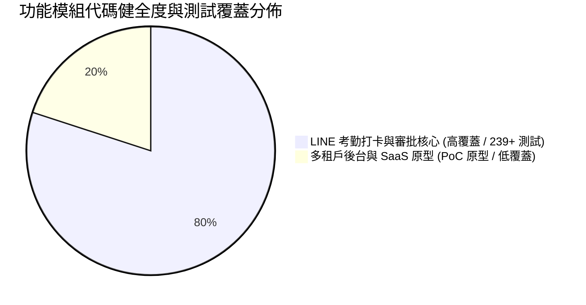

### 🟢 1. 核心高可靠度區塊 —— LINE 考勤打卡與 BPM 審批系統（面試展示重點）
此區塊為本專案之**核心工程亮點**，具備完整的邊界防禦與端到端自動化測試：
- **雙軌打卡驗證 (Dual-Track Verification)**：
  - **IPv4 / IPv6 雙棧白名單**：支援中華電信/寬頻 Wi-Fi 雙棧連線，以 CIDR / IP 精確比對邊緣請求標頭 (`cf-connecting-ip`)。
  - **GPS 備援與防偽**：未命中 Wi-Fi 時自動切換為 WGS84 座標半徑校驗（Haversine 距離公式），精準判定店舖電子圍欄範圍。
- **不可竄改打卡狀態機**：
  - 嚴格管控出勤流水（`IN`、`OUT`、`APPROVED_OVERRIDE`），防止重複打卡與跳過流程。
  - 具備防重複點擊鎖（Debounce Lock）與 0 重複請求防呆機制。
- **線上 BPM 審批工作流**：
  - **請假申請與補卡申請**：整合 Cloudflare R2 物件儲存支援醫療/證明文件上傳。
  - **嚴格防冒名審批 (Anti-Impersonation)**：Webhook 審批事件由 HMAC-SHA256 簽章驗證，非指定主管操作嚴格維持 `PENDING` 並阻斷出勤變更。
  - **業務自動連動**：主管一鍵核准後，自動於 D1 排班表標記休假日（`is_rest_day = 1`）並補足出勤打卡流水。
- **測試保證**：全套 **239+ 項自動化測試**（涵蓋 JSDOM 前端生命週期、D1 邊緣資料庫連動、LINE Flex Message 協議校驗閘、PBAC 權限矩陣），100% 通過。

### 🟡 2. 概念原型區塊 —— 多租戶管理後台與排班管理（PoC 原型）
- **功能範圍**：租戶管理員 Web 登入、門市立牌 QR Code 生成、排班資料匯入、電子薪資條推播等管理介面。
- **現狀說明**：此區塊主要用於驗證多租戶資料隔離與管理流程架構，**自動化測試覆蓋率較低，目前著重於概念性驗證，可能包含部分未覆蓋之邊界 Bug**。

---

## 🏛️ 系統架構與呼叫鏈規範 (Architecture Guardrails)

本專案採用嚴格的四層向下相依架構（Downward Invocation Order），模組間相依性完全由 `dependency-cruiser` 自動化防護，違規即中斷 CI：

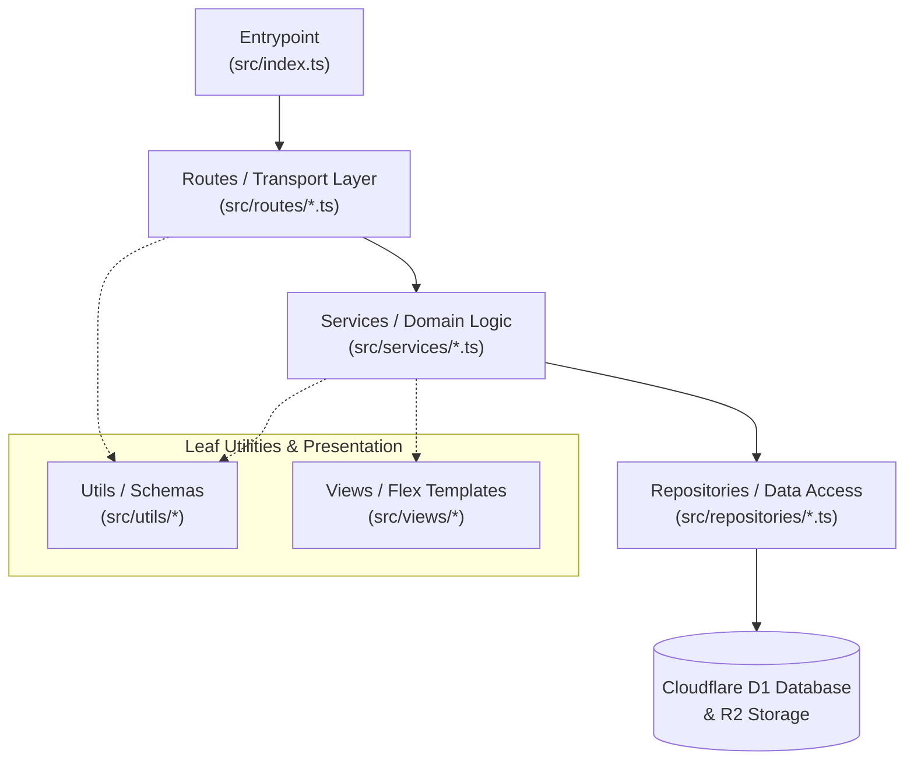

- **Routes (Layer 3)**：輕量 HTTP 控制器，僅負責解析請求與狀態碼分發，不直接接觸資料庫。
- **Services (Layer 2)**：純領域業務邏輯、考勤狀態機與 PBAC 政策，完全解耦資料存取。
- **Repositories (Layer 1)**：封裝 D1 關聯式資料庫查詢與事務，不依賴上層業務。
- **Views & Utils (Layer 0)**：無相依的底層工具、Zod Schema 與 LINE Flex Message 渲染模板。

---

## 📱 實機畫面展示 (UI Demonstration)

### 1. 門市打卡與出勤總結
| 門市 GPS / Wi-Fi 打卡介面 | 打卡成功即時 Flex 卡片 | 每日出勤月曆與工時總結 |
| :---: | :---: | :---: |
| 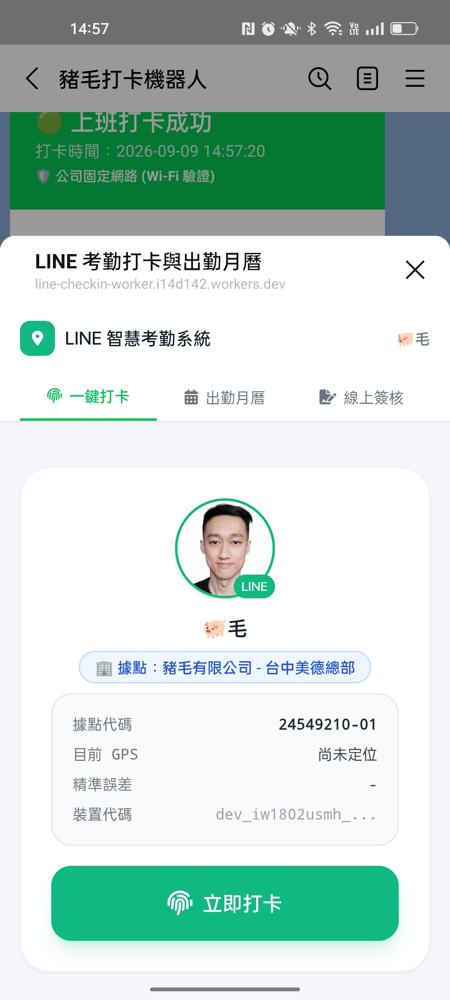 | 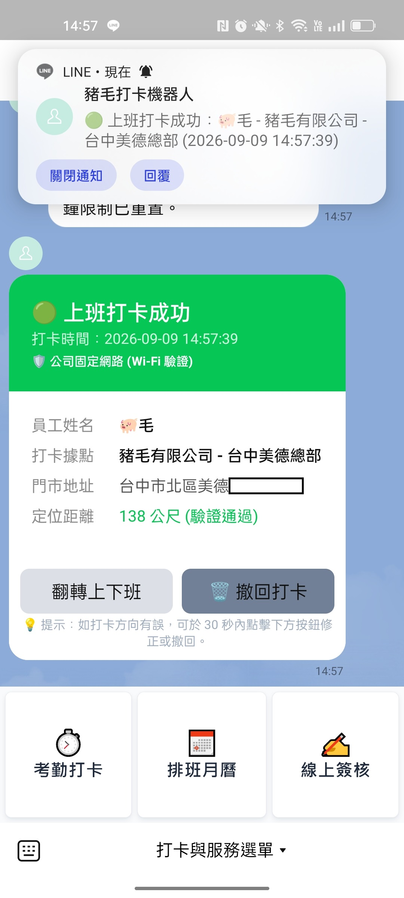 | 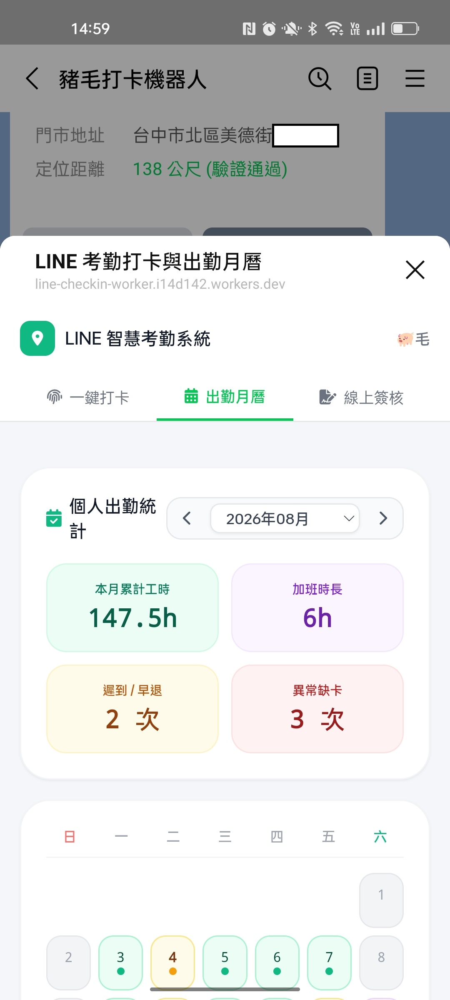 |

### 2. 線上請假、補卡與防重複申請
| 請假申請介面 | 重複請假智慧防呆攔截 | 補卡申請單據 |
| :---: | :---: | :---: |
| 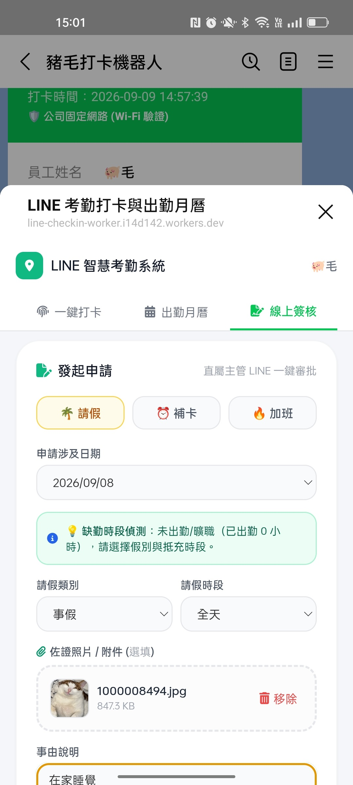 | 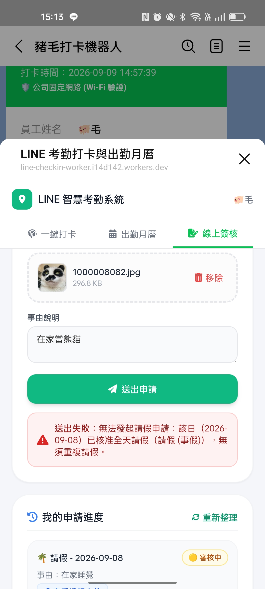 | 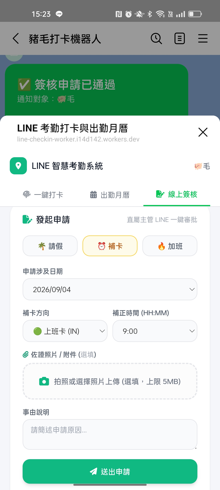 |

### 3. 主管審批與門市設定
| 門市 Wi-Fi IP 一鍵校準 | 主管今日出勤監控面板 | 門市座標電子圍欄校正 |
| :---: | :---: | :---: |
| 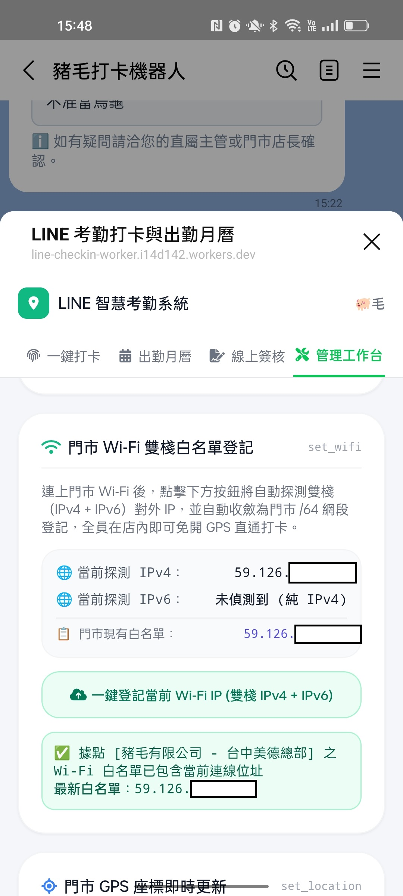 | 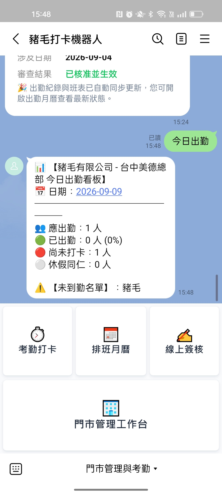 | 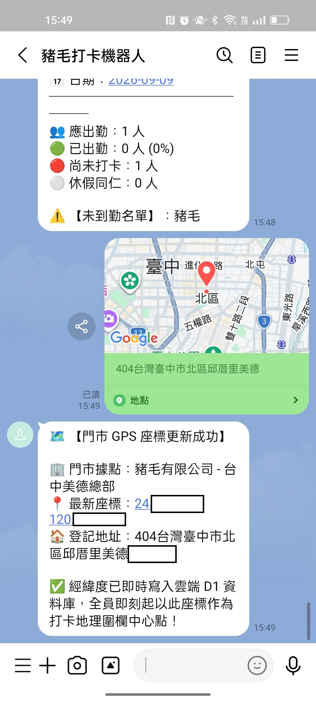 |

---

## 🛠️ 技術棧 (Tech Stack)

| 領域 | 技術選型 | 說明 |
| :--- | :--- | :--- |
| **運算邊緣** | Cloudflare Workers | 全球低延遲 Edge Serverless Runtime，冷啟動 < 15ms |
| **持久化存儲** | Cloudflare D1 | 邊緣原生分散式 SQLite 資料庫 |
| **物件儲存** | Cloudflare R2 | S3 相容物件儲存，用於請假附件證明上傳 |
| **通訊協定** | LINE Messaging API v3 | Webhook 簽名驗證、Flex Message 互動卡片推播 |
| **前端應用** | LINE LIFF SDK v2 + TypeScript | 運行於 LINE Webview 內之高響應式操作面板 |
| **架構防護** | TypeScript 5.7 + dependency-cruiser | 靜態型別與依賴架構自動化檢查 |
| **安全掃描** | Gitleaks | 提交前密鑰高熵檢測與全歷史脫敏防護 |

---

## 🚀 測試與檢驗指令 (Verification)

```bash
# 1. 執行前端構建、型別檢驗與架構相依性審查（0 違規保證）
npm run check

# 2. 執行 LINE Flex Message Protocol Gate 檢驗
npm run test:flex

# 3. 執行 Batch 1 線上審批與防冒審測試
npm run test:batch1

# 4. 執行完整自動化測試套件（239+ 測試）
npm test
```
