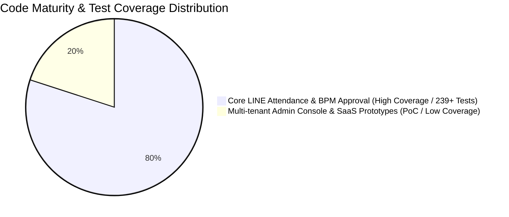
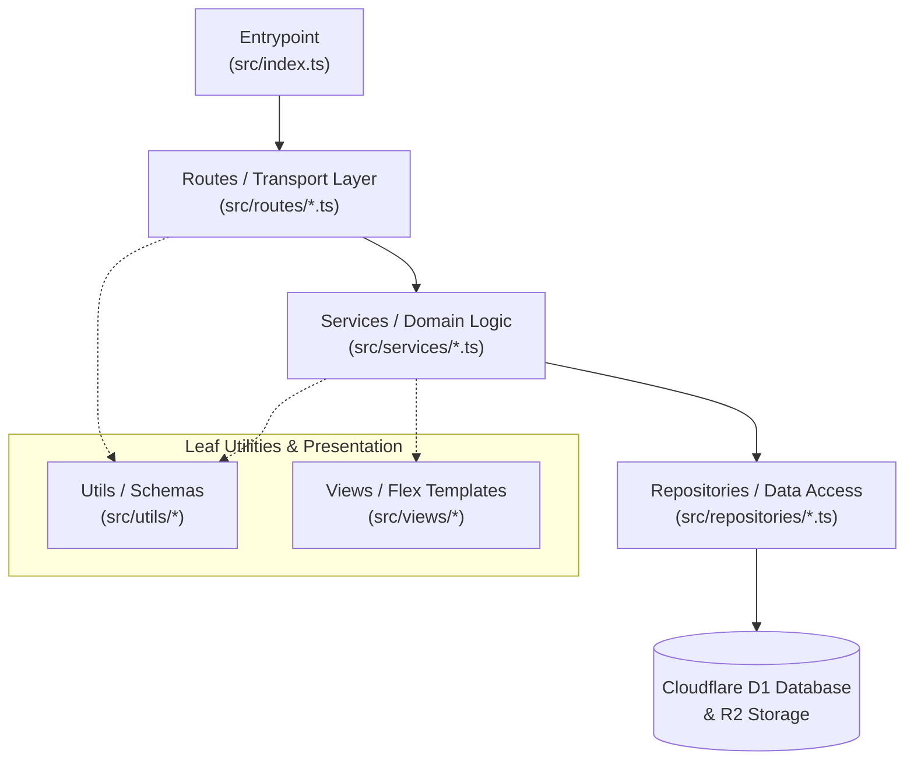

# LINE Enterprise Attendance & Check-in System

[](https://workers.cloudflare.com/)
[](https://developers.line.biz/)
[](https://www.typescriptlang.org/)
[](#)
[](#)

> **Project Scope & Disclaimer**:  
> An architectural practice project mimicking **NUEiPS (人易科技)** enterprise attendance and workforce management solutions, developed as a technical portfolio showcase for interview review.

---

## 📌 Module Maturity & Test Coverage Overview

To help reviewers quickly assess the maturity and testing depth across different components, this codebase is categorized into two distinct domains:



### 🟢 1. Core High-Reliability Domain — LINE Attendance & BPM Approval Workflow (Interview Showcase Core)
This subsystem serves as the **core engineering highlight** of the project, equipped with comprehensive edge perimeter defenses and end-to-end automated testing:
- **Dual-Track Check-in Verification**:
  - **Dual-Stack IPv4 / IPv6 Whitelisting**: Supports corporate and ISP broadband dual-stack connections, performing exact IP and CIDR subnet matching against edge request headers (`cf-connecting-ip`).
  - **GPS Fallback & Anti-Spoofing**: Automatically falls back to WGS84 geodesic radius validation (via the Haversine formula) when Wi-Fi does not match, strictly enforcing location geofencing boundaries.
- **Immutable Attendance State Machine**:
  - Strictly governs punch card sequences (`IN`, `OUT`, `APPROVED_OVERRIDE`), blocking duplicate punches and sequence skipping.
  - Features client-side debounce locking to guarantee zero duplicate submissions under network latency.
- **Online BPM Approval Workflow**:
  - **Leave & Make-up Punch Applications**: Integrated with Cloudflare R2 object storage for medical / leave certificate uploads.
  - **Strict Anti-Impersonation Protection**: Webhook approval events are verified with HMAC-SHA256 signatures; unauthorized approvals strictly preserve the `PENDING` state and reject attendance modifications.
  - **Automated Business Linking**: Manager approval automatically updates D1 employee schedules (`is_rest_day = 1`) and creates immutable attendance override records.
- **Verification Guarantee**: A suite of **239+ automated tests** (covering JSDOM frontend lifecycles, Cloudflare D1 edge database transactions, LINE Flex Message protocol validation, and PBAC permission matrices) passing at 100%.

### 🟡 2. Exploratory Prototype Domain — Multi-tenant Admin Console & Roster Management (PoC Prototype)
- **Functional Scope**: HR admin web login, store QR stand generation, CSV roster imports, and electronic payslip distribution.
- **Current Status**: Designed primarily for architectural exploration of multi-tenant data isolation and administrative workflows. **Automated test coverage is minimal; this area focuses on prototype validation and may contain unhandled edge-case defects.**

---

## 🏛️ System Architecture & Invocation Guardrails

The system strictly adheres to a downward unidirectional dependency hierarchy, continuously enforced by `dependency-cruiser` where violations fail CI:



- **Routes (Layer 3)**: Thin HTTP transport controllers responsible only for request parsing, parameter validation, and status dispatching.
- **Services (Layer 2)**: Pure domain business logic, attendance state machines, and PBAC policies, fully decoupled from database queries.
- **Repositories (Layer 1)**: Encapsulates D1 SQL queries, transactions, and mutations, with zero knowledge of upper business layers.
- **Views & Utils (Layer 0)**: Zero-dependency shared utilities, Zod validation schemas, and LINE Flex Message builders.

---

## 📱 User Interface & Flow Demonstration

### 1. Store Check-in & Attendance Summary
| Store GPS / Wi-Fi Check-in | Instant Check-in Flex Card | Monthly Attendance Calendar & Hours |
| :---: | :---: | :---: |
|  |  |  |

### 2. Online Leave, Make-up Punch & Duplicate Prevention
| Leave Application Form | Duplicate Leave Smart Defense | Make-up Punch Request |
| :---: | :---: | :---: |
|  |  |  |

### 3. Manager Approval & Store Configuration
| One-Click Wi-Fi IP Calibration | Manager Daily Attendance Monitor | Geofence Coordinate Calibration |
| :---: | :---: | :---: |
|  |  |  |

---

## 🛠️ Technology Stack

| Domain | Technology | Description |
| :--- | :--- | :--- |
| **Edge Compute** | Cloudflare Workers | Global low-latency serverless runtime with < 15ms cold starts |
| **Persistence** | Cloudflare D1 | Distributed edge-native relational SQLite database |
| **Object Storage** | Cloudflare R2 | S3-compatible zero-egress bucket for leave attachment uploads |
| **Messaging** | LINE Messaging API v3 | Webhook signature verification & interactive Flex Message cards |
| **Client UI** | LINE LIFF SDK v2 + TypeScript | Responsive web view embedded directly inside LINE chat |
| **Architecture** | TypeScript 5.7 + dependency-cruiser | Static typing and compile-time boundary enforcement |

---

## 🚀 Verification & Testing Commands

```bash
# 1. Execute client build, TypeScript typecheck, and architectural dependency cruise (0 violations)
npm run check

# 2. Run LINE Messaging API v3 Flex Schema Protocol Gate verification
npm run test:flex

# 3. Run Batch 1 online approval and anti-impersonation test suite
npm run test:batch1

# 4. Run the full automated test suite (239+ tests)
npm test
```
